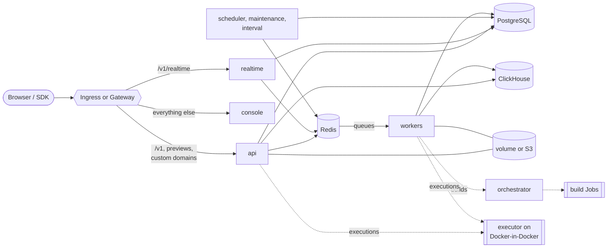

# Appwrite Helm chart

[](https://github.com/appwrite/helm-chart/actions/workflows/lint.yaml)
[](https://github.com/appwrite/helm-chart/actions/workflows/test-install.yaml)
[](https://github.com/appwrite/helm-chart/actions/workflows/e2e-nightly.yaml)
[](LICENSE)

Run [Appwrite](https://appwrite.io), the open-source backend platform, on
your own Kubernetes cluster: authentication, databases, storage, functions,
sites, messaging and realtime, installed and upgraded with Helm.

A plain install brings everything Appwrite needs, PostgreSQL, Redis and
ClickHouse included, so you can try it with nothing else running. When you go
to production, swap each of those for a managed service, one at a time.

| | |
| --- | --- |
| Appwrite | 2.3.0 |
| Kubernetes | 1.29 or later |
| Helm | 4, or 3.18 or later |
| Chart | `oci://ghcr.io/appwrite/charts/appwrite` |
| Values | [Every value, with defaults](charts/appwrite/README.md#values) |

## Quick start

> [!TIP]
> Just want to look around? [Try it on your machine](docs/getting-started.md#try-it-on-your-machine)
> with kind, over plain HTTP, in about ten minutes.

You need an ingress controller, cert-manager with a `ClusterIssuer` named
`letsencrypt`, and a DNS record for your domain pointing at the ingress
controller. Write a values file:

```yaml
# values.yaml
appwrite:
  domain: appwrite.example.com
  certificatesEmail: ops@example.com     # Let's Encrypt account for custom domains

ingress:
  enabled: true
  annotations:
    cert-manager.io/cluster-issuer: letsencrypt
  tls:
    enabled: true
  wildcard:
    enabled: false                       # function and site previews need a wildcard certificate
```

Install it:

```console
helm install appwrite oci://ghcr.io/appwrite/charts/appwrite \
  --namespace appwrite --create-namespace \
  -f values.yaml --wait --timeout 15m
```

The first start pulls about 2 GB of images, so give it a few minutes. Then
open `https://appwrite.example.com` and sign up: the first account becomes
the console administrator, and everyone after it needs an invitation.

Finally, store the encryption key the chart generated somewhere outside the
cluster. Without it, a database backup can't be read:

```console
kubectl -n appwrite get secret appwrite -o jsonpath='{.data._APP_OPENSSL_KEY_V1}' | base64 -d
```

To install a branch, or before the first release is on `ghcr.io`, use
`./charts/appwrite` from a clone in place of the `oci://` reference
([installing from source](docs/getting-started.md#installing-from-source)).

## Pick your path

| I want to... | Start here |
| --- | --- |
| Try Appwrite on my laptop | [Getting started: local](docs/getting-started.md#try-it-on-your-machine), [`examples/local.yaml`](examples/local.yaml) |
| Install it on a cluster with my own domain | [Getting started: real cluster](docs/getting-started.md#install-on-a-real-cluster), [`examples/minimal.yaml`](examples/minimal.yaml) |
| Use managed databases, S3 and SMTP | [External databases](docs/external-databases.md), [Storage](docs/storage.md#s3), [`examples/external-services.yaml`](examples/external-services.yaml) |
| Run it on AWS | [`examples/aws.yaml`](examples/aws.yaml) |
| Run Functions and Sites | [Functions and Sites](docs/executor.md), [`examples/functions.yaml`](examples/functions.yaml) |
| Go to production | [Production checklist](docs/production.md), [`examples/production.yaml`](examples/production.yaml) |
| Move from Docker Compose | [Migrating from Docker](docs/migrating-from-docker.md) |
| Deploy with Argo CD or Flux | [GitOps](docs/gitops.md) |
| Upgrade, back up, fix something | [Upgrading](docs/upgrading.md), [Backup and restore](docs/backup-restore.md), [Troubleshooting](docs/troubleshooting.md) |

Every guide is listed in [`docs/`](docs/README.md), and every example in
[`examples/`](examples/README.md).

## Built in, or bring your own

| Service | By default | Bring your own | Guide |
| --- | --- | --- | --- |
| PostgreSQL | built-in StatefulSet | RDS, Cloud SQL, Azure, CloudNativePG; or MariaDB, MySQL, MongoDB | [External databases](docs/external-databases.md#postgresql) |
| Redis | built-in StatefulSet | ElastiCache, Memorystore, Azure Cache, Valkey | [External databases](docs/external-databases.md#redis) |
| ClickHouse | built-in StatefulSet | ClickHouse Cloud, Altinity operator | [External databases](docs/external-databases.md#clickhouse) |
| File storage | PersistentVolumeClaim | S3, R2, GCS, Spaces, MinIO, ... | [Storage](docs/storage.md#s3) |
| Email | off | any SMTP server: SES, SendGrid, Postmark, ... | [Integrations](docs/integrations.md#email-smtp) |
| Git deployments, console sign-in, SMS, Sentry | off | GitHub, GitLab, Gitea, Bitbucket, Google, Twilio, ... | [Integrations](docs/integrations.md) |

The built-in datastores run a single replica each: fine for trying Appwrite
and for small installs, not for data you can't afford to lose.

## How it fits together



[Architecture](docs/architecture.md) covers each component, the startup
order, and the Appwrite settings the chart wires up for you.

## Testing

Every change is linted with chart-testing and `helm lint --strict` on Helm
3.18 and 4, unit tested with helm-unittest, and rendered through kubeconform
for several Kubernetes versions. Then it's installed on kind, in a namespace
that enforces the `restricted` profile:

| Scenario | What it exercises |
| --- | --- |
| `default` | Built-in datastores and combined workers, on Kubernetes 1.29 and 1.37 |
| `default`, upgrade from Appwrite 2.2.0 | The data migration on upgrade |
| `hardened` | NetworkPolicies with restricted egress |
| `separate-workers`, `grouped-workers` | Worker topologies |
| `external-dbs` | PostgreSQL, Redis and ClickHouse outside the release |
| `ingress`, `gateway-api` | Routing through Traefik |
| nightly | Every optional component, S3, and a function built and executed in the cluster |

Each install runs `helm test`, an end-to-end smoke test
([`hack/smoke.sh`](hack/smoke.sh)), and a second upgrade that must keep the
credentials and leave every pod alone. The files in [`examples/`](examples)
are rendered and validated on every change, and a weekly job opens an issue
when Appwrite releases a version the chart doesn't ship yet.

## Contributing

Contributions are welcome. [CONTRIBUTING.md](CONTRIBUTING.md) lists the tools
and the workflow; these get you going:

```console
make tools                             # install helm-unittest and helm-values-schema-json
make test                              # lint, unit tests, kubeconform, examples, generated files
make kind-up install helm-test smoke   # a full install on a local kind cluster
```

```text
charts/appwrite/   the chart: templates, values, unit tests, CI scenarios
docs/              operator guides
examples/          values files to start from
hack/              scripts used by CI and local development
```

## Getting help

- Problems with the chart: [open an issue](https://github.com/appwrite/helm-chart/issues),
  with what [troubleshooting](docs/troubleshooting.md#getting-help) asks you
  to collect.
- Problems in Appwrite itself: [appwrite/appwrite](https://github.com/appwrite/appwrite/issues).
- Security issues: report them privately, as [SECURITY.md](SECURITY.md)
  describes.

## License

[BSD 3-Clause](LICENSE).
