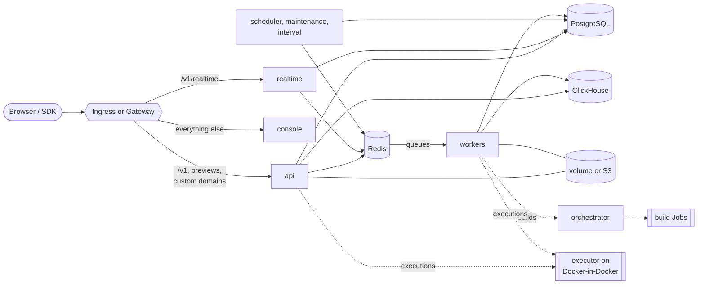

# Appwrite Helm chart

  

Appwrite, the open-source backend platform, on Kubernetes. Deploys the API, console, realtime, workers and schedulers with optional built-in PostgreSQL, Redis and ClickHouse.

> [!WARNING]
> Pre-1.0: values and behaviour may still change between minor versions.
> Read the [changelog](https://github.com/appwrite/helm-chart/blob/main/CHANGELOG.md) before upgrading.

- Runs Appwrite under the `restricted` Pod Security Standard: non-root,
  read-only root filesystem, no capabilities. Only the optional build
  orchestrator gets a ServiceAccount token.
- Built-in PostgreSQL, Redis and ClickHouse for a one-command install, or
  your own managed services.
- Ingress or Gateway API routes for the API, console, realtime, function and
  site previews and custom domains.
- Worker topologies from one combined worker to one Deployment per queue.
- Functions and Sites in the cluster, on by default: builds run as
  unprivileged Jobs in their own namespace, executions on an executor with
  its own Docker-in-Docker daemon in another namespace (a privileged pod; set
  `compute.enabled=false` where that isn't allowed), on built-in S3-compatible
  object storage.
- Credentials generated once and kept, data migrations on upgrade, and guards
  against changing the encryption key or downgrading.

## Requirements

- Kubernetes 1.29 or later, with a default StorageClass (or set `global.storageClass`)
- Helm 4, or Helm 3.18 or later
- An ingress controller or a Gateway API implementation. Appwrite serves the
  console and the API on one hostname and needs `/v1` routed to the API.
- For Functions and Sites (on by default), a cluster that admits a privileged
  pod in the executor's namespace, or `compute.enabled=false`.
- For HTTPS: cert-manager, or certificates you provide

## Quick start

You need an ingress controller, cert-manager with a `ClusterIssuer` named
`letsencrypt`, and a DNS record for your domain pointing at the ingress
controller:

```console
helm install appwrite oci://ghcr.io/appwrite/charts/appwrite \
  --namespace appwrite --create-namespace \
  --set appwrite.domain=appwrite.example.com \
  --set appwrite.certificatesEmail=ops@example.com \
  --set ingress.enabled=true \
  --set ingress.tls.enabled=true \
  --set 'ingress.annotations.cert-manager\.io/cluster-issuer=letsencrypt' \
  --set ingress.wildcard.enabled=false \
  --wait --timeout 15m
```

Function and site previews (`ingress.wildcard`) need a wildcard certificate
from a DNS-01 issuer, so they're off here.

Open `https://appwrite.example.com` and sign up: the first account becomes the
console administrator. Then **back up the encryption key**:

```console
kubectl -n appwrite get secret appwrite -o jsonpath='{.data._APP_OPENSSL_KEY_V1}' | base64 -d
```

To try Appwrite on a laptop first, or for a step-by-step install, see
[Getting started](https://github.com/appwrite/helm-chart/blob/main/docs/getting-started.md).
To install a branch, use
`./charts/appwrite` from a clone in place of the `oci://` reference
([installing from source](https://github.com/appwrite/helm-chart/blob/main/docs/getting-started.md#installing-from-source)).

Ready-made values files for a local try-out, a first install, production,
AWS and Functions and Sites are in
[`examples/`](https://github.com/appwrite/helm-chart/tree/main/examples).

## Using your own services

Everything Appwrite needs runs in the release by default. Each backing
service has one block: set its `mode` to `external` and fill in `external`
to use your own instead; each one is independent. Every credential takes a
`value`, or a `secretName` and `secretKey` to read it from a Secret you
manage. Create the Secret first (these key names are the defaults):

```console
kubectl create namespace appwrite
kubectl -n appwrite create secret generic appwrite-external \
  --from-literal=db-password='<PostgreSQL password>' \
  --from-literal=redis-password='<Redis password>' \
  --from-literal=clickhouse-password='<ClickHouse password>' \
  --from-literal=s3-access-key='<access key ID>' \
  --from-literal=s3-secret-key='<secret access key>' \
  --from-literal=smtp-password='<SMTP password>'
```

Then point the chart at your services:

```yaml
database:                      # PostgreSQL with postgis, vector and pg_trgm
  mode: external
  password:
    secretName: appwrite-external         # key db-password
  external:
    host: appwrite-db.example.internal
redis:                         # one endpoint, no TLS
  mode: external
  password:
    secretName: appwrite-external         # key redis-password
  external:
    host: appwrite-redis.example.internal
clickhouse:                    # HTTP(S) interface
  mode: external
  password:
    secretName: appwrite-external         # key clickhouse-password
  external:
    url: https://abc123.eu-west-1.aws.clickhouse.cloud:8443
storage:
  device: s3                   # any S3-compatible store
  s3:
    bucket: appwrite
    region: eu-west-1
    accessKeyId:
      secretName: appwrite-external       # key s3-access-key
    secretAccessKey:
      secretName: appwrite-external       # key s3-secret-key
smtp:
  host: smtp.example.com
  username: appwrite
  password:
    secretName: appwrite-external         # key smtp-password
```

| Service | Works with | Guide |
| --- | --- | --- |
| PostgreSQL, MariaDB, MySQL, MongoDB | RDS, Cloud SQL, Azure, CloudNativePG | [External databases](https://github.com/appwrite/helm-chart/blob/main/docs/external-databases.md#postgresql) |
| Redis | ElastiCache, Memorystore, Azure Cache, Valkey | [External databases](https://github.com/appwrite/helm-chart/blob/main/docs/external-databases.md#redis) |
| ClickHouse | ClickHouse Cloud, Altinity operator | [External databases](https://github.com/appwrite/helm-chart/blob/main/docs/external-databases.md#clickhouse) |
| S3 | AWS S3, R2, GCS, Spaces, MinIO, ... | [Storage](https://github.com/appwrite/helm-chart/blob/main/docs/storage.md#s3) |
| SMTP, GitHub App, console sign-in, SMS, Sentry | SES, SendGrid, Postmark, GitHub, Twilio, ... | [Integrations](https://github.com/appwrite/helm-chart/blob/main/docs/integrations.md) |

[`examples/external-services.yaml`](https://github.com/appwrite/helm-chart/blob/main/examples/external-services.yaml)
has every block annotated. To move the data of an existing install, see
[moving from built-in to external](https://github.com/appwrite/helm-chart/blob/main/docs/external-databases.md#moving-from-built-in-to-external).

## Architecture



See the [architecture guide](https://github.com/appwrite/helm-chart/blob/main/docs/architecture.md).

## Not included

- **Highly available datastores.** The built-in ones are single replicas. Use
  managed services or operators in production
  ([guide](https://github.com/appwrite/helm-chart/blob/main/docs/external-databases.md)).
- **Metrics.** Appwrite 2.6.1 exposes no Prometheus metrics.

## Documentation

| Guide | |
| --- | --- |
| [Getting started](https://github.com/appwrite/helm-chart/blob/main/docs/getting-started.md) | A local try-out and a first real install |
| [Production checklist](https://github.com/appwrite/helm-chart/blob/main/docs/production.md) | What to change before going live |
| [Architecture](https://github.com/appwrite/helm-chart/blob/main/docs/architecture.md) | Components, configuration flow, worker topologies |
| [Networking, TLS and domains](https://github.com/appwrite/helm-chart/blob/main/docs/networking.md) | Ingress, Gateway API, cert-manager, custom domains |
| [External databases](https://github.com/appwrite/helm-chart/blob/main/docs/external-databases.md) | PostgreSQL, MariaDB, MySQL, MongoDB, Redis, ClickHouse |
| [Storage](https://github.com/appwrite/helm-chart/blob/main/docs/storage.md) | Volumes, ReadWriteMany, S3, antivirus |
| [Email, Git and other integrations](https://github.com/appwrite/helm-chart/blob/main/docs/integrations.md) | SMTP, GitHub App, console sign-in, SMS, Sentry |
| [Functions and Sites](https://github.com/appwrite/helm-chart/blob/main/docs/executor.md) | Builds as Jobs and the executor on Docker-in-Docker |
| [Optional components](https://github.com/appwrite/helm-chart/blob/main/docs/optional-components.md) | Browser, autogravity, embedding, MQTT |
| [Security](https://github.com/appwrite/helm-chart/blob/main/docs/security.md) | Pod security, credentials, NetworkPolicies, signatures |
| [Upgrading](https://github.com/appwrite/helm-chart/blob/main/docs/upgrading.md) | Versions, migrations, rollbacks |
| [Backup and restore](https://github.com/appwrite/helm-chart/blob/main/docs/backup-restore.md) | What to back up and how |
| [Migrating from Docker](https://github.com/appwrite/helm-chart/blob/main/docs/migrating-from-docker.md) | Moving an existing install |
| [GitOps](https://github.com/appwrite/helm-chart/blob/main/docs/gitops.md) | Argo CD and Flux |
| [Troubleshooting](https://github.com/appwrite/helm-chart/blob/main/docs/troubleshooting.md) | Common problems |

## Uninstalling

```console
helm uninstall appwrite --namespace appwrite
```

The chart's Secret (encryption key and passwords) and the PersistentVolumeClaims
of `/storage` and the datastores are kept, so installing again with the same
release name finds the data. To remove everything, delete them together:

```console
kubectl -n appwrite delete secret appwrite
kubectl -n appwrite delete pvc -l app.kubernetes.io/instance=appwrite
```

## Maintainers

| Name | Email | Url |
| ---- | ------ | --- |
| levivannoort |  | <https://github.com/levivannoort> |

## Source Code

* <https://github.com/appwrite/helm-chart>
* <https://github.com/appwrite/appwrite>

## Values

Every value, grouped by area. `helm show values oci://ghcr.io/appwrite/charts/appwrite`
prints them with their comments.

### Appwrite

Settings every Appwrite pod shares: domains, console access, core secrets, extra configuration.

| Key | Type | Default | Description |
|-----|------|---------|-------------|
| appwrite.autoCertificates | bool | `false` | Have Appwrite issue Let's Encrypt certificates for function and site subdomains (`_APP_ROUTER_AUTO_CERTIFICATES`). Off by default: TLS for wildcard domains is expected to terminate at the ingress or Gateway. |
| appwrite.certificatesEmail | string | `""` | Email Let's Encrypt certificates are registered with (`_APP_EMAIL_CERTIFICATES`). Required, even with `autoCertificates` off. |
| appwrite.config | object | `{}` | Extra `_APP_*` environment variables for every Appwrite pod, e.g. Git deployments, SMS or console sign-in (docs/integrations.md). They override the chart's defaults and computed values, including those set per container (`_APP_CPU_NUM`, `_APP_WORKERS_NUM`, `_APP_WORKER_MAX_COROUTINES`, `_APP_CONNECTIONS_DB_*`), except credentials, which come from Secrets. See https://appwrite.io/docs/advanced/self-hosting/configuration/environment-variables. |
| appwrite.console.whitelistEmails | list | `[]` | Emails allowed to sign up to the console (`_APP_CONSOLE_WHITELIST_EMAILS`). |
| appwrite.console.whitelistIPs | list | `[]` | IPs allowed to sign up to the console (`_APP_CONSOLE_WHITELIST_IPS`). |
| appwrite.console.whitelistRoot | bool | `true` | Only the first user can sign up to the console; everyone else needs an invite (`_APP_CONSOLE_WHITELIST_ROOT`). |
| appwrite.consoleDomain | string | `""` | Hostname of the console (`_APP_CONSOLE_DOMAIN`). Defaults to `domain`. |
| appwrite.domain | string | `""` | Hostname of the Appwrite API and console (`_APP_DOMAIN`). Required. |
| appwrite.domainTargets.a | string | `""` | IPv4 addresses custom domains may point an A record to, comma-separated (`_APP_DOMAIN_TARGET_A`). |
| appwrite.domainTargets.aaaa | string | `""` | IPv6 addresses custom domains may point an AAAA record to, comma-separated (`_APP_DOMAIN_TARGET_AAAA`). |
| appwrite.domainTargets.caa | string | `""` | CAA record value custom domains must allow (`_APP_DOMAIN_TARGET_CAA`). |
| appwrite.domainTargets.cname | string | `""` | Hostname custom domains must CNAME to (`_APP_DOMAIN_TARGET_CNAME`). Defaults to `domain`. |
| appwrite.extraEnv | list | `[]` | Extra environment variables for every Appwrite container, as a list of EnvVar objects. |
| appwrite.extraEnvFrom | list | `[]` | Extra `envFrom` sources for every Appwrite container. |
| appwrite.extraVolumeMounts | list | `[]` | Extra volume mounts for every Appwrite container. |
| appwrite.extraVolumes | list | `[]` | Extra volumes for every Appwrite pod, e.g. a CA certificate for verifying the database's TLS certificate. |
| appwrite.forceHttps | bool | `true` | Redirect HTTP to HTTPS and generate HTTPS URLs (`_APP_OPTIONS_FORCE_HTTPS` and `_APP_OPTIONS_ROUTER_FORCE_HTTPS`). Turn it off only when TLS isn't terminated in front of Appwrite. |
| appwrite.functionsDomain | string | `""` | Parent domain for function preview URLs (`_APP_DOMAIN_FUNCTIONS`). Defaults to `functions.<domain>`. |
| appwrite.logFormat | string | `"json"` | Log format (`_APP_LOGGING_FORMAT`). |
| appwrite.routerProtection | bool | `false` | Reject requests for hostnames Appwrite doesn't know, and stop serving the console on custom project domains (`_APP_OPTIONS_ROUTER_PROTECTION`). Appwrite recommends it in production. |
| appwrite.secretConfig | object | `{}` | Extra sensitive `_APP_*` environment variables, stored in a Secret. Same precedence as `config`; changing them restarts Appwrite pods. |
| appwrite.secrets.allowKeyRotation | bool | `false` | Allow `opensslKey` to differ from the key already stored in the cluster. Appwrite can't re-encrypt data, so changing the key makes encrypted data unreadable. |
| appwrite.secrets.existingSecret | string | `""` | Existing Secret holding the core secrets, under the key names in `keys`. When empty the chart generates them once and keeps them across upgrades and uninstalls. |
| appwrite.secrets.generate | bool | `true` | Generate missing credentials: core secrets, built-in datastore passwords and compute secrets. Set to false with GitOps tools that render templates without cluster access (Argo CD, `helm template`), where generated values would change on every render; rendering then fails for any credential not given explicitly or in an existing Secret. See docs/gitops.md. |
| appwrite.secrets.geoSecret | string | `""` | Explicit `_APP_GEO_SECRET`. |
| appwrite.secrets.keys.geoSecret | string | `"_APP_GEO_SECRET"` | Key in `existingSecret` holding `_APP_GEO_SECRET`, the token Appwrite authenticates to the geo service with. |
| appwrite.secrets.keys.opensslKey | string | `"_APP_OPENSSL_KEY_V1"` | Key in `existingSecret` holding `_APP_OPENSSL_KEY_V1`, which encrypts data at rest and signs JWTs. |
| appwrite.secrets.keys.trackingSecret | string | `"_APP_NOTIFICATIONS_TRACKING_SECRET"` | Key in `existingSecret` holding `_APP_NOTIFICATIONS_TRACKING_SECRET`, which signs notification tracking tokens. |
| appwrite.secrets.opensslKey | string | `""` | Explicit `_APP_OPENSSL_KEY_V1`, e.g. when migrating from Docker. Never change it after install. |
| appwrite.secrets.trackingSecret | string | `""` | Explicit `_APP_NOTIFICATIONS_TRACKING_SECRET`. |
| appwrite.sitesDomain | string | `""` | Parent domain for site preview URLs (`_APP_DOMAIN_SITES`). Defaults to `sites.<domain>`. |
| appwrite.system.emailAddress | string | `""` | Sender address for emails Appwrite sends (`_APP_SYSTEM_EMAIL_ADDRESS`). Defaults to `noreply@<domain>`. |
| appwrite.system.emailName | string | `"Appwrite"` | Sender name for emails Appwrite sends (`_APP_SYSTEM_EMAIL_NAME`). |
| appwrite.system.securityEmailAddress | string | `""` | Address shown to users for security issues (`_APP_EMAIL_SECURITY`). |
| appwrite.usageStats | bool | `true` | Collect usage statistics in ClickHouse (`_APP_USAGE_STATS`). |
| appwrite.workerPerCore | int | `6` | Swoole worker processes per CPU in the API (`_APP_WORKER_PER_CORE`): the API runs `_APP_CPU_NUM` times this many. Every Appwrite pod also divides its database pools by `_APP_CPU_NUM` times this value (see `database.connectionsMax`). |

### Routing

Ingress and Gateway API routes.

| Key | Type | Default | Description |
|-----|------|---------|-------------|
| httpRoute.annotations | object | `{}` | Annotations for every HTTPRoute. |
| httpRoute.customDomains.enabled | bool | `false` | Route every hostname the Gateway listener accepts to the API, for custom domains. |
| httpRoute.customDomains.parentRefs | list | `[]` | Gateways (typically a dedicated catch-all listener) to attach the route to. Defaults to `httpRoute.parentRefs`. |
| httpRoute.enabled | bool | `false` | Create HTTPRoutes (gateway.networking.k8s.io/v1). |
| httpRoute.hostnameHeaderMatch | bool | `false` | Send requests that carry an `x-appwrite-hostname` header to the API instead of the console, as Appwrite's Traefik setup does. Uses a RegularExpression header match, which not every Gateway implements. |
| httpRoute.labels | object | `{}` | Labels for every HTTPRoute. |
| httpRoute.parentRefs | list | `[]` | Gateways (and listeners) to attach to. Required when enabled. |
| httpRoute.timeouts | object | `{}` | Timeouts (HTTPRouteTimeouts: `request`, `backendRequest`) for every rule. Synchronous function executions can take up to 60s on function and site domains, longer than some Gateways allow by default. |
| httpRoute.wildcard.enabled | bool | `true` | Route `*.<functionsDomain>` and `*.<sitesDomain>` to the API. |
| httpRoute.wildcard.parentRefs | list | `[]` | Gateways to attach the wildcard route to. Defaults to `httpRoute.parentRefs`. |
| ingress.annotations | object | `{}` | Annotations for every Ingress, e.g. a cert-manager issuer. |
| ingress.className | string | `""` | IngressClass to use. Empty uses the cluster default. |
| ingress.customDomains.annotations | object | `{}` | Annotations for the custom-domain Ingress, merged over `ingress.annotations`. |
| ingress.customDomains.enabled | bool | `false` | Route every other hostname to the API, for custom domains of projects, functions and sites. Creates an Ingress rule without a host. |
| ingress.enabled | bool | `false` | Create Ingress resources. |
| ingress.extraTls | list | `[]` | Extra `spec.tls` entries for the main Ingress, e.g. a certificate that covers more hosts. |
| ingress.labels | object | `{}` | Labels for every Ingress. |
| ingress.pathType | string | `"Prefix"` | `pathType` of every Ingress path. Some controllers (GCE) need `ImplementationSpecific` for prefix matching. |
| ingress.tls.enabled | bool | `false` | Terminate TLS for `appwrite.domain` and `appwrite.consoleDomain`. |
| ingress.tls.secretName | string | `""` | Secret with the certificate. Defaults to `<fullname>-tls`. |
| ingress.wildcard.annotations | object | `{}` | Annotations for the wildcard Ingress, merged over `ingress.annotations`. |
| ingress.wildcard.enabled | bool | `true` | Route `*.<functionsDomain>` and `*.<sitesDomain>` (function and site preview URLs) to the API. |
| ingress.wildcard.tls.enabled | bool | `false` | Terminate TLS for the wildcard hosts. Needs a wildcard certificate, which ACME issues through DNS-01. |
| ingress.wildcard.tls.secretName | string | `""` | Secret with the wildcard certificate. Defaults to `<fullname>-wildcard-tls`. |

### Database

The main database, built-in PostgreSQL or your own, and the optional DocumentsDB and VectorsDB servers.

| Key | Type | Default | Description |
|-----|------|---------|-------------|
| database.adapter | string | `"postgresql"` | Database engine (`_APP_DB_ADAPTER`). `builtin` is always PostgreSQL; PostgreSQL is also the recommended external engine. |
| database.builtin.affinity | object | `{}` | Affinity. Empty inherits `defaults.affinity`. |
| database.builtin.containerSecurityContext | object | `{"allowPrivilegeEscalation":false,"capabilities":{"drop":["ALL"]},"privileged":false,"readOnlyRootFilesystem":true}` | Container security context. |
| database.builtin.extraConfig | object | `{}` | Extra PostgreSQL settings passed as `-c name=value`. |
| database.builtin.extraContainers | list | `[]` | Extra sidecar containers. |
| database.builtin.extraEnv | list | `[]` | Extra environment variables, as a list of EnvVar objects. |
| database.builtin.extraInitContainers | list | `[]` | Extra init containers. |
| database.builtin.extraVolumeMounts | list | `[]` | Extra volume mounts for the main container. |
| database.builtin.extraVolumes | list | `[]` | Extra volumes. |
| database.builtin.image.digest | string | `""` | Image digest. |
| database.builtin.image.pullPolicy | string | `"IfNotPresent"` | Image pull policy. |
| database.builtin.image.registry | string | `"docker.io"` | Image registry. |
| database.builtin.image.repository | string | `"appwrite/postgres"` | Image repository. Appwrite's image is PostgreSQL 18 with the extensions Appwrite needs. |
| database.builtin.image.tag | string | `"0.1.0"` | Image tag. |
| database.builtin.maxConnections | string | `""` | `max_connections`. Defaults to `database.connectionsMax` + 20; the chart rejects a value below `connectionsMax`. |
| database.builtin.metrics.enabled | bool | `false` | Run a postgres_exporter sidecar and expose it on port 9187 of the Service. See docs/production.md#monitoring. |
| database.builtin.metrics.image.digest | string | `""` | Image digest. |
| database.builtin.metrics.image.pullPolicy | string | `"IfNotPresent"` | Image pull policy. |
| database.builtin.metrics.image.registry | string | `"quay.io"` | Image registry. |
| database.builtin.metrics.image.repository | string | `"prometheuscommunity/postgres-exporter"` | Image repository. |
| database.builtin.metrics.image.tag | string | `"v0.20.1"` | Image tag. |
| database.builtin.metrics.resources | object | `{"limits":{"memory":"128Mi"},"requests":{"cpu":"10m","memory":"32Mi"}}` | Resource requests and limits of the exporter. |
| database.builtin.nodeSelector | object | `{}` | Node selector. Empty inherits `defaults.nodeSelector`. |
| database.builtin.persistence.accessModes | list | `["ReadWriteOnce"]` | Access modes. |
| database.builtin.persistence.annotations | object | `{}` | Annotations for the PersistentVolumeClaim. |
| database.builtin.persistence.enabled | bool | `true` | Persist data in a PersistentVolumeClaim. Data is lost on restart when disabled. |
| database.builtin.persistence.size | string | `"10Gi"` | Volume size. |
| database.builtin.persistence.storageClass | string | `""` | Storage class. Empty uses `global.storageClass`, then the cluster default; `-` requests no class. |
| database.builtin.podAnnotations | object | `{}` | Pod annotations, merged over `defaults.podAnnotations`. |
| database.builtin.podLabels | object | `{}` | Pod labels, merged over `defaults.podLabels`. |
| database.builtin.podSecurityContext | object | `{"fsGroup":999,"fsGroupChangePolicy":"OnRootMismatch","runAsGroup":999,"runAsNonRoot":true,"runAsUser":999,"seccompProfile":{"type":"RuntimeDefault"}}` | Pod security context. The image's `postgres` user is UID 999. |
| database.builtin.priorityClassName | string | `""` | Priority class. Empty inherits `defaults.priorityClassName`. |
| database.builtin.resources | object | `{"limits":{"memory":"2Gi"},"requests":{"cpu":"100m","memory":"256Mi"}}` | Resource requests and limits. |
| database.builtin.shm | object | `{"enabled":true,"sizeLimit":"1Gi"}` | Shared memory for PostgreSQL (`/dev/shm`). Container runtimes give 64Mi by default, which parallel queries and large index builds outgrow. It counts against the memory limit. |
| database.builtin.shm.enabled | bool | `true` | Mount a memory-backed `/dev/shm`. |
| database.builtin.shm.sizeLimit | string | `"1Gi"` | Size limit of `/dev/shm`, as in Appwrite's Docker install. Pages count towards the memory limit only once PostgreSQL writes them. |
| database.builtin.terminationGracePeriodSeconds | int | `60` | Seconds to wait on shutdown. |
| database.builtin.tolerations | list | `[]` | Tolerations. Empty inherits `defaults.tolerations`. |
| database.connectionsMax | int | `151` | Database connection budget Appwrite sizes its pools from (`_APP_CONNECTIONS_MAX`). Every Appwrite process gets pools of `connectionsMax / poolClients / (_APP_CPU_NUM * _APP_WORKER_PER_CORE)` connections, rounded down, but at least 1 and at least `_APP_WORKER_MAX_COROUTINES`, with separate pools for the `console` and `database_db_main` connections. Pools fill on demand, and at peak the total can exceed this value. Keep it well below the database's `max_connections`; see docs/external-databases.md#connections. |
| database.external.host | string | `""` | Hostname of your database server. |
| database.external.port | string | `""` | Port. Empty uses the engine's standard port. |
| database.mode | string | `"builtin"` | `builtin` deploys PostgreSQL in the release; `external` uses `database.external`. |
| database.name | string | `"appwrite"` | Database (schema) name (`_APP_DB_SCHEMA`). |
| database.password.secretKey | string | `"db-password"` | Key in the Secret. |
| database.password.secretName | string | `""` | Existing Secret holding the password. Takes precedence over `value`. |
| database.password.value | string | `""` | Password, set inline. Stored in the chart's Secret. With `builtin`, empty generates one and keeps it; PostgreSQL only reads it when it first creates the database. |
| database.poolClients | int | `15` | Divisor of `connectionsMax` (`_APP_POOL_CLIENTS`), meant as the number of Appwrite pods sharing it. Set it to at least the number of Appwrite pods, counting autoscalers at `maxReplicas`; NOTES warns when it's lower. |
| database.username | string | `"appwrite"` | User (`_APP_DB_USER`). |
| documentsDb.enabled | bool | `false` | Enable DocumentsDB databases (`_APP_DOCUMENTSDB`). |
| documentsDb.host | string | `""` | MongoDB hostname. |
| documentsDb.name | string | `""` | Database name. Empty uses `database.name`. |
| documentsDb.password.secretKey | string | `"documentsdb-password"` | Key in the Secret. |
| documentsDb.password.secretName | string | `""` | Existing Secret holding the password. Takes precedence over `value`. |
| documentsDb.password.value | string | `""` | Password, set inline. Stored in the chart's Secret. Empty uses `database.password`. |
| documentsDb.port | int | `27017` | MongoDB port. |
| documentsDb.username | string | `""` | User. Empty uses `database.username`. |
| vectorsDb.enabled | bool | `false` | Enable VectorsDB databases (`_APP_VECTORSDB`). |
| vectorsDb.host | string | `""` | PostgreSQL hostname. Empty uses the main database, which must then be PostgreSQL. |
| vectorsDb.name | string | `""` | Database name. Empty uses `database.name`. |
| vectorsDb.password.secretKey | string | `"vectorsdb-password"` | Key in the Secret. |
| vectorsDb.password.secretName | string | `""` | Existing Secret holding the password. Takes precedence over `value`. |
| vectorsDb.password.value | string | `""` | Password, set inline. Stored in the chart's Secret. Empty uses `database.password`. |
| vectorsDb.port | int | `5432` | PostgreSQL port. |
| vectorsDb.username | string | `""` | User. Empty uses `database.username`. |

### Redis

Built-in or your own.

| Key | Type | Default | Description |
|-----|------|---------|-------------|
| redis.builtin.affinity | object | `{}` | Affinity. Empty inherits `defaults.affinity`. |
| redis.builtin.containerSecurityContext | object | `{"allowPrivilegeEscalation":false,"capabilities":{"drop":["ALL"]},"privileged":false,"readOnlyRootFilesystem":true}` | Container security context. |
| redis.builtin.extraContainers | list | `[]` | Extra sidecar containers. |
| redis.builtin.extraEnv | list | `[]` | Extra environment variables, as a list of EnvVar objects. |
| redis.builtin.extraInitContainers | list | `[]` | Extra init containers. |
| redis.builtin.extraVolumeMounts | list | `[]` | Extra volume mounts for the main container. |
| redis.builtin.extraVolumes | list | `[]` | Extra volumes. |
| redis.builtin.image.digest | string | `""` | Image digest. |
| redis.builtin.image.pullPolicy | string | `"IfNotPresent"` | Image pull policy. |
| redis.builtin.image.registry | string | `"docker.io"` | Image registry. |
| redis.builtin.image.repository | string | `"library/redis"` | Image repository. `valkey/valkey` works as a drop-in replacement, with a Valkey tag (e.g. `8-alpine`). |
| redis.builtin.image.tag | string | `"7.4.12-alpine"` | Image tag. |
| redis.builtin.maxmemory | string | `"512mb"` | `maxmemory`. Keep it below the memory limit. |
| redis.builtin.maxmemoryPolicy | string | `"allkeys-lru"` | `maxmemory-policy`. Appwrite's Docker install uses `allkeys-lru`. |
| redis.builtin.metrics.enabled | bool | `false` | Run a redis_exporter sidecar and expose it on port 9121 of the Service. See docs/production.md#monitoring. |
| redis.builtin.metrics.image.digest | string | `""` | Image digest. |
| redis.builtin.metrics.image.pullPolicy | string | `"IfNotPresent"` | Image pull policy. |
| redis.builtin.metrics.image.registry | string | `"docker.io"` | Image registry. |
| redis.builtin.metrics.image.repository | string | `"oliver006/redis_exporter"` | Image repository. |
| redis.builtin.metrics.image.tag | string | `"v1.96.0-alpine"` | Image tag. |
| redis.builtin.metrics.resources | object | `{"limits":{"memory":"128Mi"},"requests":{"cpu":"10m","memory":"32Mi"}}` | Resource requests and limits of the exporter. |
| redis.builtin.nodeSelector | object | `{}` | Node selector. Empty inherits `defaults.nodeSelector`. |
| redis.builtin.persistence.accessModes | list | `["ReadWriteOnce"]` | Access modes. |
| redis.builtin.persistence.annotations | object | `{}` | Annotations for the PersistentVolumeClaim. |
| redis.builtin.persistence.enabled | bool | `true` | Persist data in a PersistentVolumeClaim. |
| redis.builtin.persistence.size | string | `"2Gi"` | Volume size. |
| redis.builtin.persistence.storageClass | string | `""` | Storage class. Empty uses `global.storageClass`, then the cluster default; `-` requests no class. |
| redis.builtin.podAnnotations | object | `{}` | Pod annotations, merged over `defaults.podAnnotations`. |
| redis.builtin.podLabels | object | `{}` | Pod labels, merged over `defaults.podLabels`. |
| redis.builtin.podSecurityContext | object | `{"fsGroup":999,"fsGroupChangePolicy":"OnRootMismatch","runAsGroup":999,"runAsNonRoot":true,"runAsUser":999,"seccompProfile":{"type":"RuntimeDefault"}}` | Pod security context. The image's `redis` user is UID 999. |
| redis.builtin.priorityClassName | string | `""` | Priority class. Empty inherits `defaults.priorityClassName`. |
| redis.builtin.requirePassword | bool | `true` | Require a password (`redis.password`). |
| redis.builtin.resources | object | `{"limits":{"memory":"768Mi"},"requests":{"cpu":"50m","memory":"128Mi"}}` | Resource requests and limits. |
| redis.builtin.terminationGracePeriodSeconds | int | `60` | Seconds to wait on shutdown. |
| redis.builtin.tolerations | list | `[]` | Tolerations. Empty inherits `defaults.tolerations`. |
| redis.external.host | string | `""` | Hostname of your Redis. |
| redis.external.port | int | `6379` | Port. |
| redis.mode | string | `"builtin"` | `builtin` deploys Redis in the release; `external` uses `redis.external`. |
| redis.password.secretKey | string | `"redis-password"` | Key in the Secret. |
| redis.password.secretName | string | `""` | Existing Secret holding the password. Takes precedence over `value`. |
| redis.password.value | string | `""` | Password, set inline. Stored in the chart's Secret. With `builtin`, empty generates one (see `builtin.requirePassword`); with `external`, empty means no AUTH. |
| redis.username | string | `""` | ACL user (`_APP_REDIS_USER`), external only. The MQTT server ignores it, so leave it empty when MQTT is enabled. |

### ClickHouse

Built-in or your own.

| Key | Type | Default | Description |
|-----|------|---------|-------------|
| clickhouse.builtin.affinity | object | `{}` | Affinity. Empty inherits `defaults.affinity`. |
| clickhouse.builtin.containerSecurityContext | object | `{"allowPrivilegeEscalation":false,"capabilities":{"drop":["ALL"]},"privileged":false,"readOnlyRootFilesystem":true}` | Container security context. |
| clickhouse.builtin.extraContainers | list | `[]` | Extra sidecar containers. |
| clickhouse.builtin.extraEnv | list | `[]` | Extra environment variables, as a list of EnvVar objects. |
| clickhouse.builtin.extraInitContainers | list | `[]` | Extra init containers. |
| clickhouse.builtin.extraVolumeMounts | list | `[]` | Extra volume mounts for the main container. |
| clickhouse.builtin.extraVolumes | list | `[]` | Extra volumes. |
| clickhouse.builtin.image.digest | string | `""` | Image digest. |
| clickhouse.builtin.image.pullPolicy | string | `"IfNotPresent"` | Image pull policy. |
| clickhouse.builtin.image.registry | string | `"docker.io"` | Image registry. |
| clickhouse.builtin.image.repository | string | `"clickhouse/clickhouse-server"` | Image repository. |
| clickhouse.builtin.image.tag | string | `"26.4.5-alpine"` | Image tag. |
| clickhouse.builtin.metrics.enabled | bool | `false` | Serve ClickHouse's built-in Prometheus endpoint on port 9363 of the Service (`/metrics`). No sidecar. See docs/production.md#monitoring. |
| clickhouse.builtin.nodeSelector | object | `{}` | Node selector. Empty inherits `defaults.nodeSelector`. |
| clickhouse.builtin.persistence.accessModes | list | `["ReadWriteOnce"]` | Access modes. |
| clickhouse.builtin.persistence.annotations | object | `{}` | Annotations for the PersistentVolumeClaim. |
| clickhouse.builtin.persistence.enabled | bool | `true` | Persist data in a PersistentVolumeClaim. |
| clickhouse.builtin.persistence.size | string | `"10Gi"` | Volume size. |
| clickhouse.builtin.persistence.storageClass | string | `""` | Storage class. Empty uses `global.storageClass`, then the cluster default; `-` requests no class. |
| clickhouse.builtin.podAnnotations | object | `{}` | Pod annotations, merged over `defaults.podAnnotations`. |
| clickhouse.builtin.podLabels | object | `{}` | Pod labels, merged over `defaults.podLabels`. |
| clickhouse.builtin.podSecurityContext | object | `{"fsGroup":101,"fsGroupChangePolicy":"OnRootMismatch","runAsGroup":101,"runAsNonRoot":true,"runAsUser":101,"seccompProfile":{"type":"RuntimeDefault"}}` | Pod security context. The image's `clickhouse` user is UID 101. |
| clickhouse.builtin.priorityClassName | string | `""` | Priority class. Empty inherits `defaults.priorityClassName`. |
| clickhouse.builtin.resources | object | `{"limits":{"memory":"2Gi"},"requests":{"cpu":"100m","memory":"512Mi"}}` | Resource requests and limits. |
| clickhouse.builtin.terminationGracePeriodSeconds | int | `60` | Seconds to wait on shutdown. |
| clickhouse.builtin.tolerations | list | `[]` | Tolerations. Empty inherits `defaults.tolerations`. |
| clickhouse.database | string | `"appwrite"` | Database name. |
| clickhouse.external.url | string | `""` | HTTP(S) endpoint without a path, e.g. `https://abc.clickhouse.cloud:8443`. |
| clickhouse.mode | string | `"builtin"` | `builtin` deploys ClickHouse in the release; `external` uses `clickhouse.external`. |
| clickhouse.password.secretKey | string | `"clickhouse-password"` | Key in the Secret. |
| clickhouse.password.secretName | string | `""` | Existing Secret holding the password. Takes precedence over `value`. |
| clickhouse.password.value | string | `""` | Password, set inline. Stored in the chart's Secret. Must be URL-safe (letters, digits, `-_.~`). With `builtin`, empty generates one. |
| clickhouse.username | string | `"appwrite"` | User. |

### Storage

Where files go (the volume or S3), and the `/storage` volume.

| Key | Type | Default | Description |
|-----|------|---------|-------------|
| storage.device | string | `"s3"` | Where Appwrite stores files (`_APP_STORAGE_DEVICE`): `s3`, by default the built-in SeaweedFS (`storage.s3.mode`), or `local`, the `/storage` volume. Functions and Sites need `s3`. |
| storage.limit | int | `30000000` | Maximum file size in bytes (`_APP_STORAGE_LIMIT`). |
| storage.previewLimit | int | `20000000` | Maximum size in bytes of files Appwrite renders previews for (`_APP_STORAGE_PREVIEW_LIMIT`). |
| storage.s3.accessKeyId.secretKey | string | `"s3-access-key"` | Key in the Secret. |
| storage.s3.accessKeyId.secretName | string | `""` | Existing Secret holding the access key id. Takes precedence over `value`. |
| storage.s3.accessKeyId.value | string | `""` | Access key ID, set inline. Stored in the chart's Secret. With `mode: builtin`, generated once when empty. |
| storage.s3.bucket | string | `"appwrite"` | Bucket (`_APP_STORAGE_S3_BUCKET`). The built-in store creates it. |
| storage.s3.builtin.affinity | object | `{}` | Affinity. Empty inherits `defaults.affinity`. |
| storage.s3.builtin.containerSecurityContext | object | `{"allowPrivilegeEscalation":false,"capabilities":{"drop":["ALL"]},"privileged":false,"readOnlyRootFilesystem":true}` | Container security context. |
| storage.s3.builtin.extraContainers | list | `[]` | Extra sidecar containers. |
| storage.s3.builtin.extraEnv | list | `[]` | Extra environment variables, as a list of EnvVar objects. |
| storage.s3.builtin.extraInitContainers | list | `[]` | Extra init containers. |
| storage.s3.builtin.extraVolumeMounts | list | `[]` | Extra volume mounts for the main container. |
| storage.s3.builtin.extraVolumes | list | `[]` | Extra volumes. |
| storage.s3.builtin.image.digest | string | `""` | Image digest. |
| storage.s3.builtin.image.pullPolicy | string | `"IfNotPresent"` | Image pull policy. |
| storage.s3.builtin.image.registry | string | `"docker.io"` | Image registry. |
| storage.s3.builtin.image.repository | string | `"chrislusf/seaweedfs"` | Image repository. |
| storage.s3.builtin.image.tag | string | `"4.51"` | Image tag. |
| storage.s3.builtin.nodeSelector | object | `{}` | Node selector. Empty inherits `defaults.nodeSelector`. |
| storage.s3.builtin.persistence.accessModes | list | `["ReadWriteOnce"]` | Access modes. |
| storage.s3.builtin.persistence.annotations | object | `{}` | Annotations for the PersistentVolumeClaim. |
| storage.s3.builtin.persistence.enabled | bool | `true` | Persist data in a PersistentVolumeClaim. Without it, every restart loses the files and build output. |
| storage.s3.builtin.persistence.size | string | `"20Gi"` | Volume size: uploaded files, deployment sources and build output. |
| storage.s3.builtin.persistence.storageClass | string | `""` | Storage class. Empty uses `global.storageClass`, then the cluster default; `-` requests no class. |
| storage.s3.builtin.podAnnotations | object | `{}` | Pod annotations, merged over `defaults.podAnnotations`. |
| storage.s3.builtin.podLabels | object | `{}` | Pod labels, merged over `defaults.podLabels`. |
| storage.s3.builtin.podSecurityContext | object | `{"fsGroup":1000,"fsGroupChangePolicy":"OnRootMismatch","runAsGroup":1000,"runAsNonRoot":true,"runAsUser":1000,"seccompProfile":{"type":"RuntimeDefault"}}` | Pod security context. The image runs as root by default; the chart runs it as UID 1000. |
| storage.s3.builtin.priorityClassName | string | `""` | Priority class. Empty inherits `defaults.priorityClassName`. |
| storage.s3.builtin.resources | object | `{"limits":{"memory":"1Gi"},"requests":{"cpu":"50m","memory":"128Mi"}}` | Resource requests and limits. |
| storage.s3.builtin.terminationGracePeriodSeconds | int | `60` | Seconds to wait on shutdown. |
| storage.s3.builtin.tolerations | list | `[]` | Tolerations. Empty inherits `defaults.tolerations`. |
| storage.s3.builtin.volumeSizeLimitMB | int | `1024` | Size of each SeaweedFS volume file in MB. The store fills the disk with volumes of this size, so keep it well below `persistence.size`. |
| storage.s3.external.endpoint | string | `""` | Endpoint (`_APP_STORAGE_S3_ENDPOINT`), e.g. `https://fsn1.your-objectstorage.com` or `https://<account>.r2.cloudflarestorage.com`. Empty uses AWS S3. Endpoints and regions per provider: docs/storage.md#s3. |
| storage.s3.external.pathStyle | string | `""` | Whether requests name the bucket in the path (`_APP_STORAGE_S3_PATH_STYLE`): `enabled` when `endpoint` is the bare service, `disabled` when it already addresses the bucket (such as a custom domain pointing at it). Empty lets Appwrite infer it from the endpoint. See docs/storage.md#s3. |
| storage.s3.external.region | string | `"us-east-1"` | Region (`_APP_STORAGE_S3_REGION`). |
| storage.s3.mode | string | `"builtin"` | `builtin` runs SeaweedFS, an S3-compatible store, in the release; `external` uses `storage.s3.external`. Only used with `device: s3`. |
| storage.s3.secretAccessKey.secretKey | string | `"s3-secret-key"` | Key in the Secret. |
| storage.s3.secretAccessKey.secretName | string | `""` | Existing Secret holding the secret access key. Takes precedence over `value`. |
| storage.s3.secretAccessKey.value | string | `""` | Secret access key, set inline. Stored in the chart's Secret. With `mode: builtin`, generated once when empty. |
| storage.volume.accessModes | list | `["ReadWriteOnce"]` | Access modes. Use ReadWriteMany to spread API and worker pods across nodes. They mount `/storage` even with S3 storage, so a ReadWriteOnce volume pins them to one node (and the API gets no PodDisruptionBudget, which would block drains). |
| storage.volume.annotations | object | `{}` | Annotations for the PersistentVolumeClaim. |
| storage.volume.colocateReadWriteOnce | bool | `true` | With a ReadWriteOnce volume, schedule every pod that mounts it on the same node so the volume can be attached. |
| storage.volume.enabled | bool | `true` | Persist `/storage` in a PersistentVolumeClaim. When disabled every pod gets its own emptyDir, which only works with a single API and worker pod (NOTES warns otherwise). |
| storage.volume.existingClaim | string | `""` | Use an existing PersistentVolumeClaim instead of creating one. |
| storage.volume.keep | bool | `true` | Keep the PersistentVolumeClaim when the release is uninstalled. |
| storage.volume.size | string | `"20Gi"` | Volume size. |
| storage.volume.storageClass | string | `""` | Storage class. Empty uses `global.storageClass`, then the cluster default; `-` requests no class. |

### Email

The SMTP server Appwrite sends mail through.

| Key | Type | Default | Description |
|-----|------|---------|-------------|
| smtp.host | string | `""` | SMTP server (`_APP_SMTP_HOST`). Empty disables email. |
| smtp.password.secretKey | string | `"smtp-password"` | Key in the Secret. |
| smtp.password.secretName | string | `""` | Existing Secret holding the password. Takes precedence over `value`. |
| smtp.password.value | string | `""` | Password, set inline. Stored in the chart's Secret. |
| smtp.port | int | `587` | SMTP port (`_APP_SMTP_PORT`). |
| smtp.secure | string | `"tls"` | SMTP encryption (`_APP_SMTP_SECURE`): `tls` (STARTTLS) on 587, `ssl` on 465. |
| smtp.username | string | `""` | SMTP username (`_APP_SMTP_USERNAME`). |

### API, console, realtime and geo

| Key | Type | Default | Description |
|-----|------|---------|-------------|
| api.affinity | object | `{}` | Affinity. Empty inherits `defaults.affinity`. |
| api.autoscaling.behavior | object | `{}` | HPA scaling behaviour. |
| api.autoscaling.enabled | bool | `false` | Create a HorizontalPodAutoscaler. |
| api.autoscaling.maxReplicas | int | `10` | Maximum replicas. |
| api.autoscaling.metrics | list | `[]` | Metrics (MetricSpec list) that replace the CPU and memory targets, e.g. a Pods or External metric from a metrics adapter. |
| api.autoscaling.minReplicas | int | `2` | Minimum replicas. |
| api.autoscaling.targetCPUUtilizationPercentage | int | `75` | Target average CPU utilisation, in percent. |
| api.autoscaling.targetMemoryUtilizationPercentage | string | `""` | Target average memory utilisation, in percent. Empty disables the metric. |
| api.containerSecurityContext | object | `{}` | Container security context, merged key by key over `containerSecurityContext`. |
| api.cpuNum | string | `""` | CPUs Appwrite sizes its worker and connection pools for (`_APP_CPU_NUM`). Derived from the CPU limit, then the CPU request, when empty. |
| api.extraContainers | list | `[]` | Extra sidecar containers. |
| api.extraEnv | list | `[]` | Extra environment variables for this component. |
| api.extraInitContainers | list | `[]` | Extra init containers. |
| api.extraVolumeMounts | list | `[]` | Extra volume mounts for the main container. |
| api.extraVolumes | list | `[]` | Extra volumes for this component. |
| api.livenessProbe.enabled | bool | `true` | Enable the liveness probe. |
| api.livenessProbe.failureThreshold | int | `6` | Consecutive failures before the probe counts as failed. |
| api.livenessProbe.periodSeconds | int | `10` | Seconds between probes. |
| api.livenessProbe.timeoutSeconds | int | `5` | Seconds before a probe times out. |
| api.nodeSelector | object | `{}` | Node selector. Empty inherits `defaults.nodeSelector`. |
| api.pdb.enabled | bool | `true` | Create a PodDisruptionBudget when more than one replica can run. |
| api.pdb.maxUnavailable | int | `1` | Maximum unavailable pods. |
| api.pdb.minAvailable | string | `""` | Minimum available pods. Takes precedence over `maxUnavailable`. |
| api.podAnnotations | object | `{}` | Pod annotations, merged over `defaults.podAnnotations`. |
| api.podLabels | object | `{}` | Pod labels, merged over `defaults.podLabels`. |
| api.podSecurityContext | object | `{}` | Pod security context, merged key by key over `podSecurityContext`. |
| api.preStopSleepSeconds | int | `5` | Seconds to sleep before shutdown so endpoints are removed first. |
| api.priorityClassName | string | `""` | Priority class. Empty inherits `defaults.priorityClassName`. |
| api.readinessProbe.enabled | bool | `true` | Enable the readiness probe. |
| api.readinessProbe.failureThreshold | int | `3` | Consecutive failures before the probe counts as failed. |
| api.readinessProbe.periodSeconds | int | `10` | Seconds between probes. |
| api.readinessProbe.successThreshold | int | `1` | Consecutive successes before the probe counts as passed again. |
| api.readinessProbe.timeoutSeconds | int | `5` | Seconds before a probe times out. |
| api.replicaCount | int | `1` | Number of API replicas. Ignored when autoscaling is enabled. |
| api.resources | object | `{"limits":{"memory":"2Gi"},"requests":{"cpu":"250m","memory":"512Mi"}}` | Resource requests and limits. |
| api.service.annotations | object | `{}` | Service annotations. |
| api.service.port | int | `80` | Service port. |
| api.service.type | string | `"ClusterIP"` | Service type. |
| api.startupProbe.enabled | bool | `true` | Enable the startup probe. The first start creates database schemas and can take minutes. |
| api.startupProbe.failureThreshold | int | `72` | Consecutive failures before the probe counts as failed. |
| api.startupProbe.initialDelaySeconds | int | `5` | Seconds to wait before the first probe. |
| api.startupProbe.periodSeconds | int | `5` | Seconds between probes. |
| api.startupProbe.timeoutSeconds | int | `5` | Seconds before a probe times out. |
| api.terminationGracePeriodSeconds | int | `45` | Seconds to wait for in-flight requests on shutdown. Swoole drains for up to 30s. |
| api.tolerations | list | `[]` | Tolerations. Empty inherits `defaults.tolerations`. |
| api.topologySpreadConstraints | list | `[]` | Topology spread constraints. Empty inherits `defaults.topologySpreadConstraints`. |
| api.updateStrategy | object | `{"rollingUpdate":{"maxSurge":"25%","maxUnavailable":0},"type":"RollingUpdate"}` | Deployment update strategy. |
| console.affinity | object | `{}` | Affinity. Empty inherits `defaults.affinity`. |
| console.autoscaling.behavior | object | `{}` | HPA scaling behaviour. |
| console.autoscaling.enabled | bool | `false` | Create a HorizontalPodAutoscaler. |
| console.autoscaling.maxReplicas | int | `5` | Maximum replicas. |
| console.autoscaling.metrics | list | `[]` | Metrics (MetricSpec list) that replace the CPU and memory targets, e.g. a Pods or External metric from a metrics adapter. |
| console.autoscaling.minReplicas | int | `2` | Minimum replicas. |
| console.autoscaling.targetCPUUtilizationPercentage | int | `75` | Target average CPU utilisation, in percent. |
| console.autoscaling.targetMemoryUtilizationPercentage | string | `""` | Target average memory utilisation, in percent. Empty disables the metric. |
| console.containerSecurityContext | object | `{"allowPrivilegeEscalation":false,"capabilities":{"drop":["ALL"]},"privileged":false,"readOnlyRootFilesystem":true}` | Container security context. |
| console.enabled | bool | `true` | Deploy the console. |
| console.env | object | `{"APPWRITE_ENDPOINT_SAME_ORIGIN":"true","VITE_CONSOLE_PROFILE":"self-hosted"}` | Environment variables for the console, as a map. |
| console.extraContainers | list | `[]` | Extra sidecar containers. |
| console.extraEnv | list | `[]` | Extra environment variables, as a list of EnvVar objects. |
| console.extraInitContainers | list | `[]` | Extra init containers. |
| console.extraVolumeMounts | list | `[]` | Extra volume mounts for the main container. |
| console.extraVolumes | list | `[]` | Extra volumes. |
| console.image.digest | string | `""` | Image digest. |
| console.image.pullPolicy | string | `"IfNotPresent"` | Image pull policy. |
| console.image.registry | string | `"docker.io"` | Image registry. |
| console.image.repository | string | `"appwrite/new"` | Image repository. |
| console.image.tag | string | `"1.2.106-self-hosted"` | Image tag. Pinned independently from appVersion so Console security updates can ship separately. |
| console.livenessProbe.enabled | bool | `true` | Enable the liveness probe. |
| console.livenessProbe.failureThreshold | int | `3` | Consecutive failures before the probe counts as failed. |
| console.livenessProbe.periodSeconds | int | `20` | Seconds between probes. |
| console.livenessProbe.timeoutSeconds | int | `5` | Seconds before a probe times out. |
| console.nodeSelector | object | `{}` | Node selector. Empty inherits `defaults.nodeSelector`. |
| console.pdb.enabled | bool | `true` | Create a PodDisruptionBudget when more than one replica can run. |
| console.pdb.maxUnavailable | int | `1` | Maximum unavailable pods. |
| console.pdb.minAvailable | string | `""` | Minimum available pods. Takes precedence over `maxUnavailable`. |
| console.podAnnotations | object | `{}` | Pod annotations, merged over `defaults.podAnnotations`. |
| console.podLabels | object | `{}` | Pod labels, merged over `defaults.podLabels`. |
| console.podSecurityContext | object | `{"fsGroup":1000,"runAsGroup":1000,"runAsNonRoot":true,"runAsUser":1000,"seccompProfile":{"type":"RuntimeDefault"}}` | Pod security context. The console image's `bun` user is UID 1000. |
| console.priorityClassName | string | `""` | Priority class. Empty inherits `defaults.priorityClassName`. |
| console.readinessProbe.enabled | bool | `true` | Enable the readiness probe. |
| console.readinessProbe.failureThreshold | int | `3` | Consecutive failures before the probe counts as failed. |
| console.readinessProbe.periodSeconds | int | `10` | Seconds between probes. |
| console.readinessProbe.successThreshold | int | `1` | Consecutive successes before the probe counts as passed again. |
| console.readinessProbe.timeoutSeconds | int | `5` | Seconds before a probe times out. |
| console.replicaCount | int | `1` | Number of console replicas. Ignored when autoscaling is enabled. |
| console.resources | object | `{"limits":{"memory":"512Mi"},"requests":{"cpu":"50m","memory":"128Mi"}}` | Resource requests and limits. |
| console.service.annotations | object | `{}` | Service annotations. |
| console.service.port | int | `80` | Service port. |
| console.service.type | string | `"ClusterIP"` | Service type. |
| console.startupProbe.enabled | bool | `true` | Enable the startup probe. |
| console.startupProbe.failureThreshold | int | `30` | Consecutive failures before the probe counts as failed. |
| console.startupProbe.periodSeconds | int | `5` | Seconds between probes. |
| console.startupProbe.timeoutSeconds | int | `5` | Seconds before a probe times out. |
| console.terminationGracePeriodSeconds | int | `30` | Seconds to wait for in-flight requests on shutdown. |
| console.tolerations | list | `[]` | Tolerations. Empty inherits `defaults.tolerations`. |
| console.topologySpreadConstraints | list | `[]` | Topology spread constraints. Empty inherits `defaults.topologySpreadConstraints`. |
| console.updateStrategy | object | `{}` | Deployment update strategy. |
| geo.affinity | object | `{}` | Affinity. Empty inherits `defaults.affinity`. |
| geo.containerSecurityContext | object | `{"allowPrivilegeEscalation":false,"capabilities":{"drop":["ALL"]},"privileged":false,"readOnlyRootFilesystem":true}` | Container security context. |
| geo.enabled | bool | `true` | Deploy the geo service. When disabled, Appwrite skips geolocation. |
| geo.extraContainers | list | `[]` | Extra sidecar containers. |
| geo.extraEnv | list | `[]` | Extra environment variables, as a list of EnvVar objects. |
| geo.extraInitContainers | list | `[]` | Extra init containers. |
| geo.extraVolumeMounts | list | `[]` | Extra volume mounts for the main container. |
| geo.extraVolumes | list | `[]` | Extra volumes. |
| geo.image.digest | string | `""` | Image digest. |
| geo.image.pullPolicy | string | `"IfNotPresent"` | Image pull policy. |
| geo.image.registry | string | `"docker.io"` | Image registry. |
| geo.image.repository | string | `"appwrite/geo"` | Image repository. |
| geo.image.tag | string | `"0.3.2"` | Image tag. |
| geo.nodeSelector | object | `{}` | Node selector. Empty inherits `defaults.nodeSelector`. |
| geo.podAnnotations | object | `{}` | Pod annotations, merged over `defaults.podAnnotations`. |
| geo.podLabels | object | `{}` | Pod labels, merged over `defaults.podLabels`. |
| geo.podSecurityContext | object | `{"runAsGroup":82,"runAsNonRoot":true,"runAsUser":82,"seccompProfile":{"type":"RuntimeDefault"},"sysctls":[{"name":"net.ipv4.ip_unprivileged_port_start","value":"0"}]}` | Pod security context. The geo server listens on port 80, so the unprivileged port range is lowered for the pod instead of running as root. |
| geo.priorityClassName | string | `""` | Priority class. Empty inherits `defaults.priorityClassName`. |
| geo.replicaCount | int | `1` | Number of replicas. |
| geo.resources | object | `{"limits":{"memory":"512Mi"},"requests":{"cpu":"20m","memory":"128Mi"}}` | Resource requests and limits. |
| geo.terminationGracePeriodSeconds | int | `30` | Seconds to wait on shutdown. |
| geo.tolerations | list | `[]` | Tolerations. Empty inherits `defaults.tolerations`. |
| realtime.affinity | object | `{}` | Affinity. Empty inherits `defaults.affinity`. |
| realtime.autoscaling.behavior | object | `{}` | HPA scaling behaviour. |
| realtime.autoscaling.enabled | bool | `false` | Create a HorizontalPodAutoscaler. |
| realtime.autoscaling.maxReplicas | int | `10` | Maximum replicas. |
| realtime.autoscaling.metrics | list | `[]` | Metrics (MetricSpec list) that replace the CPU and memory targets, e.g. a Pods or External metric from a metrics adapter. |
| realtime.autoscaling.minReplicas | int | `2` | Minimum replicas. |
| realtime.autoscaling.targetCPUUtilizationPercentage | int | `75` | Target average CPU utilisation, in percent. |
| realtime.autoscaling.targetMemoryUtilizationPercentage | string | `""` | Target average memory utilisation, in percent. Empty disables the metric. |
| realtime.containerSecurityContext | object | `{}` | Container security context, merged key by key over `containerSecurityContext`. |
| realtime.cpuNum | string | `""` | CPUs Appwrite sizes its connection pools for (`_APP_CPU_NUM`). Derived from resources when empty. |
| realtime.enabled | bool | `true` | Deploy the realtime server. |
| realtime.extraContainers | list | `[]` | Extra sidecar containers. |
| realtime.extraEnv | list | `[]` | Extra environment variables for this component. |
| realtime.extraInitContainers | list | `[]` | Extra init containers. |
| realtime.extraVolumeMounts | list | `[]` | Extra volume mounts for the main container. |
| realtime.extraVolumes | list | `[]` | Extra volumes for this component. |
| realtime.livenessProbe.enabled | bool | `true` | Enable the liveness probe. |
| realtime.livenessProbe.failureThreshold | int | `3` | Consecutive failures before the probe counts as failed. |
| realtime.livenessProbe.periodSeconds | int | `20` | Seconds between probes. |
| realtime.livenessProbe.timeoutSeconds | int | `5` | Seconds before a probe times out. |
| realtime.nodeSelector | object | `{}` | Node selector. Empty inherits `defaults.nodeSelector`. |
| realtime.pdb.enabled | bool | `true` | Create a PodDisruptionBudget when more than one replica can run. |
| realtime.pdb.maxUnavailable | int | `1` | Maximum unavailable pods. |
| realtime.pdb.minAvailable | string | `""` | Minimum available pods. Takes precedence over `maxUnavailable`. |
| realtime.podAnnotations | object | `{}` | Pod annotations, merged over `defaults.podAnnotations`. |
| realtime.podLabels | object | `{}` | Pod labels, merged over `defaults.podLabels`. |
| realtime.podSecurityContext | object | `{}` | Pod security context, merged key by key over `podSecurityContext`. |
| realtime.preStopSleepSeconds | int | `5` | Seconds to sleep before shutdown so endpoints are removed first. |
| realtime.priorityClassName | string | `""` | Priority class. Empty inherits `defaults.priorityClassName`. |
| realtime.processes | int | `1` | Swoole worker processes per pod (`_APP_WORKERS_NUM`). Prefer more replicas over more processes. |
| realtime.readinessProbe.enabled | bool | `true` | Enable the readiness probe. |
| realtime.readinessProbe.failureThreshold | int | `3` | Consecutive failures before the probe counts as failed. |
| realtime.readinessProbe.periodSeconds | int | `10` | Seconds between probes. |
| realtime.readinessProbe.successThreshold | int | `1` | Consecutive successes before the probe counts as passed again. |
| realtime.readinessProbe.timeoutSeconds | int | `5` | Seconds before a probe times out. |
| realtime.replicaCount | int | `1` | Number of realtime replicas. Ignored when autoscaling is enabled. |
| realtime.resources | object | `{"limits":{"memory":"1Gi"},"requests":{"cpu":"100m","memory":"256Mi"}}` | Resource requests and limits. |
| realtime.service.annotations | object | `{}` | Service annotations. |
| realtime.service.port | int | `80` | Service port. |
| realtime.service.type | string | `"ClusterIP"` | Service type. |
| realtime.startupProbe.enabled | bool | `true` | Enable the startup probe. |
| realtime.startupProbe.failureThreshold | int | `60` | Consecutive failures before the probe counts as failed. |
| realtime.startupProbe.periodSeconds | int | `5` | Seconds between probes. |
| realtime.startupProbe.timeoutSeconds | int | `5` | Seconds before a probe times out. |
| realtime.terminationGracePeriodSeconds | int | `30` | Seconds to wait on shutdown. Realtime drains for up to 15s before closing sockets. |
| realtime.tolerations | list | `[]` | Tolerations. Empty inherits `defaults.tolerations`. |
| realtime.topologySpreadConstraints | list | `[]` | Topology spread constraints. Empty inherits `defaults.topologySpreadConstraints`. |
| realtime.updateStrategy | object | `{}` | Deployment update strategy. |

### Workers and tasks

| Key | Type | Default | Description |
|-----|------|---------|-------------|
| tasks.affinity | object | `{}` | Affinity. Empty inherits `defaults.affinity`. |
| tasks.containerSecurityContext | object | `{}` | Container security context, merged key by key over `containerSecurityContext`. |
| tasks.extraContainers | list | `[]` | Extra sidecar containers. |
| tasks.extraEnv | list | `[]` | Extra environment variables for every task. |
| tasks.extraInitContainers | list | `[]` | Extra init containers. |
| tasks.extraVolumeMounts | list | `[]` | Extra volume mounts for every task. |
| tasks.extraVolumes | list | `[]` | Extra volumes for every task. |
| tasks.interval.enabled | bool | `true` | Run the interval task, which verifies custom domains and queues their certificates. |
| tasks.interval.resources | object | `{"limits":{"memory":"512Mi"},"requests":{"cpu":"20m","memory":"128Mi"}}` | Resource requests and limits. |
| tasks.maintenance.enabled | bool | `true` | Run the maintenance task (cleanup, certificate renewal). |
| tasks.maintenance.resources | object | `{"limits":{"memory":"512Mi"},"requests":{"cpu":"20m","memory":"128Mi"}}` | Resource requests and limits. |
| tasks.nodeSelector | object | `{}` | Node selector. Empty inherits `defaults.nodeSelector`. |
| tasks.podAnnotations | object | `{}` | Pod annotations, merged over `defaults.podAnnotations`. |
| tasks.podLabels | object | `{}` | Pod labels, merged over `defaults.podLabels`. |
| tasks.podSecurityContext | object | `{}` | Pod security context, merged key by key over `podSecurityContext`. |
| tasks.priorityClassName | string | `""` | Priority class. Empty inherits `defaults.priorityClassName`. |
| tasks.scheduler.enabled | bool | `true` | Run the scheduler for function, execution and message schedules. |
| tasks.scheduler.mode | string | `"combined"` | `combined` runs one scheduler pod. `separate` runs the functions, executions and messages schedulers and the resource-usage task as separate pods, each with these resources. |
| tasks.scheduler.resources | object | `{"limits":{"memory":"512Mi"},"requests":{"cpu":"50m","memory":"128Mi"}}` | Resource requests and limits. |
| tasks.terminationGracePeriodSeconds | int | `30` | Seconds to wait on shutdown. |
| tasks.tolerations | list | `[]` | Tolerations. Empty inherits `defaults.tolerations`. |
| workers.affinity | object | `{}` | Affinity. Empty inherits `defaults.affinity`. |
| workers.combined.cpuNum | string | `""` | CPUs Appwrite sizes its connection pools for (`_APP_CPU_NUM`). Derived from resources when empty. |
| workers.combined.maxCoroutines | int | `79` | Coroutine budget used to size connection pools (`_APP_WORKER_MAX_COROUTINES`). The default is the sum of every queue's concurrency in Appwrite's own combined worker. |
| workers.combined.processes | int | `1` | Worker processes per pod (`_APP_WORKERS_NUM`). Must be 1: each process would consume the `databases` queue. |
| workers.combined.replicaCount | int | `1` | Replicas. Capped at 1, because the `databases` queue must have a single consumer; use `separate` or `grouped` to scale other queues. |
| workers.combined.resources | object | `{"limits":{"memory":"2Gi"},"requests":{"cpu":"250m","memory":"512Mi"}}` | Resource requests and limits. |
| workers.containerSecurityContext | object | `{}` | Container security context, merged key by key over `containerSecurityContext`. |
| workers.extraContainers | list | `[]` | Extra sidecar containers. |
| workers.extraEnv | list | `[]` | Extra environment variables for every worker. |
| workers.extraInitContainers | list | `[]` | Extra init containers. |
| workers.extraVolumeMounts | list | `[]` | Extra volume mounts for every worker. |
| workers.extraVolumes | list | `[]` | Extra volumes for every worker. |
| workers.groups | object | `{}` | Deployments used when `mode` is `grouped`: a map of group name to `queues` (list of queue names, e.g. `stats-usage`) plus optional `replicaCount`, `processes`, `maxCoroutines`, `cpuNum`, `resources` and `autoscaling`. `maxCoroutines` defaults to the sum of the queues' concurrency and sizes connection pools; in a single-queue group it also sets that queue's concurrency. Every queue must be in exactly one group, and the group with `databases` must stay at one replica and one process. |
| workers.mode | string | `"combined"` | How queues are spread over Deployments. `combined` runs one Deployment that consumes every queue. `separate` runs one Deployment per queue (configured under `queues`). `grouped` runs one Deployment per entry in `groups`, each consuming a list of queues. |
| workers.nodeSelector | object | `{}` | Node selector. Empty inherits `defaults.nodeSelector`. |
| workers.podAnnotations | object | `{}` | Pod annotations, merged over `defaults.podAnnotations`. |
| workers.podLabels | object | `{}` | Pod labels, merged over `defaults.podLabels`. |
| workers.podSecurityContext | object | `{}` | Pod security context, merged key by key over `podSecurityContext`. |
| workers.priorityClassName | string | `""` | Priority class. Empty inherits `defaults.priorityClassName`. |
| workers.queues.builds.autoscaling.enabled | bool | `false` | Create a HorizontalPodAutoscaler. |
| workers.queues.builds.autoscaling.maxReplicas | int | `5` | Maximum replicas. |
| workers.queues.builds.autoscaling.minReplicas | int | `1` | Minimum replicas. |
| workers.queues.builds.autoscaling.targetCPUUtilizationPercentage | int | `75` | Target average CPU utilisation, in percent. |
| workers.queues.builds.enabled | bool | `true` | Consume the `builds` queue. Function and site builds (needs the orchestrator, see `compute`). |
| workers.queues.builds.maxCoroutines | int | `8` | Concurrent jobs per process (`_APP_WORKER_MAX_COROUTINES`). |
| workers.queues.builds.replicaCount | int | `1` | Replicas. |
| workers.queues.builds.resources | object | `{}` | Resource requests and limits. Empty inherits `workers.resources`. |
| workers.queues.certificates.autoscaling.enabled | bool | `false` | Create a HorizontalPodAutoscaler. |
| workers.queues.certificates.autoscaling.maxReplicas | int | `5` | Maximum replicas. |
| workers.queues.certificates.autoscaling.minReplicas | int | `1` | Minimum replicas. |
| workers.queues.certificates.autoscaling.targetCPUUtilizationPercentage | int | `75` | Target average CPU utilisation, in percent. |
| workers.queues.certificates.enabled | bool | `true` | Consume the `certificates` queue. Let's Encrypt certificates and custom domain verification. |
| workers.queues.certificates.maxCoroutines | int | `8` | Concurrent jobs per process (`_APP_WORKER_MAX_COROUTINES`). |
| workers.queues.certificates.replicaCount | int | `1` | Replicas. |
| workers.queues.certificates.resources | object | `{}` | Resource requests and limits. Empty inherits `workers.resources`. |
| workers.queues.databases.enabled | bool | `true` | Consume the `databases` queue. Database, collection, attribute and index changes. Must have a single consumer: `replicaCount` is capped at 1. |
| workers.queues.databases.maxCoroutines | int | `1` | Concurrent jobs per process (`_APP_WORKER_MAX_COROUTINES`). |
| workers.queues.databases.replicaCount | int | `1` | Replicas. Capped at 1. |
| workers.queues.databases.resources | object | `{}` | Resource requests and limits. Empty inherits `workers.resources`. |
| workers.queues.deletes.autoscaling.enabled | bool | `false` | Create a HorizontalPodAutoscaler. |
| workers.queues.deletes.autoscaling.maxReplicas | int | `5` | Maximum replicas. |
| workers.queues.deletes.autoscaling.minReplicas | int | `1` | Minimum replicas. |
| workers.queues.deletes.autoscaling.targetCPUUtilizationPercentage | int | `75` | Target average CPU utilisation, in percent. |
| workers.queues.deletes.enabled | bool | `true` | Consume the `deletes` queue. Deletes and cleanup. |
| workers.queues.deletes.maxCoroutines | int | `8` | Concurrent jobs per process (`_APP_WORKER_MAX_COROUTINES`). |
| workers.queues.deletes.replicaCount | int | `1` | Replicas. |
| workers.queues.deletes.resources | object | `{}` | Resource requests and limits. Empty inherits `workers.resources`. |
| workers.queues.executions.autoscaling.enabled | bool | `false` | Create a HorizontalPodAutoscaler. |
| workers.queues.executions.autoscaling.maxReplicas | int | `5` | Maximum replicas. |
| workers.queues.executions.autoscaling.minReplicas | int | `1` | Minimum replicas. |
| workers.queues.executions.autoscaling.targetCPUUtilizationPercentage | int | `75` | Target average CPU utilisation, in percent. |
| workers.queues.executions.enabled | bool | `true` | Consume the `executions` queue. Execution logs. |
| workers.queues.executions.maxCoroutines | int | `8` | Concurrent jobs per process (`_APP_WORKER_MAX_COROUTINES`). |
| workers.queues.executions.replicaCount | int | `1` | Replicas. |
| workers.queues.executions.resources | object | `{}` | Resource requests and limits. Empty inherits `workers.resources`. |
| workers.queues.functions.autoscaling.enabled | bool | `false` | Create a HorizontalPodAutoscaler. |
| workers.queues.functions.autoscaling.maxReplicas | int | `5` | Maximum replicas. |
| workers.queues.functions.autoscaling.minReplicas | int | `1` | Minimum replicas. |
| workers.queues.functions.autoscaling.targetCPUUtilizationPercentage | int | `75` | Target average CPU utilisation, in percent. |
| workers.queues.functions.enabled | bool | `true` | Consume the `functions` queue. Function executions (needs the executor, see `compute`). |
| workers.queues.functions.maxCoroutines | int | `8` | Concurrent jobs per process (`_APP_WORKER_MAX_COROUTINES`). |
| workers.queues.functions.replicaCount | int | `1` | Replicas. |
| workers.queues.functions.resources | object | `{}` | Resource requests and limits. Empty inherits `workers.resources`. |
| workers.queues.jobs.autoscaling.enabled | bool | `false` | Create a HorizontalPodAutoscaler. |
| workers.queues.jobs.autoscaling.maxReplicas | int | `5` | Maximum replicas. |
| workers.queues.jobs.autoscaling.minReplicas | int | `1` | Minimum replicas. |
| workers.queues.jobs.autoscaling.targetCPUUtilizationPercentage | int | `75` | Target average CPU utilisation, in percent. |
| workers.queues.jobs.enabled | bool | `true` | Consume the `jobs` queue. Build job events from the orchestrator. |
| workers.queues.jobs.maxCoroutines | int | `8` | Concurrent jobs per process (`_APP_WORKER_MAX_COROUTINES`). |
| workers.queues.jobs.replicaCount | int | `1` | Replicas. |
| workers.queues.jobs.resources | object | `{}` | Resource requests and limits. Empty inherits `workers.resources`. |
| workers.queues.mails.autoscaling.enabled | bool | `false` | Create a HorizontalPodAutoscaler. |
| workers.queues.mails.autoscaling.maxReplicas | int | `5` | Maximum replicas. |
| workers.queues.mails.autoscaling.minReplicas | int | `1` | Minimum replicas. |
| workers.queues.mails.autoscaling.targetCPUUtilizationPercentage | int | `75` | Target average CPU utilisation, in percent. |
| workers.queues.mails.enabled | bool | `true` | Consume the `mails` queue. Emails. |
| workers.queues.mails.maxCoroutines | int | `1` | Concurrent jobs per process (`_APP_WORKER_MAX_COROUTINES`). |
| workers.queues.mails.replicaCount | int | `1` | Replicas. |
| workers.queues.mails.resources | object | `{}` | Resource requests and limits. Empty inherits `workers.resources`. |
| workers.queues.maintenance.enabled | bool | `true` | Consume the `maintenance` queue. Cleanup of projects nobody used in the last 30 days, in slices the scheduler hands out; each waits while the `deletes` queue is backed up. |
| workers.queues.maintenance.maxCoroutines | int | `1` | Concurrent jobs per process. Appwrite runs one at a time. |
| workers.queues.maintenance.replicaCount | int | `1` | Replicas. |
| workers.queues.maintenance.resources | object | `{}` | Resource requests and limits. Empty inherits `workers.resources`. |
| workers.queues.messaging.autoscaling.enabled | bool | `false` | Create a HorizontalPodAutoscaler. |
| workers.queues.messaging.autoscaling.maxReplicas | int | `5` | Maximum replicas. |
| workers.queues.messaging.autoscaling.minReplicas | int | `1` | Minimum replicas. |
| workers.queues.messaging.autoscaling.targetCPUUtilizationPercentage | int | `75` | Target average CPU utilisation, in percent. |
| workers.queues.messaging.enabled | bool | `true` | Consume the `messaging` queue. Messaging (email, SMS, push providers). |
| workers.queues.messaging.maxCoroutines | int | `1` | Concurrent jobs per process (`_APP_WORKER_MAX_COROUTINES`). |
| workers.queues.messaging.replicaCount | int | `1` | Replicas. |
| workers.queues.messaging.resources | object | `{}` | Resource requests and limits. Empty inherits `workers.resources`. |
| workers.queues.migrations.autoscaling.enabled | bool | `false` | Create a HorizontalPodAutoscaler. |
| workers.queues.migrations.autoscaling.maxReplicas | int | `5` | Maximum replicas. |
| workers.queues.migrations.autoscaling.minReplicas | int | `1` | Minimum replicas. |
| workers.queues.migrations.autoscaling.targetCPUUtilizationPercentage | int | `75` | Target average CPU utilisation, in percent. |
| workers.queues.migrations.enabled | bool | `true` | Consume the `migrations` queue. Imports from other Appwrite instances and providers. |
| workers.queues.migrations.maxCoroutines | int | `1` | Concurrent jobs per process (`_APP_WORKER_MAX_COROUTINES`). |
| workers.queues.migrations.replicaCount | int | `1` | Replicas. |
| workers.queues.migrations.resources | object | `{}` | Resource requests and limits. Empty inherits `workers.resources`. |
| workers.queues.notifications.autoscaling.enabled | bool | `false` | Create a HorizontalPodAutoscaler. |
| workers.queues.notifications.autoscaling.maxReplicas | int | `5` | Maximum replicas. |
| workers.queues.notifications.autoscaling.minReplicas | int | `1` | Minimum replicas. |
| workers.queues.notifications.autoscaling.targetCPUUtilizationPercentage | int | `75` | Target average CPU utilisation, in percent. |
| workers.queues.notifications.enabled | bool | `true` | Consume the `notifications` queue. Push notifications. |
| workers.queues.notifications.maxCoroutines | int | `1` | Concurrent jobs per process (`_APP_WORKER_MAX_COROUTINES`). |
| workers.queues.notifications.replicaCount | int | `1` | Replicas. |
| workers.queues.notifications.resources | object | `{}` | Resource requests and limits. Empty inherits `workers.resources`. |
| workers.queues.screenshots.autoscaling.enabled | bool | `false` | Create a HorizontalPodAutoscaler. |
| workers.queues.screenshots.autoscaling.maxReplicas | int | `5` | Maximum replicas. |
| workers.queues.screenshots.autoscaling.minReplicas | int | `1` | Minimum replicas. |
| workers.queues.screenshots.autoscaling.targetCPUUtilizationPercentage | int | `75` | Target average CPU utilisation, in percent. |
| workers.queues.screenshots.enabled | bool | `true` | Consume the `screenshots` queue. Site screenshots (needs the browser service). |
| workers.queues.screenshots.maxCoroutines | int | `8` | Concurrent jobs per process (`_APP_WORKER_MAX_COROUTINES`). |
| workers.queues.screenshots.replicaCount | int | `1` | Replicas. |
| workers.queues.screenshots.resources | object | `{}` | Resource requests and limits. Empty inherits `workers.resources`. |
| workers.queues.statsResources.autoscaling.enabled | bool | `false` | Create a HorizontalPodAutoscaler. |
| workers.queues.statsResources.autoscaling.maxReplicas | int | `5` | Maximum replicas. |
| workers.queues.statsResources.autoscaling.minReplicas | int | `1` | Minimum replicas. |
| workers.queues.statsResources.autoscaling.targetCPUUtilizationPercentage | int | `75` | Target average CPU utilisation, in percent. |
| workers.queues.statsResources.enabled | bool | `true` | Consume the `stats-resources` queue. Periodic resource counts per project. |
| workers.queues.statsResources.maxCoroutines | int | `1` | Concurrent jobs per process (`_APP_WORKER_MAX_COROUTINES`). |
| workers.queues.statsResources.replicaCount | int | `1` | Replicas. |
| workers.queues.statsResources.resources | object | `{}` | Resource requests and limits. Empty inherits `workers.resources`. |
| workers.queues.statsUsage.autoscaling.enabled | bool | `false` | Create a HorizontalPodAutoscaler. |
| workers.queues.statsUsage.autoscaling.maxReplicas | int | `5` | Maximum replicas. |
| workers.queues.statsUsage.autoscaling.minReplicas | int | `1` | Minimum replicas. |
| workers.queues.statsUsage.autoscaling.targetCPUUtilizationPercentage | int | `75` | Target average CPU utilisation, in percent. |
| workers.queues.statsUsage.enabled | bool | `true` | Consume the `stats-usage` queue. Usage statistics written to ClickHouse after every request. |
| workers.queues.statsUsage.maxCoroutines | int | `8` | Concurrent jobs per process (`_APP_WORKER_MAX_COROUTINES`). |
| workers.queues.statsUsage.replicaCount | int | `1` | Replicas. |
| workers.queues.statsUsage.resources | object | `{}` | Resource requests and limits. Empty inherits `workers.resources`. |
| workers.queues.webhooks.autoscaling.enabled | bool | `false` | Create a HorizontalPodAutoscaler. |
| workers.queues.webhooks.autoscaling.maxReplicas | int | `5` | Maximum replicas. |
| workers.queues.webhooks.autoscaling.minReplicas | int | `1` | Minimum replicas. |
| workers.queues.webhooks.autoscaling.targetCPUUtilizationPercentage | int | `75` | Target average CPU utilisation, in percent. |
| workers.queues.webhooks.enabled | bool | `true` | Consume the `webhooks` queue. Webhook deliveries. |
| workers.queues.webhooks.maxCoroutines | int | `8` | Concurrent jobs per process (`_APP_WORKER_MAX_COROUTINES`). |
| workers.queues.webhooks.replicaCount | int | `1` | Replicas. |
| workers.queues.webhooks.resources | object | `{}` | Resource requests and limits. Empty inherits `workers.resources`. |
| workers.resources | object | `{"limits":{"memory":"1Gi"},"requests":{"cpu":"50m","memory":"192Mi"}}` | Resource requests and limits for `separate` and `grouped` Deployments that don't set their own. |
| workers.terminationGracePeriodSeconds | int | `45` | Seconds to let workers finish in-flight jobs on shutdown. The queue drains for up to 30s. |
| workers.tolerations | list | `[]` | Tolerations. Empty inherits `defaults.tolerations`. |
| workers.topologySpreadConstraints | list | `[]` | Topology spread constraints. Empty inherits `defaults.topologySpreadConstraints`. |

### Functions and Sites

The build orchestrator and the executor.

| Key | Type | Default | Description |
|-----|------|---------|-------------|
| compute.builds.cpuOvercommit | int | `8` | Divides each build's CPU limit to get its CPU request (`KUBE_CPU_OVERCOMMIT`). The limit is the build specification: by default 8 CPUs for functions and 2 for sites, lower when `_APP_COMPUTE_CPUS` (in `appwrite.config`) caps it. The default requests 1 CPU for an 8-CPU build. |
| compute.builds.createNamespace | bool | `true` | Create the namespace, labelled for the `baseline` Pod Security Standard. Set to false to create it yourself. |
| compute.builds.memoryOvercommit | int | `8` | Divides each build's memory limit to get its memory request (`KUBE_MEMORY_OVERCOMMIT`). The limit is the build specification: by default 8 GiB for functions and 2 GiB for sites, lower when `_APP_COMPUTE_MEMORY` (in `appwrite.config`) caps it. The default requests 1 GiB for an 8 GiB build. |
| compute.builds.namespace | string | `""` | Namespace for build Jobs. Defaults to `<release namespace>-builds`. Use a different one per release when several releases share a namespace. |
| compute.builds.networkPolicy.deniedCIDRs | list | `[]` | CIDRs build pods may not reach, on top of the private, link-local, CGNAT and special-purpose ranges always blocked. Add pod, Service and node ranges that aren't private addresses (GKE privately used public ranges, IPv6 clusters). |
| compute.builds.networkPolicy.enabled | bool | `true` | Restrict build pods' traffic: no incoming connections; outgoing only to DNS, the API, the orchestrator, the S3 endpoint and public addresses. Takes effect only with a CNI that enforces NetworkPolicies. |
| compute.builds.networkPolicy.extraEgress | list | `[]` | Extra egress rules (NetworkPolicyEgressRule) for build pods, e.g. an S3 endpoint on a private network that isn't an IP address, or a private package registry. |
| compute.builds.nodeSelector | object | `{}` | Node selector for build pods. |
| compute.builds.retention | string | `"15m"` | How long finished build Jobs are kept (`JOB_RETENTION`). |
| compute.builds.sidecarImage.digest | string | `""` | Image digest. |
| compute.builds.sidecarImage.registry | string | `"ghcr.io"` | Image registry. |
| compute.builds.sidecarImage.repository | string | `"open-runtimes/orchestrator/job-sidecar"` | Image repository of the sidecar that moves sources, outputs and caches for each build. |
| compute.builds.sidecarImage.tag | string | `"2.2.4"` | Image tag. |
| compute.builds.tolerations | list | `[]` | Tolerations for build pods. |
| compute.enabled | bool | `true` | Enable Functions and Sites. Needs `storage.device: s3`, and runs the executor as a privileged pod in a namespace of its own (see docs/executor.md). Set to false on clusters that forbid privileged pods. |
| compute.executor.affinity | object | `{}` | Affinity. Empty inherits `defaults.affinity`. |
| compute.executor.createNamespace | bool | `true` | Create the namespace, labelled for the `privileged` Pod Security Standard. Set to false to create it yourself. |
| compute.executor.dind.addressPool | string | `"198.18.0.0/15"` | Addresses of the Docker daemon's networks, split into /24s: its bridge and the runtimes' network. They shadow anything the executor and runtimes would reach in the same range, so it must not overlap the S3 endpoint, the cluster or your networks. Docker's own default, 172.17.0.0/16 onwards, often does; this one is reserved for benchmarking (RFC 2544) and routed nowhere. |
| compute.executor.dind.extraArgs | list | `[]` | Extra arguments for `dockerd`, e.g. `--registry-mirror=https://mirror.example.com`. |
| compute.executor.dind.image.digest | string | `""` | Image digest. |
| compute.executor.dind.image.pullPolicy | string | `"IfNotPresent"` | Image pull policy. |
| compute.executor.dind.image.registry | string | `"docker.io"` | Image registry. |
| compute.executor.dind.image.repository | string | `"library/docker"` | Image repository of the Docker daemon, also used to start the executor. |
| compute.executor.dind.image.tag | string | `"29.9.2-dind"` | Image tag. |
| compute.executor.dind.volume | object | `{}` | Volume source for the Docker daemon's images and containers, e.g. `{ephemeral: {volumeClaimTemplate: ...}}`. Empty is an `emptyDir` of at most 20Gi; runtime images are pulled again when the pod is replaced. |
| compute.executor.existingSecret | string | `""` | Secret in the executor namespace with the keys `executor-secret`, `s3-access-key` and `s3-secret-key`. Pods can't read Secrets in other namespaces, so it's required when `compute.secrets.existingSecret` or an S3 `secretName` (`storage.s3.accessKeyId`) is set. Otherwise the chart creates it. |
| compute.executor.extraEnv | list | `[]` | Extra environment variables for the executor. Variables named `OPR_EXECUTOR_*` are passed on to it, e.g. `OPR_EXECUTOR_DOCKER_HUB_USERNAME` and `OPR_EXECUTOR_DOCKER_HUB_PASSWORD` to pull runtime images as a Docker Hub user. |
| compute.executor.image.digest | string | `""` | Image digest. |
| compute.executor.image.registry | string | `"docker.io"` | Image registry. The executor image is pulled by the Docker daemon in the pod, not by the kubelet, so image pull secrets don't apply to it. |
| compute.executor.image.repository | string | `"openruntimes/executor"` | Image repository. |
| compute.executor.image.tag | string | `"1.1.2"` | Image tag. |
| compute.executor.images | list | `[]` | Runtime images to pull when the executor starts (`OPR_EXECUTOR_IMAGES`). Empty derives them from `functionsRuntimes` and `sitesRuntimes`, e.g. `node-22` becomes `openruntimes/node:v5-22`; with both of those empty too, nothing is pulled ahead of the first executions. |
| compute.executor.inactiveThreshold | int | `60` | Seconds a runtime may stay idle before it's removed (`OPR_EXECUTOR_INACTIVE_THRESHOLD`). The executor removes idle runtimes in its maintenance pass, which the chart runs hourly (`OPR_EXECUTOR_MAINTENANCE_INTERVAL`), so a runtime can stay up to an hour longer. |
| compute.executor.namespace | string | `""` | Namespace of the executor. Defaults to `<release namespace>-executor`. Use a different one per release when several releases share a namespace. |
| compute.executor.networkPolicy.deniedCIDRs | list | `[]` | CIDRs executor pods may not reach, on top of the private, link-local, CGNAT and special-purpose ranges always blocked. |
| compute.executor.networkPolicy.enabled | bool | `true` | Restrict executor pods' traffic: incoming only from Appwrite pods of this release; outgoing (which includes every runtime) only to DNS, the S3 endpoint and public addresses. Takes effect only with a CNI that enforces NetworkPolicies. |
| compute.executor.networkPolicy.extraEgress | list | `[]` | Extra egress rules (NetworkPolicyEgressRule) for executor pods, e.g. an S3 endpoint on a private network that isn't an IP address, or a registry mirror. |
| compute.executor.nodeSelector | object | `{}` | Node selector. Empty inherits `defaults.nodeSelector`. |
| compute.executor.podAnnotations | object | `{}` | Pod annotations, merged over `defaults.podAnnotations`. |
| compute.executor.podLabels | object | `{}` | Pod labels, merged over `defaults.podLabels`. |
| compute.executor.priorityClassName | string | `""` | Priority class. Empty inherits `defaults.priorityClassName`. |
| compute.executor.privileged | bool | `true` | Run the Docker daemon as a privileged container, which makes it root on its node. Set to false, together with `runtimeClassName`, for a runtime that runs Docker without it, such as Sysbox. For production, give the executor nodes of its own (`nodeSelector`, `tolerations`). |
| compute.executor.replicaCount | int | `1` | Executor replicas. Each has its own Docker daemon: a runtime starts on the replica an execution reaches and stays there until it's idle. |
| compute.executor.resources | object | `{"limits":{"memory":"4Gi"},"requests":{"cpu":"500m","memory":"1Gi"}}` | Resources of the Docker daemon container, which runs the executor and every runtime: size it for the executions you expect. |
| compute.executor.runtimeClassName | string | `""` | RuntimeClass of executor pods, e.g. `sysbox-runc` (with `privileged: false`). |
| compute.executor.terminationGracePeriodSeconds | int | `60` | Seconds to wait on shutdown. |
| compute.executor.tolerations | list | `[]` | Tolerations. Empty inherits `defaults.tolerations`. |
| compute.executor.topologySpreadConstraints | list | `[]` | Topology spread constraints. Empty inherits `defaults.topologySpreadConstraints`, or spreads replicas across nodes. |
| compute.functionsRuntimes | list | `[]` | Function runtimes to enable (`_APP_FUNCTIONS_RUNTIMES`). Empty keeps the Docker installer's list (node-16.0, node-22, php-8.0, python-3.9, ruby-3.0). |
| compute.orchestrator.affinity | object | `{}` | Affinity. Empty inherits `defaults.affinity`. |
| compute.orchestrator.containerSecurityContext | object | `{"allowPrivilegeEscalation":false,"capabilities":{"drop":["ALL"]},"privileged":false,"readOnlyRootFilesystem":true}` | Container security context. |
| compute.orchestrator.image.digest | string | `""` | Image digest. |
| compute.orchestrator.image.pullPolicy | string | `"IfNotPresent"` | Image pull policy. |
| compute.orchestrator.image.registry | string | `"ghcr.io"` | Image registry. |
| compute.orchestrator.image.repository | string | `"open-runtimes/orchestrator/jobs-service"` | Image repository: the orchestrator's jobs service, with the Kubernetes backend. |
| compute.orchestrator.image.tag | string | `"2.2.4"` | Image tag. |
| compute.orchestrator.nodeSelector | object | `{}` | Node selector. Empty inherits `defaults.nodeSelector`. |
| compute.orchestrator.podAnnotations | object | `{}` | Pod annotations, merged over `defaults.podAnnotations`. |
| compute.orchestrator.podLabels | object | `{}` | Pod labels, merged over `defaults.podLabels`. |
| compute.orchestrator.podSecurityContext | object | `{"runAsGroup":65532,"runAsNonRoot":true,"runAsUser":65532,"seccompProfile":{"type":"RuntimeDefault"}}` | Pod security context. The image's `nonroot` user is UID 65532. |
| compute.orchestrator.priorityClassName | string | `""` | Priority class. Empty inherits `defaults.priorityClassName`. |
| compute.orchestrator.resources | object | `{"limits":{"memory":"256Mi"},"requests":{"cpu":"20m","memory":"64Mi"}}` | Resource requests and limits. |
| compute.orchestrator.tolerations | list | `[]` | Tolerations. Empty inherits `defaults.tolerations`. |
| compute.secrets.executorSecret | string | `""` | Explicit executor secret. |
| compute.secrets.executorSecretKey | string | `"executor-secret"` | Key holding the executor secret (`_APP_EXECUTOR_SECRET`, `OPR_EXECUTOR_SECRET` on the executor). |
| compute.secrets.existingSecret | string | `""` | Existing Secret holding the executor and orchestrator secrets. When empty, the chart generates them. With an existing Secret, the executor also needs `compute.executor.existingSecret` in its namespace. |
| compute.secrets.orchestratorSecret | string | `""` | Explicit orchestrator API key. |
| compute.secrets.orchestratorSecretKey | string | `"orchestrator-secret"` | Key holding the orchestrator API key (`_APP_JOBS_SECRET`, the file in `API_KEY_FILE` on the orchestrator). |
| compute.sitesRuntimes | list | `[]` | Site runtimes to enable (`_APP_SITES_RUNTIMES`). Empty keeps the Docker installer's list (static-1, node-22, flutter-3.29). Sites build with `node-22`, so keep it in the list. |

### Optional components

| Key | Type | Default | Description |
|-----|------|---------|-------------|
| autogravity.affinity | object | `{}` | Affinity. Empty inherits `defaults.affinity`. |
| autogravity.containerSecurityContext | object | `{"allowPrivilegeEscalation":false,"capabilities":{"drop":["ALL"]},"privileged":false,"readOnlyRootFilesystem":true}` | Container security context. |
| autogravity.enabled | bool | `false` | Deploy autogravity. |
| autogravity.extraContainers | list | `[]` | Extra sidecar containers. |
| autogravity.extraEnv | list | `[]` | Extra environment variables, as a list of EnvVar objects. |
| autogravity.extraInitContainers | list | `[]` | Extra init containers. |
| autogravity.extraVolumeMounts | list | `[]` | Extra volume mounts for the main container. |
| autogravity.extraVolumes | list | `[]` | Extra volumes. |
| autogravity.image.digest | string | `""` | Image digest. |
| autogravity.image.pullPolicy | string | `"IfNotPresent"` | Image pull policy. |
| autogravity.image.registry | string | `"ghcr.io"` | Image registry. |
| autogravity.image.repository | string | `"appwrite/autogravity"` | Image repository. |
| autogravity.image.tag | string | `"0.0.11"` | Image tag. |
| autogravity.modelBackend | string | `"focalnet"` | Model backend (`MODEL_BACKEND`). |
| autogravity.nodeSelector | object | `{}` | Node selector. Empty inherits `defaults.nodeSelector`. |
| autogravity.podAnnotations | object | `{}` | Pod annotations, merged over `defaults.podAnnotations`. |
| autogravity.podLabels | object | `{}` | Pod labels, merged over `defaults.podLabels`. |
| autogravity.podSecurityContext | object | `{"runAsGroup":65532,"runAsNonRoot":true,"runAsUser":65532,"seccompProfile":{"type":"RuntimeDefault"}}` | Pod security context. |
| autogravity.priorityClassName | string | `""` | Priority class. Empty inherits `defaults.priorityClassName`. |
| autogravity.resources | object | `{"limits":{"memory":"2Gi"},"requests":{"cpu":"100m","memory":"512Mi"}}` | Resource requests and limits. |
| autogravity.terminationGracePeriodSeconds | int | `30` | Seconds to wait on shutdown. |
| autogravity.tolerations | list | `[]` | Tolerations. Empty inherits `defaults.tolerations`. |
| browser.affinity | object | `{}` | Affinity. Empty inherits `defaults.affinity`. |
| browser.containerSecurityContext | object | `{"allowPrivilegeEscalation":false,"capabilities":{"drop":["ALL"]},"privileged":false,"readOnlyRootFilesystem":true}` | Container security context. |
| browser.enabled | bool | `true` | Deploy the browser service. Sites need it for their preview screenshots: without it, every site deployment logs that capturing the screenshot failed, and the console shows no preview. |
| browser.extraContainers | list | `[]` | Extra sidecar containers. |
| browser.extraEnv | list | `[]` | Extra environment variables, as a list of EnvVar objects. |
| browser.extraInitContainers | list | `[]` | Extra init containers. |
| browser.extraVolumeMounts | list | `[]` | Extra volume mounts for the main container. |
| browser.extraVolumes | list | `[]` | Extra volumes. |
| browser.image.digest | string | `""` | Image digest. |
| browser.image.pullPolicy | string | `"IfNotPresent"` | Image pull policy. |
| browser.image.registry | string | `"docker.io"` | Image registry. |
| browser.image.repository | string | `"appwrite/browser"` | Image repository. |
| browser.image.tag | string | `"0.3.6"` | Image tag. |
| browser.nodeSelector | object | `{}` | Node selector. Empty inherits `defaults.nodeSelector`. |
| browser.podAnnotations | object | `{}` | Pod annotations, merged over `defaults.podAnnotations`. |
| browser.podLabels | object | `{}` | Pod labels, merged over `defaults.podLabels`. |
| browser.podSecurityContext | object | `{"fsGroup":999,"runAsGroup":999,"runAsNonRoot":true,"runAsUser":999,"seccompProfile":{"type":"RuntimeDefault"}}` | Pod security context. |
| browser.priorityClassName | string | `""` | Priority class. Empty inherits `defaults.priorityClassName`. |
| browser.replicaCount | int | `1` | Number of replicas. |
| browser.resources | object | `{"limits":{"memory":"2Gi"},"requests":{"cpu":"100m","memory":"512Mi"}}` | Resource requests and limits. |
| browser.terminationGracePeriodSeconds | int | `30` | Seconds to wait on shutdown. |
| browser.tolerations | list | `[]` | Tolerations. Empty inherits `defaults.tolerations`. |
| embedding.affinity | object | `{}` | Affinity. Empty inherits `defaults.affinity`. |
| embedding.containerSecurityContext | object | `{"allowPrivilegeEscalation":false,"capabilities":{"drop":["ALL"]},"privileged":false,"readOnlyRootFilesystem":true}` | Container security context. |
| embedding.enabled | bool | `false` | Deploy the embedding service (`_APP_EMBEDDING`). When disabled, the embeddings API returns a service-disabled error. |
| embedding.extraContainers | list | `[]` | Extra sidecar containers. |
| embedding.extraEnv | list | `[]` | Extra environment variables, as a list of EnvVar objects. |
| embedding.extraInitContainers | list | `[]` | Extra init containers. |
| embedding.extraVolumeMounts | list | `[]` | Extra volume mounts for the main container. |
| embedding.extraVolumes | list | `[]` | Extra volumes. |
| embedding.image.digest | string | `""` | Image digest. |
| embedding.image.pullPolicy | string | `"IfNotPresent"` | Image pull policy. |
| embedding.image.registry | string | `"docker.io"` | Image registry. |
| embedding.image.repository | string | `"appwrite/embedding"` | Image repository. |
| embedding.image.tag | string | `"0.3.1"` | Image tag. |
| embedding.models | list | `["nomic-embed-text"]` | Models to load (`EMBEDDING_MODELS`). |
| embedding.nodeSelector | object | `{}` | Node selector. Empty inherits `defaults.nodeSelector`. |
| embedding.persistence.enabled | bool | `true` | Keep downloaded models in a PersistentVolumeClaim. |
| embedding.persistence.size | string | `"5Gi"` | Volume size. |
| embedding.persistence.storageClass | string | `""` | Storage class. Empty uses `global.storageClass`, then the cluster default; `-` requests no class. |
| embedding.podAnnotations | object | `{}` | Pod annotations, merged over `defaults.podAnnotations`. |
| embedding.podLabels | object | `{}` | Pod labels, merged over `defaults.podLabels`. |
| embedding.podSecurityContext | object | `{"fsGroup":10001,"runAsGroup":10001,"runAsNonRoot":true,"runAsUser":10001,"seccompProfile":{"type":"RuntimeDefault"}}` | Pod security context. |
| embedding.priorityClassName | string | `""` | Priority class. Empty inherits `defaults.priorityClassName`. |
| embedding.resources | object | `{"limits":{"memory":"4Gi"},"requests":{"cpu":"250m","memory":"1Gi"}}` | Resource requests and limits. |
| embedding.terminationGracePeriodSeconds | int | `30` | Seconds to wait on shutdown. |
| embedding.tolerations | list | `[]` | Tolerations. Empty inherits `defaults.tolerations`. |
| mqtt.affinity | object | `{}` | Affinity. Empty inherits `defaults.affinity`. |
| mqtt.containerSecurityContext | object | `{}` | Container security context, merged key by key over `containerSecurityContext`. |
| mqtt.cpuNum | string | `""` | CPUs Appwrite sizes its connection pools for (`_APP_CPU_NUM`). Derived from resources when empty. |
| mqtt.enabled | bool | `false` | Deploy the MQTT broker. |
| mqtt.extraContainers | list | `[]` | Extra sidecar containers. |
| mqtt.extraEnv | list | `[]` | Extra environment variables, as a list of EnvVar objects. |
| mqtt.extraInitContainers | list | `[]` | Extra init containers. |
| mqtt.extraVolumeMounts | list | `[]` | Extra volume mounts for the main container. |
| mqtt.extraVolumes | list | `[]` | Extra volumes. |
| mqtt.nodeSelector | object | `{}` | Node selector. Empty inherits `defaults.nodeSelector`. |
| mqtt.podAnnotations | object | `{}` | Pod annotations, merged over `defaults.podAnnotations`. |
| mqtt.podLabels | object | `{}` | Pod labels, merged over `defaults.podLabels`. |
| mqtt.podSecurityContext | object | `{}` | Pod security context, merged key by key over `podSecurityContext`. |
| mqtt.priorityClassName | string | `""` | Priority class. Empty inherits `defaults.priorityClassName`. |
| mqtt.replicaCount | int | `1` | Number of replicas. |
| mqtt.resources | object | `{"limits":{"memory":"512Mi"},"requests":{"cpu":"50m","memory":"128Mi"}}` | Resource requests and limits. |
| mqtt.service.annotations | object | `{}` | Service annotations, e.g. for a cloud load balancer with TLS. |
| mqtt.service.loadBalancerSourceRanges | list | `[]` | Source ranges allowed through a LoadBalancer. |
| mqtt.service.port | int | `1883` | MQTT port. |
| mqtt.service.type | string | `"ClusterIP"` | Service type. Use LoadBalancer to reach MQTT from outside the cluster. |
| mqtt.service.wsPort | int | `8083` | MQTT over WebSocket port. |
| mqtt.terminationGracePeriodSeconds | int | `30` | Seconds to wait on shutdown. |
| mqtt.tolerations | list | `[]` | Tolerations. Empty inherits `defaults.tolerations`. |

### Monitoring

Prometheus Operator objects for the datastores' metrics.

| Key | Type | Default | Description |
|-----|------|---------|-------------|
| metrics.prometheusRule.enabled | bool | `false` | Create a PrometheusRule with `groups`. Needs the Prometheus Operator CRDs. |
| metrics.prometheusRule.groups | list | `[]` | Rule groups (PrometheusRule `spec.groups`). |
| metrics.prometheusRule.labels | object | `{}` | Extra labels, e.g. the selector of your Prometheus. |
| metrics.serviceMonitor.enabled | bool | `false` | Create a ServiceMonitor (monitoring.coreos.com/v1) for each built-in datastore with `metrics.enabled`. Needs the Prometheus Operator CRDs. |
| metrics.serviceMonitor.interval | string | `""` | Scrape interval. Empty uses Prometheus' default. |
| metrics.serviceMonitor.labels | object | `{}` | Extra labels, e.g. the selector of your Prometheus. |
| metrics.serviceMonitor.scrapeTimeout | string | `""` | Scrape timeout. Empty uses Prometheus' default. |

### Network policies

| Key | Type | Default | Description |
|-----|------|---------|-------------|
| networkPolicy.egress.dns | list | `[{"namespaceSelector":{},"podSelector":{"matchLabels":{"k8s-app":"kube-dns"}}}]` | DNS servers (NetworkPolicyPeer) allowed on port 53 wherever egress is restricted: here, for the browser, and for the executor and build Jobs, whose policies are on by default with compute. For NodeLocal DNSCache, add `{ipBlock: {cidr: 169.254.20.10/32}}`. DNS on another port (OpenShift: 5353) needs rules in `extraRules`, `compute.executor.networkPolicy.extraEgress` and `compute.builds.networkPolicy.extraEgress`. |
| networkPolicy.egress.enabled | bool | `false` | Restrict egress to DNS, pods of this release and `extraRules` (needs `networkPolicy.enabled`). Off by default: Appwrite calls webhooks, SMTP servers, OAuth providers, S3, and the DNS server it verifies custom domains, migration sources and avatar URLs against (`_APP_DNS` and `_APP_DNS_EXTERNAL`, 8.8.8.8). With compute, the orchestrator also needs the Kubernetes API. Allow what you use in `extraRules`; the executor is allowed already. |
| networkPolicy.egress.extraRules | list | `[]` | Extra egress rules (NetworkPolicyEgressRule) when egress is restricted. |
| networkPolicy.enabled | bool | `false` | Create NetworkPolicies in the release namespace. The built-in datastores then accept only Appwrite pods of this release, the internal services (geo, browser, autogravity, embedding) only pods of this release, and workers and tasks no incoming traffic. Off by default: any pod in the cluster can reach the built-in PostgreSQL, Redis and ClickHouse, which only their passwords protect. Policies only take effect with a CNI that enforces them. |
| networkPolicy.ingress.from | list | `[]` | Sources (NetworkPolicyPeer) allowed to reach the API, console, realtime and MQTT, typically your ingress controller or Gateway. Empty allows any source. Pods of this release can always reach the API, console and realtime. |
| networkPolicy.metrics.from | list | `[]` | Sources (NetworkPolicyPeer), typically Prometheus, allowed to scrape the datastores' metrics ports (`<service>.builtin.metrics.enabled`). Empty allows none. |

### Migrations and tests

| Key | Type | Default | Description |
|-----|------|---------|-------------|
| migrations.activeDeadlineSeconds | int | `7200` | Seconds the migration may run before it's stopped. |
| migrations.allowDowngrade | bool | `false` | Allow upgrading to an older Appwrite version than the one installed. Appwrite can't migrate data backwards; restore a backup instead. |
| migrations.backoffLimit | int | `1` | Retries after a failure. |
| migrations.mode | string | `"hook"` | How to run it. `hook`: a Helm post-upgrade hook, when the Appwrite version changes or the previous hook failed. `job`: a regular Job named after the version and a hash of its spec, for tools that don't run Helm hooks (Argo CD). `none`: run it yourself. |
| migrations.resources | object | `{"limits":{"memory":"1Gi"},"requests":{"cpu":"100m","memory":"256Mi"}}` | Resource requests and limits. |
| tests.enabled | bool | `true` | Render the `helm test` pods, which check that the API, console and realtime respond. |

### Global settings and defaults

Image, security contexts, scheduling defaults, names, labels and extra objects.

| Key | Type | Default | Description |
|-----|------|---------|-------------|
| commonAnnotations | object | `{}` | Annotations added to every resource rendered by the chart. |
| commonLabels | object | `{}` | Labels added to every resource rendered by the chart. |
| containerSecurityContext | object | `{"allowPrivilegeEscalation":false,"capabilities":{"drop":["ALL"]},"privileged":false,"readOnlyRootFilesystem":true}` | Container security context for every container running the Appwrite image. |
| defaults.affinity | object | `{}` | Affinity for every pod. |
| defaults.dnsConfig | object | `{}` | DNS settings for every pod (PodDNSConfig), e.g. `options: [{name: ndots, value: "2"}]`. |
| defaults.dnsPolicy | string | `""` | DNS policy for every pod. Empty uses the Kubernetes default (`ClusterFirst`). |
| defaults.hostAliases | list | `[]` | Extra `/etc/hosts` entries for every pod (HostAlias objects). |
| defaults.nodeSelector | object | `{}` | Node selector for every pod. |
| defaults.podAnnotations | object | `{}` | Annotations added to every Deployment and StatefulSet pod (not the migration Job or `helm test` pods). |
| defaults.podLabels | object | `{}` | Labels added to every Deployment and StatefulSet pod (not the migration Job or `helm test` pods). |
| defaults.priorityClassName | string | `""` | Priority class for every pod. |
| defaults.revisionHistoryLimit | int | `10` | Old ReplicaSets (and StatefulSet revisions) kept for `kubectl rollout undo`. |
| defaults.tolerations | list | `[]` | Tolerations for every pod. |
| defaults.topologySpreadConstraints | list | `[]` | Topology spread constraints for every pod. The component's selector labels are filled in when `labelSelector` is omitted. Leave empty for a soft spread across nodes on scalable components. |
| extraObjects | list | `[]` | Extra Kubernetes objects to deploy with the release, as a list or a map of manifests (objects or YAML strings). Each one is rendered with `tpl`, so it may use `{{ .Release.Name }}` and other template values. A map lets several values files add objects without replacing each other. |
| fullnameOverride | string | `""` | Override the fully qualified app name used in resource names. |
| global.imagePullSecrets | list | `[]` | Image pull secrets added to the pods the chart renders, as a list of Secret names (or `{name: ...}` objects). Each Secret must exist in the pod's namespace, which includes the executor's with `compute.enabled`. Build Jobs don't get them, and neither do images the executor's Docker daemon pulls. |
| global.imageRegistry | string | `""` | Registry that replaces the registry of every image the chart renders, e.g. a pull-through cache. With `compute.enabled` it doesn't reach the runtime images (`openruntimes/*`) the executor and build Jobs pull from Docker Hub; see docs/executor.md#registries. |
| global.storageClass | string | `""` | Storage class for every PersistentVolumeClaim that doesn't set its own. Empty uses the cluster default; `-` requests no class. |
| image.allowUnsupportedVersion | bool | `false` | Allow an `image.tag` whose major version differs from the chart's appVersion. The chart's defaults and migrations are written for one major version; other majors are untested. |
| image.digest | string | `""` | Image digest (`sha256:...`). When set it pins the image and the tag is informational. |
| image.pullPolicy | string | `"IfNotPresent"` | Image pull policy. |
| image.registry | string | `"docker.io"` | Image registry. |
| image.repository | string | `"appwrite/appwrite"` | Image repository. |
| image.tag | string | `""` | Image tag. Defaults to the chart appVersion. |
| nameOverride | string | `""` | Override the chart name used in resource names. |
| podSecurityContext | object | `{"fsGroup":82,"fsGroupChangePolicy":"OnRootMismatch","runAsGroup":82,"runAsNonRoot":true,"runAsUser":82,"seccompProfile":{"type":"RuntimeDefault"}}` | Pod security context for every pod running the Appwrite image. UID/GID 82 is `www-data`, which owns `/storage` in the image. |
| serviceAccount.annotations | object | `{}` | Annotations for the ServiceAccount. |
| serviceAccount.automountServiceAccountToken | bool | `false` | `automountServiceAccountToken` on the ServiceAccount object. The chart's pods set it to false themselves, which takes precedence, so this only affects other pods that use the ServiceAccount. Appwrite doesn't call the Kubernetes API. |
| serviceAccount.create | bool | `true` | Create the shared ServiceAccount. |
| serviceAccount.name | string | `""` | Name of the ServiceAccount. Defaults to the fullname when `create` is true, `default` otherwise. |

### Other values

| Key | Type | Default | Description |
|-----|------|---------|-------------|
| exiftool.affinity | object | `{}` | Affinity. Empty inherits `defaults.affinity`. |
| exiftool.concurrency | int | `2` | ExifTool processes per pod, and so images stripped at once (`MAX_CONCURRENT_STRIPS`). Each takes about 50 MiB. |
| exiftool.containerSecurityContext | object | `{"allowPrivilegeEscalation":false,"capabilities":{"drop":["ALL"]},"privileged":false,"readOnlyRootFilesystem":true}` | Container security context. |
| exiftool.enabled | bool | `true` | Deploy ExifTool. Without it, buckets with stripping on keep the metadata of their images. |
| exiftool.extraContainers | list | `[]` | Extra sidecar containers. |
| exiftool.extraEnv | list | `[]` | Extra environment variables, as a list of EnvVar objects. |
| exiftool.extraInitContainers | list | `[]` | Extra init containers. |
| exiftool.extraVolumeMounts | list | `[]` | Extra volume mounts for the main container. |
| exiftool.extraVolumes | list | `[]` | Extra volumes. |
| exiftool.image.digest | string | `""` | Image digest. |
| exiftool.image.pullPolicy | string | `"IfNotPresent"` | Image pull policy. |
| exiftool.image.registry | string | `"ghcr.io"` | Image registry. |
| exiftool.image.repository | string | `"appwrite/exiftool"` | Image repository. |
| exiftool.image.tag | string | `"0.1.0"` | Image tag. |
| exiftool.nodeSelector | object | `{}` | Node selector. Empty inherits `defaults.nodeSelector`. |
| exiftool.podAnnotations | object | `{}` | Pod annotations, merged over `defaults.podAnnotations`. |
| exiftool.podLabels | object | `{}` | Pod labels, merged over `defaults.podLabels`. |
| exiftool.podSecurityContext | object | `{"runAsGroup":65532,"runAsNonRoot":true,"runAsUser":65532,"seccompProfile":{"type":"RuntimeDefault"}}` | Pod security context. |
| exiftool.priorityClassName | string | `""` | Priority class. Empty inherits `defaults.priorityClassName`. |
| exiftool.replicaCount | int | `1` | Number of replicas. |
| exiftool.resources | object | `{"limits":{"memory":"512Mi"},"requests":{"cpu":"20m","memory":"128Mi"}}` | Resource requests and limits. |
| exiftool.terminationGracePeriodSeconds | int | `40` | Seconds to wait on shutdown. ExifTool lets requests finish for 30s. |
| exiftool.tolerations | list | `[]` | Tolerations. Empty inherits `defaults.tolerations`. |

## License

BSD 3-Clause. See [LICENSE](https://github.com/appwrite/helm-chart/blob/main/LICENSE).
