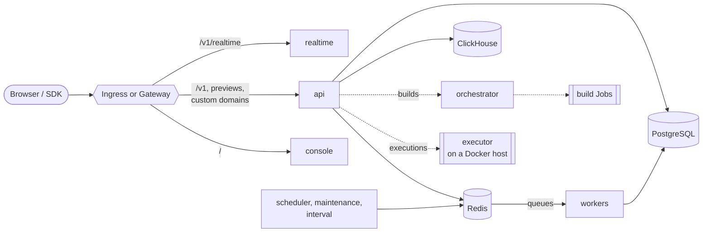

# Appwrite Helm chart

  

Appwrite, the open-source backend platform, on Kubernetes. Deploys the API, console, realtime, workers and schedulers with optional built-in PostgreSQL, Redis and ClickHouse.

> [!WARNING]
> Pre-1.0: values and behaviour may still change between minor versions.
> Read the [changelog](https://github.com/appwrite-labs/helm-chart/blob/main/CHANGELOG.md) before upgrading.

- Runs Appwrite under the `restricted` Pod Security Standard: non-root,
  read-only root filesystem, no capabilities, no ServiceAccount token.
- Built-in PostgreSQL, Redis and ClickHouse for a one-command install, or
  your own managed services.
- Ingress or Gateway API routes for the API, console, realtime, function and
  site previews and custom domains.
- Worker topologies from one combined worker to one Deployment per queue.
- Functions and Sites: builds run in the cluster as unprivileged Jobs in their
  own namespace, executions on an executor on a Docker host, so the cluster
  never runs privileged pods.
- Credentials generated once and kept, data migrations on upgrade, and guards
  against changing the encryption key or downgrading.

## Requirements

- Kubernetes 1.29 or later, with a default StorageClass (or set `global.storageClass`)
- Helm 4, or Helm 3.18 or later
- An ingress controller or a Gateway API implementation. Appwrite serves the
  console and the API on one hostname and needs `/v1` routed to the API.
- For HTTPS: cert-manager, or certificates you provide

## Quick start

With an ingress controller and a cert-manager `ClusterIssuer` named
`letsencrypt`:

```console
helm install appwrite oci://ghcr.io/appwrite-labs/charts/appwrite \
  --namespace appwrite --create-namespace \
  --set appwrite.domain=appwrite.example.com \
  --set appwrite.certificatesEmail=ops@example.com \
  --set ingress.enabled=true \
  --set ingress.tls.enabled=true \
  --set 'ingress.annotations.cert-manager\.io/cluster-issuer=letsencrypt' \
  --wait --timeout 15m
```

Open `https://appwrite.example.com` and sign up: the first account becomes the
console administrator. Then **back up the encryption key**:

```console
kubectl -n appwrite get secret appwrite -o jsonpath='{.data._APP_OPENSSL_KEY_V1}' | base64 -d
```

To try Appwrite on a laptop first, or for a step-by-step install, see
[Getting started](https://github.com/appwrite-labs/helm-chart/blob/main/docs/getting-started.md).

## Architecture



See the [architecture guide](https://github.com/appwrite-labs/helm-chart/blob/main/docs/architecture.md).

## Not included

- **The executor for Functions and Sites.** It needs a Docker daemon, so it
  runs on a Docker host next to the cluster; builds run in the cluster ([guide](https://github.com/appwrite-labs/helm-chart/blob/main/docs/executor.md)).
- **Highly available datastores.** The built-in ones are single replicas. Use
  managed services or operators in production
  ([guide](https://github.com/appwrite-labs/helm-chart/blob/main/docs/external-databases.md)).
- **Metrics.** Appwrite 2.3.0 exposes no Prometheus metrics.

## Documentation

| Guide | |
| --- | --- |
| [Getting started](https://github.com/appwrite-labs/helm-chart/blob/main/docs/getting-started.md) | A local try-out and a first real install |
| [Production checklist](https://github.com/appwrite-labs/helm-chart/blob/main/docs/production.md) | What to change before going live |
| [Architecture](https://github.com/appwrite-labs/helm-chart/blob/main/docs/architecture.md) | Components, configuration flow, worker topologies |
| [Networking, TLS and domains](https://github.com/appwrite-labs/helm-chart/blob/main/docs/networking.md) | Ingress, Gateway API, cert-manager, custom domains |
| [External databases](https://github.com/appwrite-labs/helm-chart/blob/main/docs/external-databases.md) | PostgreSQL, Redis, ClickHouse, MongoDB |
| [Storage](https://github.com/appwrite-labs/helm-chart/blob/main/docs/storage.md) | Volumes and S3 |
| [Functions and Sites](https://github.com/appwrite-labs/helm-chart/blob/main/docs/executor.md) | In-cluster builds and the external executor |
| [Optional components](https://github.com/appwrite-labs/helm-chart/blob/main/docs/optional-components.md) | Browser, assistant, autogravity, embedding, MQTT |
| [Security](https://github.com/appwrite-labs/helm-chart/blob/main/docs/security.md) | Pod security, credentials, NetworkPolicies, signatures |
| [Upgrading](https://github.com/appwrite-labs/helm-chart/blob/main/docs/upgrading.md) | Versions, migrations, rollbacks |
| [Backup and restore](https://github.com/appwrite-labs/helm-chart/blob/main/docs/backup-restore.md) | What to back up and how |
| [Migrating from Docker](https://github.com/appwrite-labs/helm-chart/blob/main/docs/migrating-from-docker.md) | Moving an existing install |
| [GitOps](https://github.com/appwrite-labs/helm-chart/blob/main/docs/gitops.md) | Argo CD and Flux |
| [Troubleshooting](https://github.com/appwrite-labs/helm-chart/blob/main/docs/troubleshooting.md) | Common problems |

## Uninstalling

```console
helm uninstall appwrite --namespace appwrite
```

The chart's Secret (encryption key and passwords) and the PersistentVolumeClaims
of `/storage` and the datastores are kept, so installing again with the same
release name finds the data. To remove everything, delete them together:

```console
kubectl -n appwrite delete secret appwrite
kubectl -n appwrite delete pvc -l app.kubernetes.io/instance=appwrite
```

## Maintainers

| Name | Email | Url |
| ---- | ------ | --- |
| levivannoort |  | <https://github.com/levivannoort> |

## Source Code

* <https://github.com/appwrite-labs/helm-chart>
* <https://github.com/appwrite/appwrite>

## Values

| Key | Type | Default | Description |
|-----|------|---------|-------------|
| api.affinity | object | `{}` | Affinity. Empty inherits `defaults.affinity`. |
| api.autoscaling.behavior | object | `{}` | HPA scaling behaviour. |
| api.autoscaling.enabled | bool | `false` | Create a HorizontalPodAutoscaler. |
| api.autoscaling.maxReplicas | int | `10` | Maximum replicas. |
| api.autoscaling.minReplicas | int | `2` | Minimum replicas. |
| api.autoscaling.targetCPUUtilizationPercentage | int | `75` | Target average CPU utilisation, in percent. |
| api.autoscaling.targetMemoryUtilizationPercentage | string | `""` | Target average memory utilisation, in percent. Empty disables the metric. |
| api.containerSecurityContext | object | `{}` | Container security context. Empty inherits `containerSecurityContext`. |
| api.cpuNum | string | `""` | CPUs Appwrite sizes its worker and connection pools for (`_APP_CPU_NUM`). Derived from the CPU limit, then the CPU request, when empty. |
| api.extraContainers | list | `[]` | Extra sidecar containers. |
| api.extraEnv | list | `[]` | Extra environment variables for this component. |
| api.extraInitContainers | list | `[]` | Extra init containers. |
| api.extraVolumeMounts | list | `[]` | Extra volume mounts for the main container. |
| api.extraVolumes | list | `[]` | Extra volumes for this component. |
| api.livenessProbe.enabled | bool | `true` | Enable the liveness probe. |
| api.livenessProbe.failureThreshold | int | `6` | Consecutive failures before the probe counts as failed. |
| api.livenessProbe.periodSeconds | int | `10` | Seconds between probes. |
| api.livenessProbe.timeoutSeconds | int | `5` | Seconds before a probe times out. |
| api.nodeSelector | object | `{}` | Node selector. Empty inherits `defaults.nodeSelector`. |
| api.pdb.enabled | bool | `true` | Create a PodDisruptionBudget when more than one replica can run. |
| api.pdb.maxUnavailable | int | `1` | Maximum unavailable pods. |
| api.pdb.minAvailable | string | `""` | Minimum available pods. Takes precedence over `maxUnavailable`. |
| api.podAnnotations | object | `{}` | Pod annotations, merged over `defaults.podAnnotations`. |
| api.podLabels | object | `{}` | Pod labels, merged over `defaults.podLabels`. |
| api.podSecurityContext | object | `{}` | Pod security context. Empty inherits `podSecurityContext`. |
| api.preStopSleepSeconds | int | `5` | Seconds to sleep before shutdown so endpoints are removed first. |
| api.priorityClassName | string | `""` | Priority class. Empty inherits `defaults.priorityClassName`. |
| api.readinessProbe.enabled | bool | `true` | Enable the readiness probe. |
| api.readinessProbe.failureThreshold | int | `3` | Consecutive failures before the probe counts as failed. |
| api.readinessProbe.periodSeconds | int | `10` | Seconds between probes. |
| api.readinessProbe.successThreshold | int | `1` | Consecutive successes before the probe counts as passed again. |
| api.readinessProbe.timeoutSeconds | int | `5` | Seconds before a probe times out. |
| api.replicaCount | int | `1` | Number of API replicas. Ignored when autoscaling is enabled. |
| api.resources | object | `{"limits":{"memory":"2Gi"},"requests":{"cpu":"250m","memory":"512Mi"}}` | Resource requests and limits. |
| api.service.annotations | object | `{}` | Service annotations. |
| api.service.port | int | `80` | Service port. |
| api.service.type | string | `"ClusterIP"` | Service type. |
| api.startupProbe.enabled | bool | `true` | Enable the startup probe. The first start creates database schemas and can take minutes. |
| api.startupProbe.failureThreshold | int | `72` | Consecutive failures before the probe counts as failed. |
| api.startupProbe.initialDelaySeconds | int | `5` | Seconds to wait before the first probe. |
| api.startupProbe.periodSeconds | int | `5` | Seconds between probes. |
| api.startupProbe.timeoutSeconds | int | `5` | Seconds before a probe times out. |
| api.terminationGracePeriodSeconds | int | `45` | Seconds to wait for in-flight requests on shutdown. Swoole drains for up to 30s. |
| api.tolerations | list | `[]` | Tolerations. Empty inherits `defaults.tolerations`. |
| api.topologySpreadConstraints | list | `[]` | Topology spread constraints. Empty inherits `defaults.topologySpreadConstraints`. |
| api.updateStrategy | object | `{"rollingUpdate":{"maxSurge":"25%","maxUnavailable":0},"type":"RollingUpdate"}` | Deployment update strategy. |
| appwrite.autoCertificates | bool | `false` | Have Appwrite issue Let's Encrypt certificates for function and site subdomains (`_APP_ROUTER_AUTO_CERTIFICATES`). Off by default: TLS for wildcard domains is expected to terminate at the ingress or Gateway. |
| appwrite.certificatesEmail | string | `""` | Email used to register Let's Encrypt certificates (`_APP_EMAIL_CERTIFICATES`). Required. |
| appwrite.config | object | `{}` | Extra `_APP_*` environment variables for every Appwrite pod. They override the chart's defaults and computed values, except variables set per container (credentials, `_APP_CPU_NUM`, `_APP_WORKERS_NUM`, `_APP_WORKER_MAX_COROUTINES`, `_APP_CONNECTIONS_DB_*`), which have their own values. See https://appwrite.io/docs/advanced/self-hosting/configuration/environment-variables. |
| appwrite.console.whitelistEmails | list | `[]` | Emails allowed to sign up to the console (`_APP_CONSOLE_WHITELIST_EMAILS`). |
| appwrite.console.whitelistIPs | list | `[]` | IPs allowed to sign up to the console (`_APP_CONSOLE_WHITELIST_IPS`). |
| appwrite.console.whitelistRoot | bool | `true` | Only the first user can sign up to the console; everyone else needs an invite (`_APP_CONSOLE_WHITELIST_ROOT`). |
| appwrite.consoleDomain | string | `""` | Hostname of the console (`_APP_CONSOLE_DOMAIN`). Defaults to `domain`. |
| appwrite.database.connectionsMax | int | `151` | Total connections Appwrite may open to the database, shared by all pods (`_APP_CONNECTIONS_MAX`). Keep it below the database's `max_connections`. |
| appwrite.database.poolClients | int | `15` | Number of Appwrite processes sharing `connectionsMax` (`_APP_POOL_CLIENTS`). Must be at least the number of Appwrite pods. |
| appwrite.documentsDb.database | string | `""` | Database name. Empty uses the main database name. |
| appwrite.documentsDb.enabled | bool | `false` | Enable DocumentsDB databases (`_APP_DOCUMENTSDB`), backed by a MongoDB replica set. |
| appwrite.documentsDb.existingSecret | string | `""` | Existing Secret holding the password. |
| appwrite.documentsDb.host | string | `""` | MongoDB hostname. |
| appwrite.documentsDb.password | string | `""` | Password. Ignored when `existingSecret` is set. Empty uses the main database password. |
| appwrite.documentsDb.passwordKey | string | `"documentsdb-password"` | Key in the Secret holding the password. |
| appwrite.documentsDb.port | int | `27017` | MongoDB port. |
| appwrite.documentsDb.username | string | `""` | User. Empty uses the main database user. |
| appwrite.domain | string | `""` | Hostname of the Appwrite API and console (`_APP_DOMAIN`). Required. |
| appwrite.domainTargets.a | string | `""` | IPv4 addresses custom domains may point an A record to, comma-separated (`_APP_DOMAIN_TARGET_A`). |
| appwrite.domainTargets.aaaa | string | `""` | IPv6 addresses custom domains may point an AAAA record to, comma-separated (`_APP_DOMAIN_TARGET_AAAA`). |
| appwrite.domainTargets.caa | string | `""` | CAA record value custom domains must allow (`_APP_DOMAIN_TARGET_CAA`). |
| appwrite.domainTargets.cname | string | `""` | Hostname custom domains must CNAME to (`_APP_DOMAIN_TARGET_CNAME`). Defaults to `domain`. |
| appwrite.extraEnv | list | `[]` | Extra environment variables for every Appwrite container, as a list of EnvVar objects. |
| appwrite.extraEnvFrom | list | `[]` | Extra `envFrom` sources for every Appwrite container. |
| appwrite.forceHttps | bool | `true` | Redirect HTTP to HTTPS and generate HTTPS URLs (`_APP_OPTIONS_FORCE_HTTPS` and `_APP_OPTIONS_ROUTER_FORCE_HTTPS`). Turn it off only when TLS isn't terminated in front of Appwrite. |
| appwrite.functionsDomain | string | `""` | Parent domain for function preview URLs (`_APP_DOMAIN_FUNCTIONS`). Defaults to `functions.<domain>`. |
| appwrite.logFormat | string | `"json"` | Log format (`_APP_LOGGING_FORMAT`). |
| appwrite.routerProtection | bool | `false` | Reject requests for hostnames Appwrite doesn't know (`_APP_OPTIONS_ROUTER_PROTECTION`). |
| appwrite.secretConfig | object | `{}` | Extra sensitive `_APP_*` environment variables, stored in a Secret. |
| appwrite.secrets.allowKeyRotation | bool | `false` | Allow `opensslKey` to differ from the key already stored in the cluster. Appwrite can't re-encrypt data, so changing the key makes encrypted data unreadable. |
| appwrite.secrets.existingSecret | string | `""` | Existing Secret holding the core secrets. When empty the chart generates them once and keeps them across upgrades and uninstalls. |
| appwrite.secrets.generate | bool | `true` | Generate missing credentials (core secrets and built-in datastore passwords). Set to false with GitOps tools that render templates without cluster access (Argo CD, `helm template`), where generated values would change on every render. |
| appwrite.secrets.geoSecret | string | `""` | Explicit `_APP_GEO_SECRET`. |
| appwrite.secrets.keys.geoSecret | string | `"_APP_GEO_SECRET"` | Key holding `_APP_GEO_SECRET`, shared with the geo service. |
| appwrite.secrets.keys.opensslKey | string | `"_APP_OPENSSL_KEY_V1"` | Key holding `_APP_OPENSSL_KEY_V1`, which encrypts data at rest and signs JWTs. |
| appwrite.secrets.keys.trackingSecret | string | `"_APP_NOTIFICATIONS_TRACKING_SECRET"` | Key holding `_APP_NOTIFICATIONS_TRACKING_SECRET`. |
| appwrite.secrets.opensslKey | string | `""` | Explicit `_APP_OPENSSL_KEY_V1`, e.g. when migrating from Docker. Never change it after install. |
| appwrite.secrets.trackingSecret | string | `""` | Explicit `_APP_NOTIFICATIONS_TRACKING_SECRET`. |
| appwrite.sitesDomain | string | `""` | Parent domain for site preview URLs (`_APP_DOMAIN_SITES`). Defaults to `sites.<domain>`. |
| appwrite.smtp.existingSecret | string | `""` | Existing Secret holding the SMTP password. |
| appwrite.smtp.host | string | `""` | SMTP server (`_APP_SMTP_HOST`). Empty disables email. |
| appwrite.smtp.password | string | `""` | SMTP password (`_APP_SMTP_PASSWORD`). Ignored when `existingSecret` is set. |
| appwrite.smtp.passwordKey | string | `"smtp-password"` | Key in `existingSecret` holding the SMTP password. |
| appwrite.smtp.port | int | `587` | SMTP port (`_APP_SMTP_PORT`). |
| appwrite.smtp.secure | string | `"tls"` | SMTP encryption (`_APP_SMTP_SECURE`). |
| appwrite.smtp.username | string | `""` | SMTP username (`_APP_SMTP_USERNAME`). |
| appwrite.storage.device | string | `"local"` | Where Appwrite stores files (`_APP_STORAGE_DEVICE`): `local` uses the `/storage` volume (see `persistence`), `s3` any S3-compatible object store. S3 is required with an external compute plane. |
| appwrite.storage.limit | int | `30000000` | Maximum file size in bytes (`_APP_STORAGE_LIMIT`). |
| appwrite.storage.previewLimit | int | `20000000` | Maximum size in bytes of files Appwrite renders previews for (`_APP_STORAGE_PREVIEW_LIMIT`). |
| appwrite.storage.s3.accessKey | string | `""` | Access key ID. Ignored when `existingSecret` is set. |
| appwrite.storage.s3.accessKeyKey | string | `"s3-access-key"` | Key in `existingSecret` holding the access key ID. |
| appwrite.storage.s3.bucket | string | `""` | Bucket. |
| appwrite.storage.s3.endpoint | string | `""` | Endpoint of an S3-compatible store, e.g. `https://fsn1.your-objectstorage.com`. Empty uses AWS S3. |
| appwrite.storage.s3.existingSecret | string | `""` | Existing Secret holding the access key ID and secret access key. |
| appwrite.storage.s3.region | string | `"us-east-1"` | Region. |
| appwrite.storage.s3.secretKey | string | `""` | Secret access key. Ignored when `existingSecret` is set. |
| appwrite.storage.s3.secretKeyKey | string | `"s3-secret-key"` | Key in `existingSecret` holding the secret access key. |
| appwrite.system.emailAddress | string | `""` | Sender address for emails Appwrite sends (`_APP_SYSTEM_EMAIL_ADDRESS`). |
| appwrite.system.emailName | string | `"Appwrite"` | Sender name for emails Appwrite sends (`_APP_SYSTEM_EMAIL_NAME`). |
| appwrite.system.securityEmailAddress | string | `""` | Address shown to users for security issues (`_APP_EMAIL_SECURITY`). |
| appwrite.usageStats | bool | `true` | Collect usage statistics in ClickHouse (`_APP_USAGE_STATS`). |
| appwrite.vectorsDb.database | string | `""` | Database name. Empty uses the main database name. |
| appwrite.vectorsDb.enabled | bool | `false` | Enable VectorsDB databases (`_APP_VECTORSDB`), backed by PostgreSQL with pgvector. |
| appwrite.vectorsDb.existingSecret | string | `""` | Existing Secret holding the password. |
| appwrite.vectorsDb.host | string | `""` | PostgreSQL hostname. Empty uses the main database, which must then be PostgreSQL. |
| appwrite.vectorsDb.password | string | `""` | Password. Ignored when `existingSecret` is set. Empty uses the main database password. |
| appwrite.vectorsDb.passwordKey | string | `"vectorsdb-password"` | Key in the Secret holding the password. |
| appwrite.vectorsDb.port | int | `5432` | PostgreSQL port. |
| appwrite.vectorsDb.username | string | `""` | User. Empty uses the main database user. |
| appwrite.workerPerCore | int | `6` | Swoole workers per CPU in the API (`_APP_WORKER_PER_CORE`). |
| assistant.affinity | object | `{}` | Affinity. Empty inherits `defaults.affinity`. |
| assistant.containerSecurityContext | object | `{"allowPrivilegeEscalation":false,"capabilities":{"drop":["ALL"]},"privileged":false,"readOnlyRootFilesystem":true}` | Container security context. |
| assistant.enabled | bool | `false` | Deploy the assistant. |
| assistant.existingSecret | string | `""` | Existing Secret holding the OpenAI API key. |
| assistant.image.digest | string | `""` | Image digest. |
| assistant.image.pullPolicy | string | `"IfNotPresent"` | Image pull policy. |
| assistant.image.registry | string | `"docker.io"` | Image registry. |
| assistant.image.repository | string | `"appwrite/assistant"` | Image repository. |
| assistant.image.tag | string | `"0.8.4"` | Image tag. |
| assistant.nodeSelector | object | `{}` | Node selector. Empty inherits `defaults.nodeSelector`. |
| assistant.openaiApiKey | string | `""` | OpenAI API key (`_APP_ASSISTANT_OPENAI_API_KEY`). Ignored when `existingSecret` is set. |
| assistant.podAnnotations | object | `{}` | Pod annotations, merged over `defaults.podAnnotations`. |
| assistant.podLabels | object | `{}` | Pod labels, merged over `defaults.podLabels`. |
| assistant.podSecurityContext | object | `{"fsGroup":1000,"runAsGroup":1000,"runAsNonRoot":true,"runAsUser":1000,"seccompProfile":{"type":"RuntimeDefault"}}` | Pod security context. |
| assistant.priorityClassName | string | `""` | Priority class. Empty inherits `defaults.priorityClassName`. |
| assistant.resources | object | `{"limits":{"memory":"512Mi"},"requests":{"cpu":"20m","memory":"128Mi"}}` | Resource requests and limits. |
| assistant.secretKey | string | `"openai-api-key"` | Key in the Secret holding the OpenAI API key. |
| assistant.tolerations | list | `[]` | Tolerations. Empty inherits `defaults.tolerations`. |
| autogravity.affinity | object | `{}` | Affinity. Empty inherits `defaults.affinity`. |
| autogravity.containerSecurityContext | object | `{"allowPrivilegeEscalation":false,"capabilities":{"drop":["ALL"]},"privileged":false,"readOnlyRootFilesystem":true}` | Container security context. |
| autogravity.enabled | bool | `false` | Deploy autogravity. |
| autogravity.image.digest | string | `""` | Image digest. |
| autogravity.image.pullPolicy | string | `"IfNotPresent"` | Image pull policy. |
| autogravity.image.registry | string | `"ghcr.io"` | Image registry. |
| autogravity.image.repository | string | `"appwrite/autogravity"` | Image repository. |
| autogravity.image.tag | string | `"0.0.11"` | Image tag. |
| autogravity.modelBackend | string | `"focalnet"` | Model backend (`MODEL_BACKEND`). |
| autogravity.nodeSelector | object | `{}` | Node selector. Empty inherits `defaults.nodeSelector`. |
| autogravity.podAnnotations | object | `{}` | Pod annotations, merged over `defaults.podAnnotations`. |
| autogravity.podLabels | object | `{}` | Pod labels, merged over `defaults.podLabels`. |
| autogravity.podSecurityContext | object | `{"runAsGroup":65532,"runAsNonRoot":true,"runAsUser":65532,"seccompProfile":{"type":"RuntimeDefault"}}` | Pod security context. |
| autogravity.priorityClassName | string | `""` | Priority class. Empty inherits `defaults.priorityClassName`. |
| autogravity.resources | object | `{"limits":{"memory":"2Gi"},"requests":{"cpu":"100m","memory":"512Mi"}}` | Resource requests and limits. |
| autogravity.tolerations | list | `[]` | Tolerations. Empty inherits `defaults.tolerations`. |
| browser.affinity | object | `{}` | Affinity. Empty inherits `defaults.affinity`. |
| browser.containerSecurityContext | object | `{"allowPrivilegeEscalation":false,"capabilities":{"drop":["ALL"]},"privileged":false,"readOnlyRootFilesystem":true}` | Container security context. |
| browser.enabled | bool | `false` | Deploy the browser service. |
| browser.image.digest | string | `""` | Image digest. |
| browser.image.pullPolicy | string | `"IfNotPresent"` | Image pull policy. |
| browser.image.registry | string | `"docker.io"` | Image registry. |
| browser.image.repository | string | `"appwrite/browser"` | Image repository. |
| browser.image.tag | string | `"0.3.4"` | Image tag. |
| browser.nodeSelector | object | `{}` | Node selector. Empty inherits `defaults.nodeSelector`. |
| browser.podAnnotations | object | `{}` | Pod annotations, merged over `defaults.podAnnotations`. |
| browser.podLabels | object | `{}` | Pod labels, merged over `defaults.podLabels`. |
| browser.podSecurityContext | object | `{"fsGroup":999,"runAsGroup":999,"runAsNonRoot":true,"runAsUser":999,"seccompProfile":{"type":"RuntimeDefault"}}` | Pod security context. |
| browser.priorityClassName | string | `""` | Priority class. Empty inherits `defaults.priorityClassName`. |
| browser.replicaCount | int | `1` | Number of replicas. |
| browser.resources | object | `{"limits":{"memory":"2Gi"},"requests":{"cpu":"100m","memory":"512Mi"}}` | Resource requests and limits. |
| browser.tolerations | list | `[]` | Tolerations. Empty inherits `defaults.tolerations`. |
| clickhouse.affinity | object | `{}` | Affinity. Empty inherits `defaults.affinity`. |
| clickhouse.auth.database | string | `"appwrite"` | Database name. |
| clickhouse.auth.existingSecret | string | `""` | Existing Secret holding the password. |
| clickhouse.auth.password | string | `""` | Password. Generated and kept across upgrades when empty. |
| clickhouse.auth.passwordKey | string | `"clickhouse-password"` | Key in the Secret holding the password. |
| clickhouse.auth.username | string | `"appwrite"` | User. |
| clickhouse.containerSecurityContext | object | `{"allowPrivilegeEscalation":false,"capabilities":{"drop":["ALL"]},"privileged":false,"readOnlyRootFilesystem":true}` | Container security context. |
| clickhouse.enabled | bool | `true` | Deploy the built-in ClickHouse. |
| clickhouse.image.digest | string | `""` | Image digest. |
| clickhouse.image.pullPolicy | string | `"IfNotPresent"` | Image pull policy. |
| clickhouse.image.registry | string | `"docker.io"` | Image registry. |
| clickhouse.image.repository | string | `"clickhouse/clickhouse-server"` | Image repository. |
| clickhouse.image.tag | string | `"26.4.3-alpine"` | Image tag. |
| clickhouse.nodeSelector | object | `{}` | Node selector. Empty inherits `defaults.nodeSelector`. |
| clickhouse.persistence.accessModes | list | `["ReadWriteOnce"]` | Access modes. |
| clickhouse.persistence.annotations | object | `{}` | Annotations for the PersistentVolumeClaim. |
| clickhouse.persistence.enabled | bool | `true` | Persist data in a PersistentVolumeClaim. |
| clickhouse.persistence.size | string | `"10Gi"` | Volume size. |
| clickhouse.persistence.storageClass | string | `""` | Storage class. Empty uses the cluster default. |
| clickhouse.podAnnotations | object | `{}` | Pod annotations, merged over `defaults.podAnnotations`. |
| clickhouse.podLabels | object | `{}` | Pod labels, merged over `defaults.podLabels`. |
| clickhouse.podSecurityContext | object | `{"fsGroup":101,"fsGroupChangePolicy":"OnRootMismatch","runAsGroup":101,"runAsNonRoot":true,"runAsUser":101,"seccompProfile":{"type":"RuntimeDefault"}}` | Pod security context. The image's `clickhouse` user is UID 101. |
| clickhouse.priorityClassName | string | `""` | Priority class. Empty inherits `defaults.priorityClassName`. |
| clickhouse.resources | object | `{"limits":{"memory":"2Gi"},"requests":{"cpu":"100m","memory":"512Mi"}}` | Resource requests and limits. |
| clickhouse.tolerations | list | `[]` | Tolerations. Empty inherits `defaults.tolerations`. |
| commonAnnotations | object | `{}` | Annotations added to every resource rendered by the chart. |
| commonLabels | object | `{}` | Labels added to every resource rendered by the chart. |
| compute.appwriteEndpoint | string | `""` | URL build Jobs use to download sources from and report back to Appwrite (`_APP_JOBS_ENDPOINT`). Defaults to the API Service in the cluster, or, with an external orchestrator, to `https://<domain>` (`http` when `forceHttps` is off), whose host must then be `appwrite.domain`. |
| compute.builds.cpuOvercommit | int | `8` | Divides each build's CPU limit to get its CPU request (`KUBE_CPU_OVERCOMMIT`). Appwrite gives builds up to 8 CPUs; the default requests 1. |
| compute.builds.createNamespace | bool | `true` | Create the namespace, labelled for the `baseline` Pod Security Standard. Set to false to create it yourself. |
| compute.builds.memoryOvercommit | int | `8` | Divides each build's memory limit to get its memory request (`KUBE_MEMORY_OVERCOMMIT`). Appwrite gives builds up to 8 GiB; the default requests 1 GiB. |
| compute.builds.namespace | string | `""` | Namespace for build Jobs. Defaults to `<release namespace>-builds`. Use a different one per release when several releases share a namespace. |
| compute.builds.networkPolicy.enabled | bool | `true` | Restrict build pods' traffic: no incoming connections; outgoing only to DNS, the API, the orchestrator, the S3 endpoint and public addresses. Takes effect only with a CNI that enforces NetworkPolicies. |
| compute.builds.networkPolicy.extraEgress | list | `[]` | Extra egress rules (NetworkPolicyEgressRule) for build pods, e.g. an S3 endpoint on a private network that isn't an IP address, or a private package registry. |
| compute.builds.nodeSelector | object | `{}` | Node selector for build pods. |
| compute.builds.retention | string | `"15m"` | How long finished build Jobs are kept (`JOB_RETENTION`). |
| compute.builds.sidecarImage.digest | string | `""` | Image digest. |
| compute.builds.sidecarImage.registry | string | `"ghcr.io"` | Image registry. |
| compute.builds.sidecarImage.repository | string | `"open-runtimes/orchestrator/job-sidecar"` | Image repository of the sidecar that moves sources, outputs and caches for each build. |
| compute.builds.sidecarImage.tag | string | `"2.2.2"` | Image tag. |
| compute.builds.tolerations | list | `[]` | Tolerations for build pods. |
| compute.enabled | bool | `false` | Enable Functions and Sites. Needs `appwrite.storage.device: s3` and an external executor (`compute.executor.host`). |
| compute.executor.host | string | `""` | URL of the open-runtimes executor API (`_APP_EXECUTOR_HOST`), e.g. `http://10.0.0.20:9900/v1`. |
| compute.functionsRuntimes | list | `[]` | Function runtimes to enable (`_APP_FUNCTIONS_RUNTIMES`). Empty keeps Appwrite's default list. |
| compute.orchestrator.affinity | object | `{}` | Affinity. Empty inherits `defaults.affinity`. |
| compute.orchestrator.containerSecurityContext | object | `{"allowPrivilegeEscalation":false,"capabilities":{"drop":["ALL"]},"privileged":false,"readOnlyRootFilesystem":true}` | Container security context. |
| compute.orchestrator.host | string | `""` | URL of an external orchestrator's API (`_APP_JOBS_HOST`) when `mode` is `external`, e.g. `http://10.0.0.20:8080`. |
| compute.orchestrator.image.digest | string | `""` | Image digest. |
| compute.orchestrator.image.pullPolicy | string | `"IfNotPresent"` | Image pull policy. |
| compute.orchestrator.image.registry | string | `"ghcr.io"` | Image registry. |
| compute.orchestrator.image.repository | string | `"open-runtimes/orchestrator/jobs-service"` | Image repository: the orchestrator's jobs service, with the Kubernetes backend. |
| compute.orchestrator.image.tag | string | `"2.2.2"` | Image tag. |
| compute.orchestrator.mode | string | `"cluster"` | Where builds run. `cluster`: the chart runs the orchestrator, which starts every build as a Kubernetes Job in `compute.builds.namespace`. `external`: an orchestrator you run on a Docker host, at `host`. |
| compute.orchestrator.nodeSelector | object | `{}` | Node selector. Empty inherits `defaults.nodeSelector`. |
| compute.orchestrator.podAnnotations | object | `{}` | Pod annotations, merged over `defaults.podAnnotations`. |
| compute.orchestrator.podLabels | object | `{}` | Pod labels, merged over `defaults.podLabels`. |
| compute.orchestrator.podSecurityContext | object | `{"runAsGroup":65532,"runAsNonRoot":true,"runAsUser":65532,"seccompProfile":{"type":"RuntimeDefault"}}` | Pod security context. The image's `nonroot` user is UID 65532. |
| compute.orchestrator.priorityClassName | string | `""` | Priority class. Empty inherits `defaults.priorityClassName`. |
| compute.orchestrator.resources | object | `{"limits":{"memory":"256Mi"},"requests":{"cpu":"20m","memory":"64Mi"}}` | Resource requests and limits. |
| compute.orchestrator.tolerations | list | `[]` | Tolerations. Empty inherits `defaults.tolerations`. |
| compute.secrets.executorSecret | string | `""` | Explicit executor secret. |
| compute.secrets.executorSecretKey | string | `"executor-secret"` | Key holding the executor secret (`_APP_EXECUTOR_SECRET`, `OPR_EXECUTOR_SECRET` on the executor). |
| compute.secrets.existingSecret | string | `""` | Existing Secret holding the executor and orchestrator secrets. When empty, the chart generates them; configure the executor (and an external orchestrator) with the same values. |
| compute.secrets.orchestratorSecret | string | `""` | Explicit orchestrator API key. |
| compute.secrets.orchestratorSecretKey | string | `"orchestrator-secret"` | Key holding the orchestrator API key (`_APP_JOBS_SECRET`, the file in `API_KEY_FILE` on the orchestrator). |
| compute.sitesRuntimes | list | `[]` | Site runtimes to enable (`_APP_SITES_RUNTIMES`). Empty keeps Appwrite's default list. Sites build with `node-22`, so keep it in the list. |
| console.affinity | object | `{}` | Affinity. Empty inherits `defaults.affinity`. |
| console.autoscaling.behavior | object | `{}` | HPA scaling behaviour. |
| console.autoscaling.enabled | bool | `false` | Create a HorizontalPodAutoscaler. |
| console.autoscaling.maxReplicas | int | `5` | Maximum replicas. |
| console.autoscaling.minReplicas | int | `2` | Minimum replicas. |
| console.autoscaling.targetCPUUtilizationPercentage | int | `75` | Target average CPU utilisation, in percent. |
| console.autoscaling.targetMemoryUtilizationPercentage | string | `""` | Target average memory utilisation, in percent. Empty disables the metric. |
| console.containerSecurityContext | object | `{"allowPrivilegeEscalation":false,"capabilities":{"drop":["ALL"]},"privileged":false,"readOnlyRootFilesystem":true}` | Container security context. |
| console.enabled | bool | `true` | Deploy the console. |
| console.env | object | `{"APPWRITE_ENDPOINT_SAME_ORIGIN":"true","VITE_CONSOLE_PROFILE":"self-hosted","VITE_GROWTH_ENDPOINT":"https://growth.appwrite.io/v1"}` | Environment variables for the console, as a map. |
| console.extraEnv | list | `[]` | Extra environment variables, as a list of EnvVar objects. |
| console.extraVolumeMounts | list | `[]` | Extra volume mounts for the main container. |
| console.extraVolumes | list | `[]` | Extra volumes. |
| console.image.digest | string | `""` | Image digest. |
| console.image.pullPolicy | string | `"IfNotPresent"` | Image pull policy. |
| console.image.registry | string | `"docker.io"` | Image registry. |
| console.image.repository | string | `"appwrite/new"` | Image repository. |
| console.image.tag | string | `"1.1.159-self-hosted"` | Image tag. Pinned to the console that ships with the chart's appVersion. |
| console.livenessProbe.enabled | bool | `true` | Enable the liveness probe. |
| console.livenessProbe.failureThreshold | int | `3` | Consecutive failures before the probe counts as failed. |
| console.livenessProbe.periodSeconds | int | `20` | Seconds between probes. |
| console.livenessProbe.timeoutSeconds | int | `5` | Seconds before a probe times out. |
| console.nodeSelector | object | `{}` | Node selector. Empty inherits `defaults.nodeSelector`. |
| console.pdb.enabled | bool | `true` | Create a PodDisruptionBudget when more than one replica can run. |
| console.pdb.maxUnavailable | int | `1` | Maximum unavailable pods. |
| console.pdb.minAvailable | string | `""` | Minimum available pods. Takes precedence over `maxUnavailable`. |
| console.podAnnotations | object | `{}` | Pod annotations, merged over `defaults.podAnnotations`. |
| console.podLabels | object | `{}` | Pod labels, merged over `defaults.podLabels`. |
| console.podSecurityContext | object | `{"fsGroup":1000,"runAsGroup":1000,"runAsNonRoot":true,"runAsUser":1000,"seccompProfile":{"type":"RuntimeDefault"}}` | Pod security context. The console image's `bun` user is UID 1000. |
| console.priorityClassName | string | `""` | Priority class. Empty inherits `defaults.priorityClassName`. |
| console.readinessProbe.enabled | bool | `true` | Enable the readiness probe. |
| console.readinessProbe.failureThreshold | int | `3` | Consecutive failures before the probe counts as failed. |
| console.readinessProbe.periodSeconds | int | `10` | Seconds between probes. |
| console.readinessProbe.successThreshold | int | `1` | Consecutive successes before the probe counts as passed again. |
| console.readinessProbe.timeoutSeconds | int | `5` | Seconds before a probe times out. |
| console.replicaCount | int | `1` | Number of console replicas. Ignored when autoscaling is enabled. |
| console.resources | object | `{"limits":{"memory":"512Mi"},"requests":{"cpu":"50m","memory":"128Mi"}}` | Resource requests and limits. |
| console.service.annotations | object | `{}` | Service annotations. |
| console.service.port | int | `80` | Service port. |
| console.service.type | string | `"ClusterIP"` | Service type. |
| console.startupProbe.enabled | bool | `true` | Enable the startup probe. |
| console.startupProbe.failureThreshold | int | `30` | Consecutive failures before the probe counts as failed. |
| console.startupProbe.periodSeconds | int | `5` | Seconds between probes. |
| console.startupProbe.timeoutSeconds | int | `5` | Seconds before a probe times out. |
| console.terminationGracePeriodSeconds | int | `30` | Seconds to wait for in-flight requests on shutdown. |
| console.tolerations | list | `[]` | Tolerations. Empty inherits `defaults.tolerations`. |
| console.topologySpreadConstraints | list | `[]` | Topology spread constraints. Empty inherits `defaults.topologySpreadConstraints`. |
| console.updateStrategy | object | `{}` | Deployment update strategy. |
| containerSecurityContext | object | `{"allowPrivilegeEscalation":false,"capabilities":{"drop":["ALL"]},"privileged":false,"readOnlyRootFilesystem":true}` | Container security context for every container running the Appwrite image. |
| defaults.affinity | object | `{}` | Affinity for every pod. |
| defaults.nodeSelector | object | `{}` | Node selector for every pod. |
| defaults.podAnnotations | object | `{}` | Annotations added to every pod. |
| defaults.podLabels | object | `{}` | Labels added to every pod. |
| defaults.priorityClassName | string | `""` | Priority class for every pod. |
| defaults.tolerations | list | `[]` | Tolerations for every pod. |
| defaults.topologySpreadConstraints | list | `[]` | Topology spread constraints for every pod. The component's selector labels are filled in when `labelSelector` is omitted. Leave empty for a soft spread across nodes on scalable components. |
| embedding.affinity | object | `{}` | Affinity. Empty inherits `defaults.affinity`. |
| embedding.containerSecurityContext | object | `{"allowPrivilegeEscalation":false,"capabilities":{"drop":["ALL"]},"privileged":false,"readOnlyRootFilesystem":true}` | Container security context. |
| embedding.enabled | bool | `false` | Deploy the embedding service. When disabled, Appwrite's embedding features are turned off. |
| embedding.image.digest | string | `""` | Image digest. |
| embedding.image.pullPolicy | string | `"IfNotPresent"` | Image pull policy. |
| embedding.image.registry | string | `"docker.io"` | Image registry. |
| embedding.image.repository | string | `"appwrite/embedding"` | Image repository. |
| embedding.image.tag | string | `"0.3.1"` | Image tag. |
| embedding.models | list | `["nomic-embed-text"]` | Models to load (`EMBEDDING_MODELS`). |
| embedding.nodeSelector | object | `{}` | Node selector. Empty inherits `defaults.nodeSelector`. |
| embedding.persistence.enabled | bool | `true` | Keep downloaded models in a PersistentVolumeClaim. |
| embedding.persistence.size | string | `"5Gi"` | Volume size. |
| embedding.persistence.storageClass | string | `""` | Storage class. Empty uses the cluster default. |
| embedding.podAnnotations | object | `{}` | Pod annotations, merged over `defaults.podAnnotations`. |
| embedding.podLabels | object | `{}` | Pod labels, merged over `defaults.podLabels`. |
| embedding.podSecurityContext | object | `{"fsGroup":10001,"runAsGroup":10001,"runAsNonRoot":true,"runAsUser":10001,"seccompProfile":{"type":"RuntimeDefault"}}` | Pod security context. |
| embedding.priorityClassName | string | `""` | Priority class. Empty inherits `defaults.priorityClassName`. |
| embedding.resources | object | `{"limits":{"memory":"4Gi"},"requests":{"cpu":"250m","memory":"1Gi"}}` | Resource requests and limits. |
| embedding.tolerations | list | `[]` | Tolerations. Empty inherits `defaults.tolerations`. |
| externalClickhouse.database | string | `"appwrite"` | Database name. |
| externalClickhouse.existingSecret | string | `""` | Existing Secret holding the password. |
| externalClickhouse.password | string | `""` | Password. Ignored when `existingSecret` is set. Must be URL-safe, or URL-encoded, because Appwrite reads it from a connection URL. |
| externalClickhouse.passwordKey | string | `"clickhouse-password"` | Key in the Secret holding the password. |
| externalClickhouse.url | string | `""` | HTTP(S) endpoint, e.g. `https://abc.clickhouse.cloud:8443`. |
| externalClickhouse.username | string | `"appwrite"` | User. |
| externalDatabase.adapter | string | `"postgresql"` | Database engine (`_APP_DB_ADAPTER`). |
| externalDatabase.database | string | `"appwrite"` | Database (schema) name. |
| externalDatabase.existingSecret | string | `""` | Existing Secret holding the password. |
| externalDatabase.host | string | `""` | Hostname. |
| externalDatabase.password | string | `""` | Password. Ignored when `existingSecret` is set. |
| externalDatabase.passwordKey | string | `"db-password"` | Key in the Secret holding the password. |
| externalDatabase.port | string | `""` | Port. Defaults to the engine's standard port. |
| externalDatabase.username | string | `"appwrite"` | User. |
| externalRedis.existingSecret | string | `""` | Existing Secret holding the password. |
| externalRedis.host | string | `""` | Hostname. |
| externalRedis.password | string | `""` | Password. Ignored when `existingSecret` is set. |
| externalRedis.passwordKey | string | `"redis-password"` | Key in the Secret holding the password. |
| externalRedis.port | int | `6379` | Port. |
| externalRedis.username | string | `""` | ACL user (`_APP_REDIS_USER`). The MQTT server ignores it, so leave it empty when MQTT is enabled. |
| fullnameOverride | string | `""` | Override the fully qualified app name used in resource names. |
| geo.affinity | object | `{}` | Affinity. Empty inherits `defaults.affinity`. |
| geo.containerSecurityContext | object | `{"allowPrivilegeEscalation":false,"capabilities":{"drop":["ALL"]},"privileged":false,"readOnlyRootFilesystem":true}` | Container security context. |
| geo.enabled | bool | `true` | Deploy the geo service. When disabled, Appwrite skips geolocation. |
| geo.image.digest | string | `""` | Image digest. |
| geo.image.pullPolicy | string | `"IfNotPresent"` | Image pull policy. |
| geo.image.registry | string | `"docker.io"` | Image registry. |
| geo.image.repository | string | `"appwrite/geo"` | Image repository. |
| geo.image.tag | string | `"0.3.1"` | Image tag. |
| geo.nodeSelector | object | `{}` | Node selector. Empty inherits `defaults.nodeSelector`. |
| geo.podAnnotations | object | `{}` | Pod annotations, merged over `defaults.podAnnotations`. |
| geo.podLabels | object | `{}` | Pod labels, merged over `defaults.podLabels`. |
| geo.podSecurityContext | object | `{"runAsGroup":82,"runAsNonRoot":true,"runAsUser":82,"seccompProfile":{"type":"RuntimeDefault"},"sysctls":[{"name":"net.ipv4.ip_unprivileged_port_start","value":"0"}]}` | Pod security context. The geo server listens on port 80, so the unprivileged port range is lowered for the pod instead of running as root. |
| geo.priorityClassName | string | `""` | Priority class. Empty inherits `defaults.priorityClassName`. |
| geo.replicaCount | int | `1` | Number of replicas. |
| geo.resources | object | `{"limits":{"memory":"512Mi"},"requests":{"cpu":"20m","memory":"128Mi"}}` | Resource requests and limits. |
| geo.tolerations | list | `[]` | Tolerations. Empty inherits `defaults.tolerations`. |
| global.imagePullSecrets | list | `[]` | Image pull secrets added to every pod, as a list of Secret names. |
| global.imageRegistry | string | `""` | Registry that replaces the registry of every image, e.g. a pull-through cache. |
| global.storageClass | string | `""` | Storage class for every PersistentVolumeClaim that doesn't set one. `-` means no class. |
| httpRoute.annotations | object | `{}` | Annotations for every HTTPRoute. |
| httpRoute.customDomains.enabled | bool | `false` | Route every hostname the Gateway listener accepts to the API, for custom domains. |
| httpRoute.customDomains.parentRefs | list | `[]` | Gateways (typically a dedicated catch-all listener) to attach the route to. Defaults to `httpRoute.parentRefs`. |
| httpRoute.enabled | bool | `false` | Create HTTPRoutes (gateway.networking.k8s.io/v1). |
| httpRoute.hostnameHeaderMatch | bool | `false` | Send requests that carry an `x-appwrite-hostname` header to the API instead of the console, as Appwrite's Traefik setup does. Uses a RegularExpression header match, which not every Gateway implements. |
| httpRoute.labels | object | `{}` | Labels for every HTTPRoute. |
| httpRoute.parentRefs | list | `[]` | Gateways (and listeners) to attach to. Required when enabled. |
| httpRoute.wildcard.enabled | bool | `true` | Route `*.<functionsDomain>` and `*.<sitesDomain>` to the API. |
| httpRoute.wildcard.parentRefs | list | `[]` | Gateways to attach the wildcard route to. Defaults to `httpRoute.parentRefs`. |
| image.digest | string | `""` | Image digest (`sha256:...`). When set it pins the image and the tag is informational. |
| image.pullPolicy | string | `"IfNotPresent"` | Image pull policy. |
| image.registry | string | `"docker.io"` | Image registry. |
| image.repository | string | `"appwrite/appwrite"` | Image repository. |
| image.tag | string | `""` | Image tag. Defaults to the chart appVersion. |
| ingress.annotations | object | `{}` | Annotations for every Ingress, e.g. a cert-manager issuer. |
| ingress.className | string | `""` | IngressClass to use. Empty uses the cluster default. |
| ingress.customDomains.annotations | object | `{}` | Annotations for the custom-domain Ingress, merged over `ingress.annotations`. |
| ingress.customDomains.enabled | bool | `false` | Route every other hostname to the API, for custom domains of projects, functions and sites. Creates an Ingress rule without a host. |
| ingress.enabled | bool | `false` | Create Ingress resources. |
| ingress.labels | object | `{}` | Labels for every Ingress. |
| ingress.tls.enabled | bool | `false` | Terminate TLS for `appwrite.domain` and `appwrite.consoleDomain`. |
| ingress.tls.secretName | string | `""` | Secret with the certificate. Defaults to `<fullname>-tls`. |
| ingress.wildcard.annotations | object | `{}` | Annotations for the wildcard Ingress, merged over `ingress.annotations`. |
| ingress.wildcard.enabled | bool | `true` | Route `*.<functionsDomain>` and `*.<sitesDomain>` (function and site preview URLs) to the API. |
| ingress.wildcard.tls.enabled | bool | `false` | Terminate TLS for the wildcard hosts. Needs a wildcard certificate, which ACME issues through DNS-01. |
| ingress.wildcard.tls.secretName | string | `""` | Secret with the wildcard certificate. Defaults to `<fullname>-wildcard-tls`. |
| migrations.activeDeadlineSeconds | int | `7200` | Seconds the migration may run before it's stopped. |
| migrations.allowDowngrade | bool | `false` | Allow upgrading to an older Appwrite version than the one installed. Appwrite can't migrate data backwards; restore a backup instead. |
| migrations.backoffLimit | int | `1` | Retries after a failure. |
| migrations.mode | string | `"hook"` | How to run it. `hook`: a Helm post-upgrade hook, only when the Appwrite version changes. `job`: a regular Job named after the version, for tools that don't run Helm hooks (Argo CD). `none`: run it yourself. |
| migrations.resources | object | `{"limits":{"memory":"1Gi"},"requests":{"cpu":"100m","memory":"256Mi"}}` | Resource requests and limits. |
| mqtt.affinity | object | `{}` | Affinity. Empty inherits `defaults.affinity`. |
| mqtt.containerSecurityContext | object | `{}` | Container security context. Empty inherits `containerSecurityContext`. |
| mqtt.cpuNum | string | `""` | CPUs Appwrite sizes its connection pools for (`_APP_CPU_NUM`). Derived from resources when empty. |
| mqtt.enabled | bool | `false` | Deploy the MQTT broker. |
| mqtt.nodeSelector | object | `{}` | Node selector. Empty inherits `defaults.nodeSelector`. |
| mqtt.podAnnotations | object | `{}` | Pod annotations, merged over `defaults.podAnnotations`. |
| mqtt.podLabels | object | `{}` | Pod labels, merged over `defaults.podLabels`. |
| mqtt.podSecurityContext | object | `{}` | Pod security context. Empty inherits `podSecurityContext`. |
| mqtt.priorityClassName | string | `""` | Priority class. Empty inherits `defaults.priorityClassName`. |
| mqtt.replicaCount | int | `1` | Number of replicas. |
| mqtt.resources | object | `{"limits":{"memory":"512Mi"},"requests":{"cpu":"50m","memory":"128Mi"}}` | Resource requests and limits. |
| mqtt.service.annotations | object | `{}` | Service annotations, e.g. for a cloud load balancer with TLS. |
| mqtt.service.loadBalancerSourceRanges | list | `[]` | Source ranges allowed through a LoadBalancer. |
| mqtt.service.port | int | `1883` | MQTT port. |
| mqtt.service.type | string | `"ClusterIP"` | Service type. Use LoadBalancer to reach MQTT from outside the cluster. |
| mqtt.service.wsPort | int | `8083` | MQTT over WebSocket port. |
| mqtt.tolerations | list | `[]` | Tolerations. Empty inherits `defaults.tolerations`. |
| nameOverride | string | `""` | Override the chart name used in resource names. |
| networkPolicy.egress.dns | list | `[{"namespaceSelector":{},"podSelector":{"matchLabels":{"k8s-app":"kube-dns"}}}]` | DNS servers to allow (NetworkPolicyPeer) when egress is restricted. |
| networkPolicy.egress.enabled | bool | `false` | Restrict egress to DNS, pods of this release and `extraRules`. Off by default: Appwrite calls webhooks, SMTP servers, OAuth providers, the executor and other external services. |
| networkPolicy.egress.extraRules | list | `[]` | Extra egress rules (NetworkPolicyEgressRule) when egress is restricted. |
| networkPolicy.enabled | bool | `false` | Create NetworkPolicies. They only take effect with a CNI that enforces them. |
| networkPolicy.ingress.from | list | `[]` | Sources (NetworkPolicyPeer) allowed to reach the API, console and realtime, typically your ingress controller or Gateway. Empty allows any source. Pods of this release can always reach them. |
| persistence.accessModes | list | `["ReadWriteOnce"]` | Access modes. Use ReadWriteMany (or S3 storage) to spread API and worker pods across nodes. |
| persistence.annotations | object | `{}` | Annotations for the PersistentVolumeClaim. |
| persistence.colocateReadWriteOnce | bool | `true` | With a ReadWriteOnce volume, schedule every pod that mounts it on the same node so the volume can be attached. |
| persistence.enabled | bool | `true` | Persist `/storage` in a PersistentVolumeClaim. When disabled every pod gets its own emptyDir, which only works with a single API and worker pod. |
| persistence.existingClaim | string | `""` | Use an existing PersistentVolumeClaim instead of creating one. |
| persistence.keep | bool | `true` | Keep the PersistentVolumeClaim when the release is uninstalled. |
| persistence.size | string | `"20Gi"` | Volume size. |
| persistence.storageClass | string | `""` | Storage class. Empty uses the cluster default. |
| podSecurityContext | object | `{"fsGroup":82,"fsGroupChangePolicy":"OnRootMismatch","runAsGroup":82,"runAsNonRoot":true,"runAsUser":82,"seccompProfile":{"type":"RuntimeDefault"}}` | Pod security context for every pod running the Appwrite image. UID/GID 82 is `www-data`, which owns `/storage` in the image. |
| postgresql.affinity | object | `{}` | Affinity. Empty inherits `defaults.affinity`. |
| postgresql.auth.database | string | `"appwrite"` | Database name. |
| postgresql.auth.existingSecret | string | `""` | Existing Secret holding the password. |
| postgresql.auth.password | string | `""` | Password. Generated and kept across upgrades when empty. |
| postgresql.auth.passwordKey | string | `"postgres-password"` | Key in the Secret holding the password. |
| postgresql.auth.username | string | `"appwrite"` | Database user. |
| postgresql.containerSecurityContext | object | `{"allowPrivilegeEscalation":false,"capabilities":{"drop":["ALL"]},"privileged":false,"readOnlyRootFilesystem":true}` | Container security context. |
| postgresql.enabled | bool | `true` | Deploy the built-in PostgreSQL. |
| postgresql.extraConfig | object | `{}` | Extra PostgreSQL settings passed as `-c name=value`. |
| postgresql.image.digest | string | `""` | Image digest. |
| postgresql.image.pullPolicy | string | `"IfNotPresent"` | Image pull policy. |
| postgresql.image.registry | string | `"docker.io"` | Image registry. |
| postgresql.image.repository | string | `"appwrite/postgres"` | Image repository. Appwrite's image is PostgreSQL 18 with the extensions Appwrite needs. |
| postgresql.image.tag | string | `"0.1.0"` | Image tag. |
| postgresql.maxConnections | string | `""` | `max_connections`. Defaults to `appwrite.database.connectionsMax` + 20. |
| postgresql.nodeSelector | object | `{}` | Node selector. Empty inherits `defaults.nodeSelector`. |
| postgresql.persistence.accessModes | list | `["ReadWriteOnce"]` | Access modes. |
| postgresql.persistence.annotations | object | `{}` | Annotations for the PersistentVolumeClaim. |
| postgresql.persistence.enabled | bool | `true` | Persist data in a PersistentVolumeClaim. Data is lost on restart when disabled. |
| postgresql.persistence.size | string | `"10Gi"` | Volume size. |
| postgresql.persistence.storageClass | string | `""` | Storage class. Empty uses the cluster default. |
| postgresql.podAnnotations | object | `{}` | Pod annotations, merged over `defaults.podAnnotations`. |
| postgresql.podLabels | object | `{}` | Pod labels, merged over `defaults.podLabels`. |
| postgresql.podSecurityContext | object | `{"fsGroup":999,"fsGroupChangePolicy":"OnRootMismatch","runAsGroup":999,"runAsNonRoot":true,"runAsUser":999,"seccompProfile":{"type":"RuntimeDefault"}}` | Pod security context. The image's `postgres` user is UID 999. |
| postgresql.priorityClassName | string | `""` | Priority class. Empty inherits `defaults.priorityClassName`. |
| postgresql.resources | object | `{"limits":{"memory":"2Gi"},"requests":{"cpu":"100m","memory":"256Mi"}}` | Resource requests and limits. |
| postgresql.tolerations | list | `[]` | Tolerations. Empty inherits `defaults.tolerations`. |
| realtime.affinity | object | `{}` | Affinity. Empty inherits `defaults.affinity`. |
| realtime.autoscaling.behavior | object | `{}` | HPA scaling behaviour. |
| realtime.autoscaling.enabled | bool | `false` | Create a HorizontalPodAutoscaler. |
| realtime.autoscaling.maxReplicas | int | `10` | Maximum replicas. |
| realtime.autoscaling.minReplicas | int | `2` | Minimum replicas. |
| realtime.autoscaling.targetCPUUtilizationPercentage | int | `75` | Target average CPU utilisation, in percent. |
| realtime.autoscaling.targetMemoryUtilizationPercentage | string | `""` | Target average memory utilisation, in percent. Empty disables the metric. |
| realtime.containerSecurityContext | object | `{}` | Container security context. Empty inherits `containerSecurityContext`. |
| realtime.cpuNum | string | `""` | CPUs Appwrite sizes its connection pools for (`_APP_CPU_NUM`). Derived from resources when empty. |
| realtime.enabled | bool | `true` | Deploy the realtime server. |
| realtime.extraEnv | list | `[]` | Extra environment variables for this component. |
| realtime.extraVolumeMounts | list | `[]` | Extra volume mounts for the main container. |
| realtime.extraVolumes | list | `[]` | Extra volumes for this component. |
| realtime.livenessProbe.enabled | bool | `true` | Enable the liveness probe. |
| realtime.livenessProbe.failureThreshold | int | `3` | Consecutive failures before the probe counts as failed. |
| realtime.livenessProbe.periodSeconds | int | `20` | Seconds between probes. |
| realtime.livenessProbe.timeoutSeconds | int | `5` | Seconds before a probe times out. |
| realtime.nodeSelector | object | `{}` | Node selector. Empty inherits `defaults.nodeSelector`. |
| realtime.pdb.enabled | bool | `true` | Create a PodDisruptionBudget when more than one replica can run. |
| realtime.pdb.maxUnavailable | int | `1` | Maximum unavailable pods. |
| realtime.pdb.minAvailable | string | `""` | Minimum available pods. Takes precedence over `maxUnavailable`. |
| realtime.podAnnotations | object | `{}` | Pod annotations, merged over `defaults.podAnnotations`. |
| realtime.podLabels | object | `{}` | Pod labels, merged over `defaults.podLabels`. |
| realtime.podSecurityContext | object | `{}` | Pod security context. Empty inherits `podSecurityContext`. |
| realtime.preStopSleepSeconds | int | `5` | Seconds to sleep before shutdown so endpoints are removed first. |
| realtime.priorityClassName | string | `""` | Priority class. Empty inherits `defaults.priorityClassName`. |
| realtime.processes | int | `1` | Swoole worker processes per pod (`_APP_WORKERS_NUM`). Prefer more replicas over more processes. |
| realtime.readinessProbe.enabled | bool | `true` | Enable the readiness probe. |
| realtime.readinessProbe.failureThreshold | int | `3` | Consecutive failures before the probe counts as failed. |
| realtime.readinessProbe.periodSeconds | int | `10` | Seconds between probes. |
| realtime.readinessProbe.successThreshold | int | `1` | Consecutive successes before the probe counts as passed again. |
| realtime.readinessProbe.timeoutSeconds | int | `5` | Seconds before a probe times out. |
| realtime.replicaCount | int | `1` | Number of realtime replicas. Ignored when autoscaling is enabled. |
| realtime.resources | object | `{"limits":{"memory":"1Gi"},"requests":{"cpu":"100m","memory":"256Mi"}}` | Resource requests and limits. |
| realtime.service.annotations | object | `{}` | Service annotations. |
| realtime.service.port | int | `80` | Service port. |
| realtime.service.type | string | `"ClusterIP"` | Service type. |
| realtime.startupProbe.enabled | bool | `true` | Enable the startup probe. |
| realtime.startupProbe.failureThreshold | int | `60` | Consecutive failures before the probe counts as failed. |
| realtime.startupProbe.periodSeconds | int | `5` | Seconds between probes. |
| realtime.startupProbe.timeoutSeconds | int | `5` | Seconds before a probe times out. |
| realtime.terminationGracePeriodSeconds | int | `30` | Seconds to wait on shutdown. Realtime drains for up to 15s before closing sockets. |
| realtime.tolerations | list | `[]` | Tolerations. Empty inherits `defaults.tolerations`. |
| realtime.topologySpreadConstraints | list | `[]` | Topology spread constraints. Empty inherits `defaults.topologySpreadConstraints`. |
| realtime.updateStrategy | object | `{}` | Deployment update strategy. |
| redis.affinity | object | `{}` | Affinity. Empty inherits `defaults.affinity`. |
| redis.auth.enabled | bool | `true` | Require a password. |
| redis.auth.existingSecret | string | `""` | Existing Secret holding the password. |
| redis.auth.password | string | `""` | Password. Generated and kept across upgrades when empty. |
| redis.auth.passwordKey | string | `"redis-password"` | Key in the Secret holding the password. |
| redis.containerSecurityContext | object | `{"allowPrivilegeEscalation":false,"capabilities":{"drop":["ALL"]},"privileged":false,"readOnlyRootFilesystem":true}` | Container security context. |
| redis.enabled | bool | `true` | Deploy the built-in Redis. |
| redis.image.digest | string | `""` | Image digest. |
| redis.image.pullPolicy | string | `"IfNotPresent"` | Image pull policy. |
| redis.image.registry | string | `"docker.io"` | Image registry. |
| redis.image.repository | string | `"redis"` | Image repository. `valkey/valkey` works as a drop-in replacement. |
| redis.image.tag | string | `"7.4.7-alpine"` | Image tag. |
| redis.maxmemory | string | `"512mb"` | `maxmemory`. Keep it below the memory limit. |
| redis.maxmemoryPolicy | string | `"allkeys-lru"` | `maxmemory-policy`. Appwrite's Docker install uses `allkeys-lru`. |
| redis.nodeSelector | object | `{}` | Node selector. Empty inherits `defaults.nodeSelector`. |
| redis.persistence.accessModes | list | `["ReadWriteOnce"]` | Access modes. |
| redis.persistence.annotations | object | `{}` | Annotations for the PersistentVolumeClaim. |
| redis.persistence.enabled | bool | `true` | Persist data in a PersistentVolumeClaim. |
| redis.persistence.size | string | `"2Gi"` | Volume size. |
| redis.persistence.storageClass | string | `""` | Storage class. Empty uses the cluster default. |
| redis.podAnnotations | object | `{}` | Pod annotations, merged over `defaults.podAnnotations`. |
| redis.podLabels | object | `{}` | Pod labels, merged over `defaults.podLabels`. |
| redis.podSecurityContext | object | `{"fsGroup":999,"fsGroupChangePolicy":"OnRootMismatch","runAsGroup":999,"runAsNonRoot":true,"runAsUser":999,"seccompProfile":{"type":"RuntimeDefault"}}` | Pod security context. The image's `redis` user is UID 999. |
| redis.priorityClassName | string | `""` | Priority class. Empty inherits `defaults.priorityClassName`. |
| redis.resources | object | `{"limits":{"memory":"768Mi"},"requests":{"cpu":"50m","memory":"128Mi"}}` | Resource requests and limits. |
| redis.tolerations | list | `[]` | Tolerations. Empty inherits `defaults.tolerations`. |
| serviceAccount.annotations | object | `{}` | Annotations for the ServiceAccount (e.g. workload identity bindings). |
| serviceAccount.automountServiceAccountToken | bool | `false` | Mount the ServiceAccount token. Appwrite doesn't talk to the Kubernetes API. |
| serviceAccount.create | bool | `true` | Create a ServiceAccount for Appwrite pods. |
| serviceAccount.name | string | `""` | Name of the ServiceAccount. Defaults to the fullname when `create` is true, `default` otherwise. |
| tasks.affinity | object | `{}` | Affinity. Empty inherits `defaults.affinity`. |
| tasks.containerSecurityContext | object | `{}` | Container security context. Empty inherits `containerSecurityContext`. |
| tasks.extraEnv | list | `[]` | Extra environment variables for every task. |
| tasks.interval.enabled | bool | `true` | Run the interval task (domain verification, stale execution cleanup). |
| tasks.interval.resources | object | `{"limits":{"memory":"512Mi"},"requests":{"cpu":"20m","memory":"128Mi"}}` | Resource requests and limits. |
| tasks.maintenance.enabled | bool | `true` | Run the maintenance task (cleanup, certificate renewal). |
| tasks.maintenance.resources | object | `{"limits":{"memory":"512Mi"},"requests":{"cpu":"20m","memory":"128Mi"}}` | Resource requests and limits. |
| tasks.nodeSelector | object | `{}` | Node selector. Empty inherits `defaults.nodeSelector`. |
| tasks.podAnnotations | object | `{}` | Pod annotations, merged over `defaults.podAnnotations`. |
| tasks.podLabels | object | `{}` | Pod labels, merged over `defaults.podLabels`. |
| tasks.podSecurityContext | object | `{}` | Pod security context. Empty inherits `podSecurityContext`. |
| tasks.priorityClassName | string | `""` | Priority class. Empty inherits `defaults.priorityClassName`. |
| tasks.scheduler.enabled | bool | `true` | Run the scheduler for function, execution and message schedules. |
| tasks.scheduler.mode | string | `"combined"` | `combined` runs one scheduler pod. `separate` runs the functions, executions and messages schedulers and the resource-usage task as separate pods, each with these resources. |
| tasks.scheduler.resources | object | `{"limits":{"memory":"512Mi"},"requests":{"cpu":"50m","memory":"128Mi"}}` | Resource requests and limits. |
| tasks.terminationGracePeriodSeconds | int | `30` | Seconds to wait on shutdown. |
| tasks.tolerations | list | `[]` | Tolerations. Empty inherits `defaults.tolerations`. |
| tests.enabled | bool | `true` | Render `helm test` pods. |
| workers.affinity | object | `{}` | Affinity. Empty inherits `defaults.affinity`. |
| workers.combined.cpuNum | string | `""` | CPUs Appwrite sizes its connection pools for (`_APP_CPU_NUM`). Derived from resources when empty. |
| workers.combined.maxCoroutines | int | `78` | Coroutine budget used to size connection pools (`_APP_WORKER_MAX_COROUTINES`). The default is the sum of every queue's concurrency in Appwrite's own combined worker. |
| workers.combined.processes | int | `1` | Worker processes per pod (`_APP_WORKERS_NUM`). |
| workers.combined.replicaCount | int | `1` | Replicas. Capped at 1, because the `databases` queue must have a single consumer; use `separate` or `grouped` to scale other queues. |
| workers.combined.resources | object | `{"limits":{"memory":"2Gi"},"requests":{"cpu":"250m","memory":"512Mi"}}` | Resource requests and limits. |
| workers.containerSecurityContext | object | `{}` | Container security context. Empty inherits `containerSecurityContext`. |
| workers.extraEnv | list | `[]` | Extra environment variables for every worker. |
| workers.extraVolumeMounts | list | `[]` | Extra volume mounts for every worker. |
| workers.extraVolumes | list | `[]` | Extra volumes for every worker. |
| workers.groups | object | `{}` | Deployments used when `mode` is `grouped`: a map of group name to `queues` (list of queue names, e.g. `stats-usage`) plus optional `replicaCount`, `processes`, `maxCoroutines`, `cpuNum`, `resources` and `autoscaling`. Every queue should be in exactly one group. |
| workers.mode | string | `"combined"` | How queues are spread over Deployments. `combined` runs one Deployment that consumes every queue. `separate` runs one Deployment per queue (configured under `queues`). `grouped` runs one Deployment per entry in `groups`, each consuming a list of queues. |
| workers.nodeSelector | object | `{}` | Node selector. Empty inherits `defaults.nodeSelector`. |
| workers.podAnnotations | object | `{}` | Pod annotations, merged over `defaults.podAnnotations`. |
| workers.podLabels | object | `{}` | Pod labels, merged over `defaults.podLabels`. |
| workers.podSecurityContext | object | `{}` | Pod security context. Empty inherits `podSecurityContext`. |
| workers.priorityClassName | string | `""` | Priority class. Empty inherits `defaults.priorityClassName`. |
| workers.queues.builds.autoscaling.enabled | bool | `false` | Create a HorizontalPodAutoscaler. |
| workers.queues.builds.autoscaling.maxReplicas | int | `5` | Maximum replicas. |
| workers.queues.builds.autoscaling.minReplicas | int | `1` | Minimum replicas. |
| workers.queues.builds.autoscaling.targetCPUUtilizationPercentage | int | `75` | Target average CPU utilisation, in percent. |
| workers.queues.builds.enabled | bool | `true` | Consume the `builds` queue. Function and site builds (needs the orchestrator, see `compute`). |
| workers.queues.builds.maxCoroutines | int | `8` | Concurrent jobs per process (`_APP_WORKER_MAX_COROUTINES`). |
| workers.queues.builds.replicaCount | int | `1` | Replicas. |
| workers.queues.builds.resources | object | `{}` | Resource requests and limits. Empty inherits `workers.resources`. |
| workers.queues.certificates.autoscaling.enabled | bool | `false` | Create a HorizontalPodAutoscaler. |
| workers.queues.certificates.autoscaling.maxReplicas | int | `5` | Maximum replicas. |
| workers.queues.certificates.autoscaling.minReplicas | int | `1` | Minimum replicas. |
| workers.queues.certificates.autoscaling.targetCPUUtilizationPercentage | int | `75` | Target average CPU utilisation, in percent. |
| workers.queues.certificates.enabled | bool | `true` | Consume the `certificates` queue. Let's Encrypt certificates and custom domain verification. |
| workers.queues.certificates.maxCoroutines | int | `8` | Concurrent jobs per process (`_APP_WORKER_MAX_COROUTINES`). |
| workers.queues.certificates.replicaCount | int | `1` | Replicas. |
| workers.queues.certificates.resources | object | `{}` | Resource requests and limits. Empty inherits `workers.resources`. |
| workers.queues.databases.enabled | bool | `true` | Consume the `databases` queue. Database, collection, attribute and index changes. Must have a single consumer: `replicaCount` is capped at 1. |
| workers.queues.databases.maxCoroutines | int | `1` | Concurrent jobs per process (`_APP_WORKER_MAX_COROUTINES`). |
| workers.queues.databases.replicaCount | int | `1` | Replicas. Capped at 1. |
| workers.queues.databases.resources | object | `{}` | Resource requests and limits. Empty inherits `workers.resources`. |
| workers.queues.deletes.autoscaling.enabled | bool | `false` | Create a HorizontalPodAutoscaler. |
| workers.queues.deletes.autoscaling.maxReplicas | int | `5` | Maximum replicas. |
| workers.queues.deletes.autoscaling.minReplicas | int | `1` | Minimum replicas. |
| workers.queues.deletes.autoscaling.targetCPUUtilizationPercentage | int | `75` | Target average CPU utilisation, in percent. |
| workers.queues.deletes.enabled | bool | `true` | Consume the `deletes` queue. Deletes and cleanup. |
| workers.queues.deletes.maxCoroutines | int | `8` | Concurrent jobs per process (`_APP_WORKER_MAX_COROUTINES`). |
| workers.queues.deletes.replicaCount | int | `1` | Replicas. |
| workers.queues.deletes.resources | object | `{}` | Resource requests and limits. Empty inherits `workers.resources`. |
| workers.queues.executions.autoscaling.enabled | bool | `false` | Create a HorizontalPodAutoscaler. |
| workers.queues.executions.autoscaling.maxReplicas | int | `5` | Maximum replicas. |
| workers.queues.executions.autoscaling.minReplicas | int | `1` | Minimum replicas. |
| workers.queues.executions.autoscaling.targetCPUUtilizationPercentage | int | `75` | Target average CPU utilisation, in percent. |
| workers.queues.executions.enabled | bool | `true` | Consume the `executions` queue. Execution logs. |
| workers.queues.executions.maxCoroutines | int | `8` | Concurrent jobs per process (`_APP_WORKER_MAX_COROUTINES`). |
| workers.queues.executions.replicaCount | int | `1` | Replicas. |
| workers.queues.executions.resources | object | `{}` | Resource requests and limits. Empty inherits `workers.resources`. |
| workers.queues.functions.autoscaling.enabled | bool | `false` | Create a HorizontalPodAutoscaler. |
| workers.queues.functions.autoscaling.maxReplicas | int | `5` | Maximum replicas. |
| workers.queues.functions.autoscaling.minReplicas | int | `1` | Minimum replicas. |
| workers.queues.functions.autoscaling.targetCPUUtilizationPercentage | int | `75` | Target average CPU utilisation, in percent. |
| workers.queues.functions.enabled | bool | `true` | Consume the `functions` queue. Function executions (needs the executor, see `compute`). |
| workers.queues.functions.maxCoroutines | int | `8` | Concurrent jobs per process (`_APP_WORKER_MAX_COROUTINES`). |
| workers.queues.functions.replicaCount | int | `1` | Replicas. |
| workers.queues.functions.resources | object | `{}` | Resource requests and limits. Empty inherits `workers.resources`. |
| workers.queues.jobs.autoscaling.enabled | bool | `false` | Create a HorizontalPodAutoscaler. |
| workers.queues.jobs.autoscaling.maxReplicas | int | `5` | Maximum replicas. |
| workers.queues.jobs.autoscaling.minReplicas | int | `1` | Minimum replicas. |
| workers.queues.jobs.autoscaling.targetCPUUtilizationPercentage | int | `75` | Target average CPU utilisation, in percent. |
| workers.queues.jobs.enabled | bool | `true` | Consume the `jobs` queue. Build job events from the orchestrator. |
| workers.queues.jobs.maxCoroutines | int | `8` | Concurrent jobs per process (`_APP_WORKER_MAX_COROUTINES`). |
| workers.queues.jobs.replicaCount | int | `1` | Replicas. |
| workers.queues.jobs.resources | object | `{}` | Resource requests and limits. Empty inherits `workers.resources`. |
| workers.queues.mails.autoscaling.enabled | bool | `false` | Create a HorizontalPodAutoscaler. |
| workers.queues.mails.autoscaling.maxReplicas | int | `5` | Maximum replicas. |
| workers.queues.mails.autoscaling.minReplicas | int | `1` | Minimum replicas. |
| workers.queues.mails.autoscaling.targetCPUUtilizationPercentage | int | `75` | Target average CPU utilisation, in percent. |
| workers.queues.mails.enabled | bool | `true` | Consume the `mails` queue. Emails. |
| workers.queues.mails.maxCoroutines | int | `6` | Concurrent jobs per process (`_APP_WORKER_MAX_COROUTINES`). |
| workers.queues.mails.replicaCount | int | `1` | Replicas. |
| workers.queues.mails.resources | object | `{}` | Resource requests and limits. Empty inherits `workers.resources`. |
| workers.queues.messaging.autoscaling.enabled | bool | `false` | Create a HorizontalPodAutoscaler. |
| workers.queues.messaging.autoscaling.maxReplicas | int | `5` | Maximum replicas. |
| workers.queues.messaging.autoscaling.minReplicas | int | `1` | Minimum replicas. |
| workers.queues.messaging.autoscaling.targetCPUUtilizationPercentage | int | `75` | Target average CPU utilisation, in percent. |
| workers.queues.messaging.enabled | bool | `true` | Consume the `messaging` queue. Messaging (email, SMS, push providers). |
| workers.queues.messaging.maxCoroutines | int | `1` | Concurrent jobs per process (`_APP_WORKER_MAX_COROUTINES`). |
| workers.queues.messaging.replicaCount | int | `1` | Replicas. |
| workers.queues.messaging.resources | object | `{}` | Resource requests and limits. Empty inherits `workers.resources`. |
| workers.queues.migrations.autoscaling.enabled | bool | `false` | Create a HorizontalPodAutoscaler. |
| workers.queues.migrations.autoscaling.maxReplicas | int | `5` | Maximum replicas. |
| workers.queues.migrations.autoscaling.minReplicas | int | `1` | Minimum replicas. |
| workers.queues.migrations.autoscaling.targetCPUUtilizationPercentage | int | `75` | Target average CPU utilisation, in percent. |
| workers.queues.migrations.enabled | bool | `true` | Consume the `migrations` queue. Imports from other Appwrite instances and providers. |
| workers.queues.migrations.maxCoroutines | int | `1` | Concurrent jobs per process (`_APP_WORKER_MAX_COROUTINES`). |
| workers.queues.migrations.replicaCount | int | `1` | Replicas. |
| workers.queues.migrations.resources | object | `{}` | Resource requests and limits. Empty inherits `workers.resources`. |
| workers.queues.notifications.autoscaling.enabled | bool | `false` | Create a HorizontalPodAutoscaler. |
| workers.queues.notifications.autoscaling.maxReplicas | int | `5` | Maximum replicas. |
| workers.queues.notifications.autoscaling.minReplicas | int | `1` | Minimum replicas. |
| workers.queues.notifications.autoscaling.targetCPUUtilizationPercentage | int | `75` | Target average CPU utilisation, in percent. |
| workers.queues.notifications.enabled | bool | `true` | Consume the `notifications` queue. Push notifications. |
| workers.queues.notifications.maxCoroutines | int | `1` | Concurrent jobs per process (`_APP_WORKER_MAX_COROUTINES`). |
| workers.queues.notifications.replicaCount | int | `1` | Replicas. |
| workers.queues.notifications.resources | object | `{}` | Resource requests and limits. Empty inherits `workers.resources`. |
| workers.queues.screenshots.autoscaling.enabled | bool | `false` | Create a HorizontalPodAutoscaler. |
| workers.queues.screenshots.autoscaling.maxReplicas | int | `5` | Maximum replicas. |
| workers.queues.screenshots.autoscaling.minReplicas | int | `1` | Minimum replicas. |
| workers.queues.screenshots.autoscaling.targetCPUUtilizationPercentage | int | `75` | Target average CPU utilisation, in percent. |
| workers.queues.screenshots.enabled | bool | `true` | Consume the `screenshots` queue. Site screenshots (needs the browser service). |
| workers.queues.screenshots.maxCoroutines | int | `8` | Concurrent jobs per process (`_APP_WORKER_MAX_COROUTINES`). |
| workers.queues.screenshots.replicaCount | int | `1` | Replicas. |
| workers.queues.screenshots.resources | object | `{}` | Resource requests and limits. Empty inherits `workers.resources`. |
| workers.queues.statsResources.autoscaling.enabled | bool | `false` | Create a HorizontalPodAutoscaler. |
| workers.queues.statsResources.autoscaling.maxReplicas | int | `5` | Maximum replicas. |
| workers.queues.statsResources.autoscaling.minReplicas | int | `1` | Minimum replicas. |
| workers.queues.statsResources.autoscaling.targetCPUUtilizationPercentage | int | `75` | Target average CPU utilisation, in percent. |
| workers.queues.statsResources.enabled | bool | `true` | Consume the `stats-resources` queue. Periodic resource counts per project. |
| workers.queues.statsResources.maxCoroutines | int | `1` | Concurrent jobs per process (`_APP_WORKER_MAX_COROUTINES`). |
| workers.queues.statsResources.replicaCount | int | `1` | Replicas. |
| workers.queues.statsResources.resources | object | `{}` | Resource requests and limits. Empty inherits `workers.resources`. |
| workers.queues.statsUsage.autoscaling.enabled | bool | `false` | Create a HorizontalPodAutoscaler. |
| workers.queues.statsUsage.autoscaling.maxReplicas | int | `5` | Maximum replicas. |
| workers.queues.statsUsage.autoscaling.minReplicas | int | `1` | Minimum replicas. |
| workers.queues.statsUsage.autoscaling.targetCPUUtilizationPercentage | int | `75` | Target average CPU utilisation, in percent. |
| workers.queues.statsUsage.enabled | bool | `true` | Consume the `stats-usage` queue. Usage statistics written to ClickHouse after every request. |
| workers.queues.statsUsage.maxCoroutines | int | `8` | Concurrent jobs per process (`_APP_WORKER_MAX_COROUTINES`). |
| workers.queues.statsUsage.replicaCount | int | `1` | Replicas. |
| workers.queues.statsUsage.resources | object | `{}` | Resource requests and limits. Empty inherits `workers.resources`. |
| workers.queues.webhooks.autoscaling.enabled | bool | `false` | Create a HorizontalPodAutoscaler. |
| workers.queues.webhooks.autoscaling.maxReplicas | int | `5` | Maximum replicas. |
| workers.queues.webhooks.autoscaling.minReplicas | int | `1` | Minimum replicas. |
| workers.queues.webhooks.autoscaling.targetCPUUtilizationPercentage | int | `75` | Target average CPU utilisation, in percent. |
| workers.queues.webhooks.enabled | bool | `true` | Consume the `webhooks` queue. Webhook deliveries. |
| workers.queues.webhooks.maxCoroutines | int | `8` | Concurrent jobs per process (`_APP_WORKER_MAX_COROUTINES`). |
| workers.queues.webhooks.replicaCount | int | `1` | Replicas. |
| workers.queues.webhooks.resources | object | `{}` | Resource requests and limits. Empty inherits `workers.resources`. |
| workers.resources | object | `{"limits":{"memory":"1Gi"},"requests":{"cpu":"50m","memory":"192Mi"}}` | Resource requests and limits for `separate` and `grouped` Deployments that don't set their own. |
| workers.terminationGracePeriodSeconds | int | `45` | Seconds to let workers finish in-flight jobs on shutdown. The queue drains for up to 30s. |
| workers.tolerations | list | `[]` | Tolerations. Empty inherits `defaults.tolerations`. |
| workers.topologySpreadConstraints | list | `[]` | Topology spread constraints. Empty inherits `defaults.topologySpreadConstraints`. |

## License

BSD 3-Clause. See [LICENSE](https://github.com/appwrite-labs/helm-chart/blob/main/LICENSE).
