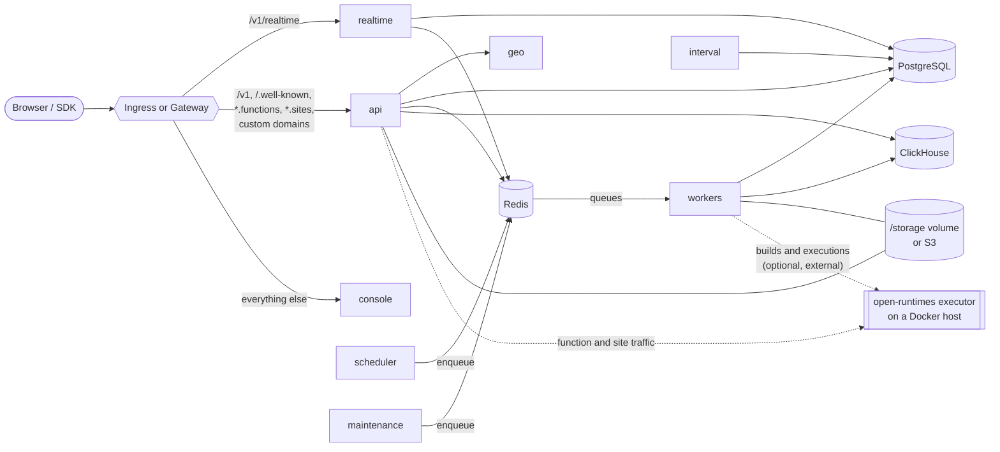

# Architecture

This page explains what the chart deploys, how the pieces talk to each other,
and which Appwrite settings the chart wires up for you.

## Components

| Component | Image | Command | Scales | Notes |
| --- | --- | --- | --- | --- |
| `api` | `appwrite/appwrite` | `php app/http.php` | Horizontally (HPA) | REST and GraphQL API. Also proxies function, site and custom-domain traffic, and serves ACME challenges. |
| `console` | `appwrite/new` | image default | Horizontally (HPA) | The web console, a separate Bun app. |
| `realtime` | `appwrite/appwrite` | `php app/realtime.php` | Horizontally (HPA) | WebSocket server for `/v1/realtime`. One Swoole worker per pod by default. |
| `worker` | `appwrite/appwrite` | `php app/worker.php all` | Horizontally | Consumes every queue: database changes, deletes, mails, webhooks, certificates, usage, builds and more. |
| `scheduler` | `appwrite/appwrite` | `php app/cli.php schedule` | **One replica** | Enqueues scheduled function executions and messages. |
| `maintenance` | `appwrite/appwrite` | `php app/cli.php maintenance` | **One replica** | Periodic cleanup and certificate renewals. |
| `interval` | `appwrite/appwrite` | `php app/cli.php interval` | **One replica** | Custom domain verification and stale execution cleanup. |
| `geo` | `appwrite/geo` | image default | Horizontally | IP geolocation for sessions and logs. |
| `postgresql` | `appwrite/postgres` | `postgres` | One replica | Built-in database. Optional. |
| `redis` | `redis` | `redis-server` | One replica | Cache, queues, pub/sub and locks. Optional. |
| `clickhouse` | `clickhouse/clickhouse-server` | image default | One replica | Usage statistics and execution logs. Optional. |

The scheduler, maintenance and interval tasks have no leader election in
Appwrite, so a second copy would do the same work twice. The chart always runs
exactly one of each and recreates (rather than rolls) them on updates.

## Startup order

Kubernetes has no `depends_on`, so the chart uses init containers:

1. The API waits until PostgreSQL, Redis and ClickHouse accept TCP connections.
2. On start, every API pod creates the console database, buckets and ClickHouse
   tables if they don't exist yet. This is idempotent and can take a few
   minutes on the first install, which is why the API's startup probe is generous.
3. Realtime, workers and tasks wait until the API answers on
   `/v1/health/version`. Appwrite's CLI tasks and workers exit when they start
   before the schema exists.

## Configuration flow

Every Appwrite pod gets the same configuration:

- **`<release>-env` ConfigMap**, loaded with `envFrom`. It starts from the
  defaults Appwrite's Docker installer writes to `.env`
  ([`files/env-defaults.yaml`](../charts/appwrite/files/env-defaults.yaml)),
  then applies values the chart computes, then `appwrite.config`.
- **Secrets**, referenced one variable at a time with `secretKeyRef`, so the
  chart works the same whether a credential comes from the chart's own Secret
  or from one you manage.
- **Per-pod variables** that depend on the component: `PORT`, `_APP_CPU_NUM`,
  `_APP_WORKERS_NUM` and `_APP_WORKER_MAX_COROUTINES`.

Pods carry checksums of the ConfigMap and the chart Secret, so changing values
rolls them. Changes to Secrets you manage yourself don't; use a tool such as
[Reloader](https://github.com/stakater/Reloader) for that.

### Values the chart computes

| Variable | Value |
| --- | --- |
| `_APP_DOMAIN`, `_APP_CONSOLE_DOMAIN` | `appwrite.domain`, `appwrite.consoleDomain` |
| `_APP_DOMAIN_FUNCTIONS`, `_APP_DOMAIN_SITES` | `functions.<domain>`, `sites.<domain>` unless set |
| `_APP_DOMAIN_TARGET_CNAME` | `appwrite.domain` unless set |
| `_APP_DB_*` | the built-in PostgreSQL Service |
| `_APP_REDIS_*` | the built-in Redis Service |
| `_APP_CONNECTIONS_DB_USAGE`, `_APP_CONNECTIONS_DB_EXECUTIONS` | the built-in ClickHouse Service |
| `_APP_GEO_ENDPOINT` | the geo Service, or empty when geo is disabled |
| `_APP_MIGRATION_HOST` | the API Service name |
| `_APP_WORKER_SCREENSHOTS_ROUTER`, `_APP_JOBS_ENDPOINT` | the API Service URL |
| `_APP_CPU_NUM` | each component's CPU limit (or request), rounded up |

### Why `_APP_CPU_NUM` matters

Appwrite sizes its Swoole worker count and its database connection pools from
the CPU count. Without `_APP_CPU_NUM` it reads the node's CPUs, ignoring the
container limit, so a small pod on a 64-core node starts hundreds of workers
and opens far more database connections than intended. The chart sets it from
each component's resources; override it with `<component>.cpuNum`.

Connection pools are split across pods with `_APP_CONNECTIONS_MAX`
(`appwrite.database.connectionsMax`, the total budget) and `_APP_POOL_CLIENTS`
(`appwrite.database.poolClients`, how many pods share it). Keep `poolClients`
at least as large as the number of Appwrite pods. The built-in PostgreSQL sets
`max_connections` to `connectionsMax + 20`.

### Health checks without a Host lookup

Appwrite routes every request by its `Host` header and looks unknown hosts up
in the database (custom domains), redirecting to HTTPS when `forceHttps` is on.
The chart sets `_APP_MIGRATION_HOST` to the API Service name, which Appwrite
treats as an internal hostname, and its probes send `Host: <release>-api`.
Probes then skip both the lookup and the redirect.

## Storage

Appwrite keeps files under `/storage`:

| Path | Contents | Where |
| --- | --- | --- |
| `/storage/uploads` | Bucket files | shared volume, or S3 |
| `/storage/functions`, `/storage/sites`, `/storage/builds` | Deployment code and build output | shared volume, or S3 |
| `/storage/imports` | Migration imports | shared volume |
| `/storage/certificates`, `/storage/config` | Let's Encrypt certificates and ACME challenges | shared volume |
| `/storage/cache` | Image previews and other cached responses | per-pod `emptyDir` |

The chart creates one PersistentVolumeClaim and mounts each path as a
`subPath`. With a ReadWriteOnce volume (the default), every pod that mounts
it is scheduled on the same node through pod affinity, so the volume can be
attached. To spread the API and workers across nodes, use a ReadWriteMany
storage class or S3.

The cache is per pod: Appwrite only serves a cached file when the database
says it exists, so a pod that hasn't cached it yet just regenerates it.

## Security

All pods run as non-root with a read-only root filesystem, no capabilities and
the `RuntimeDefault` seccomp profile, so they're admitted under the Pod
Security Standard `restricted` profile. Writable paths are `emptyDir`s.

- The Appwrite image runs as `www-data` (UID 82). The API and realtime listen
  on 8080 instead of 80.
- The geo image listens on port 80, so its pod sets the namespaced sysctl
  `net.ipv4.ip_unprivileged_port_start=0`, which the `restricted` profile allows.
- ServiceAccount tokens aren't mounted; nothing in Appwrite uses the
  Kubernetes API, and the chart creates no RBAC.
