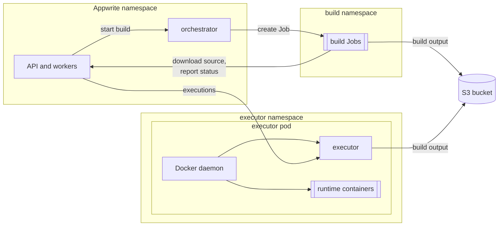

# Functions and Sites

Appwrite runs Functions and Sites with two
[Open Runtimes](https://github.com/open-runtimes) services:

| Service | Does | Where it runs | Appwrite setting |
| --- | --- | --- | --- |
| [orchestrator](https://github.com/open-runtimes/orchestrator) | Builds deployments | In the release namespace; it starts each build as a Kubernetes Job in the build namespace | `_APP_JOBS_HOST`, `_APP_JOBS_SECRET` |
| [executor](https://github.com/open-runtimes/executor) | Starts runtime containers and executes functions and sites in them | In the executor namespace, on Docker-in-Docker | `_APP_EXECUTOR_HOST`, `_APP_EXECUTOR_SECRET` |

The chart runs both and wires Appwrite to them. Builds run as ordinary,
unprivileged Jobs. The executor creates a container per runtime through a
Docker daemon, and Kubernetes has no Docker daemon to offer, so the chart
gives each executor pod its own (Docker-in-Docker). That daemon runs as a
**privileged container: root on its node**. That is why the executor gets a
namespace of its own, why you have to accept it explicitly, and why it should
get nodes of its own. Where privileged pods aren't allowed (GKE Autopilot,
EKS on Fargate, a policy that forbids them), [Sysbox](#without-a-privileged-container)
runs the daemon without it.



Without them everything else in Appwrite works; deployments of functions and
sites stay in `waiting` and executions fail.

## Requirements

- **S3 storage** (`appwrite.storage.device: s3`, see [storage.md](storage.md)).
  Builds and the executor exchange code and build output through the bucket.
- **Nodes that may run a privileged pod** for the executor, ideally
  dedicated to it, or [Sysbox](#without-a-privileged-container). The
  executor's namespace must admit the `privileged` Pod Security Standard.
- **Room for builds and executions.** Each build runs as a pod in the build
  namespace ([build resources](#build-resources)); executions run inside the
  executor pod ([sizing](#sizing)).

## 1. Configure the chart

```yaml
appwrite:
  domain: appwrite.example.com
  storage:
    device: s3
    s3:
      endpoint: https://s3.example.com
      region: us-east-1
      bucket: appwrite
      accessKey: <access key>
      secretKey: <secret key>

compute:
  enabled: true
  executor:
    privileged: true            # Docker-in-Docker: root on the node
    nodeSelector:
      workload: executor
    tolerations:
      - key: workload
        value: executor
        effect: NoSchedule
  functionsRuntimes: [node-22, python-3.12, php-8.3]
  sitesRuntimes: [static-1, node-22]
```

Keep `node-22` in `sitesRuntimes` even if you only host static sites: sites
are built with a Node.js runtime, and without it creating a site fails with
`Runtime "node-22" is not supported`.

This deploys:

- the orchestrator in the release namespace, and a namespace for builds,
  `<release namespace>-builds` (`compute.builds.namespace`);
- the executor in a namespace of its own, `<release namespace>-executor`
  (`compute.executor.namespace`), with a Service Appwrite calls at
  `http://<fullname>-executor.<namespace>.svc:9900/v1`.

Both namespaces must differ from the release namespace and from each other;
the chart refuses to render otherwise. The chart generates the executor and
orchestrator secrets and keeps them in its Secret.

### Who creates the namespaces

With `compute.builds.createNamespace` and `compute.executor.createNamespace`
(both true by default) the chart creates the Namespaces, labelled for the
`baseline` and the `privileged` Pod Security Standard. That has
consequences:

- A Namespace is cluster-scoped, so whoever runs Helm (or the GitOps tool)
  needs permission to create Namespaces, and an Argo CD AppProject has to
  allow the `Namespace` kind ([gitops.md](gitops.md#argo-cd)).
- `helm uninstall` deletes the Namespaces, and with them any build Jobs
  and executor pods still in them.

To manage them yourself, create and label them before installing, and set
`createNamespace: false`:

```console
kubectl create namespace appwrite-builds
kubectl label namespace appwrite-builds \
  pod-security.kubernetes.io/enforce=baseline \
  pod-security.kubernetes.io/warn=baseline
kubectl create namespace appwrite-executor
kubectl label namespace appwrite-executor \
  pod-security.kubernetes.io/enforce=privileged
```

```yaml
compute:
  builds:
    createNamespace: false
    namespace: appwrite-builds
  executor:
    createNamespace: false
    namespace: appwrite-executor
```

The build namespace's `enforce` label matters
([security.md](security.md#functions-and-sites)). When the chart can read the
namespace and its `enforce` label is missing or weaker than `baseline`, it
prints a warning after install or upgrade.

## 2. Check it

In the console, create a function from a template (Functions → Create
function), wait for its deployment to become ready, and execute it. Then
create a site from a template. Each build shows up as a Job, and each runtime
as a container in the executor's Docker daemon:

```console
kubectl -n appwrite-builds get jobs
kubectl -n appwrite-executor exec deploy/appwrite-executor -c dind -- docker ps
```

From a clone of this repository, a script does the same for a function:

```console
SMOKE_EMAIL=<admin email> SMOKE_PASSWORD=<password> \
  hack/functions-smoke.sh appwrite appwrite node-22
```

It creates a project named `functions` with a Node.js function, uploads code,
waits for the build and executes it. Delete the project afterwards. Without
`SMOKE_EMAIL` and `SMOKE_PASSWORD` it signs in as `smoke@example.com`, and on
an install where nobody has signed up yet, that account becomes the console
administrator.

## The executor

Each executor pod runs two containers:

- `dind`, the Docker daemon, a [native sidecar](https://kubernetes.io/docs/concepts/workloads/pods/sidecar-containers/)
  that starts first and stops last. It listens only on a Unix socket shared
  with the other container; there's no TCP listener.
- `executor`, which starts the executor as a container *of that daemon*: the
  executor looks itself up as a container, attaches itself to the network it
  creates for runtimes and reaches them by name, so it can't run beside the
  daemon. The container's logs are the executor's.

The executor's image and the runtime images are pulled by that daemon, not
by the kubelet: image pull secrets don't apply to them, and they're pulled
again whenever a pod is replaced (the daemon's storage is an `emptyDir`;
`compute.executor.dind.volume` takes any volume source). On start the
executor pulls the runtime images of `functionsRuntimes` and
`sitesRuntimes` (`compute.executor.images` overrides the list), and the pod
only becomes ready once they're there: an execution that had to wait for an
image would run into the function's timeout.

The daemon's networks (its bridge and the runtimes' network) take their
addresses from `compute.executor.dind.addressPool`, `198.18.0.0/15` by
default, a range reserved for benchmarking that nothing routes. Whatever
those networks use, the executor and the runtimes can't reach elsewhere: a
pool that overlaps the S3 endpoint, the cluster or your network cuts them
off from it. Docker's own default, `172.17.0.0/16` and up, overlaps often
(the AWS default VPC is `172.31.0.0/16`), so change the pool only to another
range nothing in your network uses.

On updates a new pod takes over before the old one stops. The old one leaves
the Service, gives executions in flight 15 seconds to finish, and stops; its
runtimes stop with it.

### Executor isolation

A privileged container can do anything on its node, and the executor runs
code your users deploy. The chart keeps it apart from the rest of the
installation:

- **Own namespace**, the only one that admits privileged pods. The Appwrite
  namespace keeps `restricted`, the build namespace `baseline`.
- **No Kubernetes API access.** The executor's ServiceAccount has no token.
- **Own copy of its credentials.** Pods can't read Secrets in other
  namespaces, so the chart puts the executor secret and the S3 credentials in
  a Secret in the executor namespace, and nothing else.
- **NetworkPolicy** (`compute.executor.networkPolicy.enabled`, on by
  default): only Appwrite pods of the release can connect, on port 9900. The
  executor and every runtime can reach only DNS, the S3 endpoint and public
  addresses, with the same blocked ranges as builds
  ([below](#isolation)), plus `compute.executor.networkPolicy.deniedCIDRs`.
  Runtimes reach Appwrite through its public domain, like any other client.
  This only takes effect with a CNI that enforces NetworkPolicies.

What it can't do is stop a runtime that escapes its container: that runtime
is root on the node. Give the executor **nodes of its own**, with a taint
nothing else tolerates, so the only things on those nodes are executor pods:

```yaml
compute:
  executor:
    nodeSelector:
      workload: executor
    tolerations:
      - key: workload
        value: executor
        effect: NoSchedule
```

Don't put the API, the datastores or anything holding credentials there. If
that's more than you can accept, use Sysbox.

### Without a privileged container

[Sysbox](https://github.com/nestybox/sysbox) is a container runtime that
runs Docker inside a container without `privileged`, using user namespaces.
Install it on the executor's nodes (it provides a `sysbox-runc`
RuntimeClass), then:

```yaml
compute:
  executor:
    privileged: false
    runtimeClassName: sysbox-runc
```

Sysbox supports a limited set of distributions and container runtimes; check
its documentation for your nodes. The chart's CI doesn't test it.

### Sizing

Runtimes run inside the `dind` container, so its resources
(`compute.executor.resources`) are what all executions on that pod share.
Appwrite gives each function the CPU and memory of its specification; size
the limit for the runtimes you expect to be running at once. A runtime is
removed after `compute.executor.inactiveThreshold` seconds without
executions (60 by default).

`compute.executor.replicaCount` adds executor pods, each with its own daemon.
Appwrite calls the Service, so an execution lands on any of them; when a
runtime isn't running on that pod yet, the executor starts it there (a cold
start). More replicas spread executions, at the cost of more cold starts and
more copies of each warm runtime.

### Existing Secrets

When the executor secret (`compute.secrets.existingSecret`) or the S3
credentials (`appwrite.storage.s3.existingSecret`) come from Secrets you
manage, the chart can't copy them. Create a Secret in the executor namespace
with the keys `executor-secret`, `s3-access-key` and `s3-secret-key`, and
name it in `compute.executor.existingSecret`:

```console
kubectl -n appwrite-executor create secret generic appwrite-executor-credentials \
  --from-literal=executor-secret=<executor secret> \
  --from-literal=s3-access-key=<access key> \
  --from-literal=s3-secret-key=<secret key>
```

### Registries

Runtime images come from Docker Hub, which limits anonymous pulls per IP
address. Pull as a Docker Hub user:

```yaml
compute:
  executor:
    extraEnv:
      - name: OPR_EXECUTOR_DOCKER_HUB_USERNAME
        value: <user>
      - name: OPR_EXECUTOR_DOCKER_HUB_PASSWORD
        valueFrom:
          secretKeyRef: {name: docker-hub, key: password}   # in the executor namespace
```

or through a mirror, which also needs an egress rule when it's on a private
network:

```yaml
compute:
  executor:
    dind:
      extraArgs: [--registry-mirror=https://mirror.example.internal]
    networkPolicy:
      extraEgress:
        - to: [{ipBlock: {cidr: 10.0.0.40/32}}]
          ports: [{port: 443}]
```

## Builds

### Isolation

A build runs the install and build commands of a function or site, which can
be any code. The chart keeps builds apart from the rest of the installation:

- **Own namespace**, admitted under the `baseline` Pod Security Standard.
  Build images may run as root, so builds can't pass `restricted`; `baseline`
  still forbids privileged pods and access to the host. The Appwrite
  namespace keeps `restricted`.
- **No Kubernetes API access.** Build pods get a ServiceAccount without a
  token. Only the orchestrator has one, with a Role limited to Jobs and their
  pods in the build namespace.
- **NetworkPolicy** (`compute.builds.networkPolicy.enabled`, on by default):
  nothing can connect to build pods, and they can reach only DNS, the API
  and orchestrator of the release, the S3 endpoint, and public addresses.
  Private, loopback, link-local (including cloud metadata at
  `169.254.169.254`), CGNAT, multicast and reserved ranges are blocked, as is
  Azure's WireServer (`168.63.129.16`), plus anything in
  `compute.builds.networkPolicy.deniedCIDRs`. This only takes effect with a
  CNI that enforces NetworkPolicies.

"Public addresses" means everything outside those ranges, which isn't always
outside your cluster. Add to `deniedCIDRs` (empty by default) when cluster
addresses aren't in the private ranges:

- pod and Service ranges outside RFC 1918, for example GKE's privately used
  public ranges or `240.0.0.0/4`,
- node addresses, if nodes have public IPs (NodePorts are reachable on them),
- IPv6 pod, Service and node ranges on IPv6 or dual-stack clusters; only
  unique-local and link-local IPv6 is blocked by default.

```yaml
compute:
  builds:
    networkPolicy:
      deniedCIDRs:
        - 34.118.224.0/20        # GKE Service range
        - 2600:1f14:abc::/56     # IPv6 pod range
```

The build's sidecar uploads the output straight to S3. When
`appwrite.storage.s3.endpoint` is an IP address, the chart allows it; when
it's a hostname on a private network, add a rule:

```yaml
compute:
  builds:
    networkPolicy:
      extraEgress:
        - to:
            - namespaceSelector:
                matchLabels:
                  kubernetes.io/metadata.name: minio
          ports:
            - port: 9000
```

Add rules the same way for a private package registry.

> [!NOTE]
> The orchestrator passes its S3 credentials and the orchestrator secret to
> each build's sidecar as environment variables, and the secret also lands in
> the pod annotation `job.callback.key`, so both are readable from the Job and
> pod objects in the build namespace. The build's own container doesn't get
> them. Anyone with `view` on the build namespace can read them: limit access
> as you would to the chart's Secret, and give Appwrite S3 credentials that
> only reach its bucket ([security.md](security.md#functions-and-sites)).

### Build resources

Appwrite gives each build up to 8 CPUs and 8 GiB of memory. On Kubernetes the
request is what the scheduler reserves, so the orchestrator divides the
limits by `compute.builds.cpuOvercommit` and `compute.builds.memoryOvercommit`
(8 by default): a build requests 1 CPU and 1 GiB and may use up to 8 of each.
Lower the divisors for faster, more predictable builds on a cluster with
room; raise them on small clusters.

To keep builds off the nodes that run Appwrite, give them their own:

```yaml
compute:
  builds:
    nodeSelector:
      workload: builds
    tolerations:
      - key: workload
        value: builds
        effect: NoSchedule
```

Finished build Jobs are removed after `compute.builds.retention` (15 minutes).

## With restricted egress

`networkPolicy.egress.enabled` limits every pod of the release to DNS, the
release itself and the executor, which cuts off the rest of the compute
plane. Add rules to `networkPolicy.egress.extraRules` for:

- **the S3 endpoint**, which the API, workers and orchestrator use,
- **the Kubernetes API server**, which the orchestrator calls. Its address is
  in the `kubernetes` Service's EndpointSlice
  (`kubectl get endpointslice -l kubernetes.io/service-name=kubernetes`).

```yaml
networkPolicy:
  egress:
    enabled: true
    extraRules:
      - to: [{ipBlock: {cidr: 10.0.0.30/32}}]      # S3
        ports: [{port: 443}]
      - to: [{ipBlock: {cidr: 172.18.0.2/32}}]     # Kubernetes API server
        ports: [{port: 6443}]
```

## Domains

Functions and sites are reached on their own hostnames, which go to the API
through the wildcard and custom-domain routes
([networking.md](networking.md#routes)):

- **Sites** get a preview domain under `*.<appwrite.sitesDomain>` for each
  deployment. Previews ask for a console login, so only project members see
  them. Add a domain to the site (Sites → Domains) to publish it.
- **Functions** deployed from your own code get no domain automatically; add
  one under `*.<appwrite.functionsDomain>` or a custom domain (Functions →
  Domains). Functions created from a template get one.

## Troubleshooting

| Symptom | Likely cause |
| --- | --- |
| Deployments stay `waiting` | The orchestrator isn't running, or can't reach the Kubernetes API (restricted egress, [above](#with-restricted-egress)): check `kubectl -n appwrite logs deploy/appwrite-orchestrator`. |
| Build pods stay `Pending` | No node has room for the build's request. Raise `compute.builds.cpuOvercommit` and `memoryOvercommit`, or add nodes. |
| Builds fail uploading the output (`dial tcp ... i/o timeout` in the build's `sidecar` container) | Build pods can't reach S3: add it to `compute.builds.networkPolicy.extraEgress`. |
| Builds fail installing dependencies | Build pods can't reach the package registry, for example a private one: add it to `extraEgress`. |
| The executor pod isn't created: `violates PodSecurity "baseline"` (or `restricted`) | The executor namespace doesn't admit privileged pods. Label it `pod-security.kubernetes.io/enforce=privileged`, or let the chart create it. |
| The executor pod isn't ready | Check `kubectl -n appwrite-executor logs deploy/appwrite-executor -c executor` and `-c dind`. The daemon pulls the executor image from Docker Hub when the pod starts: a blocked or rate-limited registry stops it ([registries](#registries)). |
| Executions fail with "Timed out waiting for runtime" | The executor can't find the build output: S3 is unreachable from the executor namespace (a private hostname needs `compute.executor.networkPolicy.extraEgress`), or S3 is in `compute.executor.dind.addressPool` ([above](#the-executor)). Or the runtime image can't be pulled. |
| Functions can't call Appwrite (`fetch failed`, connection timeouts to `appwrite.domain`) | Runtimes call Appwrite at `https://<appwrite.domain>/v1`. When that name resolves to a private address (an internal load balancer, a LAN), the executor's NetworkPolicy blocks it like any private range: allow your ingress controller or load balancer in `compute.executor.networkPolicy.extraEgress`. |
| Executions fail with 401 | `compute.executor.existingSecret` holds a different `executor-secret` than Appwrite's. |
| Creating a site fails with `Runtime "node-22" is not supported` | Add `node-22` to `compute.sitesRuntimes`. |
| A site's preview URL redirects to `/auth/preview` | Expected: previews need a console login. Add a domain to publish the site. |

Runtimes:
`kubectl -n appwrite-executor exec deploy/appwrite-executor -c dind -- docker ps`
lists them, and `docker logs <runtime>` shows a runtime's output.

Build logs: `kubectl -n appwrite-builds logs job/<job> -c worker` (the build
itself) and `-c sidecar` (uploads). The orchestrator names these containers;
if they differ in your version, list them with
`kubectl -n appwrite-builds get pod <pod> -o jsonpath='{.spec.containers[*].name}'`.
