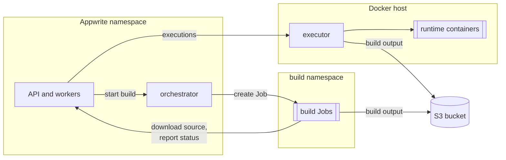

# Functions and Sites

Appwrite runs Functions and Sites with two
[Open Runtimes](https://github.com/open-runtimes) services:

| Service | Does | Where it runs | Appwrite setting |
| --- | --- | --- | --- |
| [orchestrator](https://github.com/open-runtimes/orchestrator) | Builds deployments | In the cluster: the chart runs it, and it starts each build as a Kubernetes Job | `_APP_JOBS_HOST`, `_APP_JOBS_SECRET` |
| [executor](https://github.com/open-runtimes/executor) | Starts runtime containers and executes functions and sites in them | On a Docker host next to the cluster | `_APP_EXECUTOR_HOST`, `_APP_EXECUTOR_SECRET` |

The executor creates its runtime containers through a Docker daemon. Inside
Kubernetes that means mounting a node's Docker socket (most nodes run
containerd and don't have one) or running Docker-in-Docker; either gives the
pod root on the node, so the chart doesn't run the executor. Builds don't
have that problem: the orchestrator's Kubernetes backend runs them as
ordinary, unprivileged Jobs.



Without them everything else in Appwrite works; deployments of functions and
sites stay in `waiting` and executions fail.

## Requirements

- **S3 storage** (`appwrite.storage.device: s3`, see [storage.md](storage.md)).
  Builds and the executor exchange code and build output through the bucket.
- **A Docker host for the executor**, on a private network the Appwrite pods
  can reach. The executor speaks plain HTTP, authenticated with a bearer
  secret; don't expose it to the internet. It also needs to reach the S3
  bucket.
- **Room for builds.** Each build runs as a pod in the build namespace. See
  [build resources](#build-resources).

## 1. Configure the chart

```yaml
appwrite:
  domain: appwrite.example.com
  storage:
    device: s3
    s3:
      endpoint: https://s3.example.com
      region: us-east-1
      bucket: appwrite
      existingSecret: appwrite-s3     # keys: s3-access-key, s3-secret-key

compute:
  enabled: true
  executor:
    host: http://10.0.0.20:9900/v1
  functionsRuntimes: [node-22, python-3.12, php-8.3]
  sitesRuntimes: [static-1, node-22]
```

Keep `node-22` in `sitesRuntimes` even if you only host static sites: sites
are built with a Node.js runtime, and without it creating a site fails with
`Runtime "node-22" is not supported`.

This deploys the orchestrator in the release namespace and creates a
namespace for builds, `<release namespace>-builds` (`compute.builds.namespace`).

The chart generates the executor secret and keeps it in its Secret. To bring
your own, set `compute.secrets.existingSecret` (key `executor-secret`) or
`compute.secrets.executorSecret`. Read the generated one for the Docker host:

```console
kubectl -n appwrite get secret appwrite -o jsonpath='{.data.executor-secret}' | base64 -d
```

## 2. Run the executor

[`examples/compute`](../examples/compute) has a Docker Compose file for the
Docker host:

```console
cd examples/compute
cp .env.example .env                      # fill in the secret, S3 and runtimes
docker compose up -d
```

What to get right:

| Setting | Value |
| --- | --- |
| `EXECUTOR_SECRET` | the chart's executor secret |
| `EXECUTOR_STORAGE_DSN` | the bucket Appwrite uses, as a DSN, see below |
| `RUNTIMES` | `compute.functionsRuntimes` and `compute.sitesRuntimes` combined |
| `RUNTIME_IMAGES` | the images of those runtimes, so the executor pulls them when it starts |

### The executor's storage DSN

When `appwrite.storage.s3.endpoint` is set (any S3-compatible store), Appwrite
records paths with the bucket as the first segment, so the executor's DSN
names the endpoint **without** the bucket:

```text
s3://ACCESS_KEY:SECRET_KEY@s3.example.com?region=us-east-1
s3://ACCESS_KEY:SECRET_KEY@minio.internal:9000?region=us-east-1&insecure=true   # plain HTTP
```

With AWS S3 (no endpoint in Appwrite), name the bucket in the hostname:

```text
s3://ACCESS_KEY:SECRET_KEY@my-bucket.s3.eu-central-1.amazonaws.com?region=eu-central-1
```

A wrong DSN shows up as executions failing with "Timed out waiting for
runtime": the executor can't find the build output.

## 3. Check it

In the console, create a function from a template (Functions → Create
function), wait for its deployment to become ready, and execute it. Then
create a site from a template. Each build shows up as a Job:

```console
kubectl -n appwrite-builds get jobs
```

From a clone of this repository, a script does the same for a function:

```console
SMOKE_EMAIL=<admin email> SMOKE_PASSWORD=<password> \
  hack/functions-smoke.sh appwrite appwrite node-22
```

It creates a project named `functions` with a Node.js function, uploads code,
waits for the build and executes it. Delete the project afterwards. Without
`SMOKE_EMAIL` and `SMOKE_PASSWORD` it signs in as `smoke@example.com`, and on
an install where nobody has signed up yet, that account becomes the console
administrator.

## Builds

### Isolation

A build runs the install and build commands of a function or site, which can
be any code. The chart keeps builds apart from the rest of the installation:

- **Own namespace**, admitted under the `baseline` Pod Security Standard.
  Build images may run as root, so builds can't pass `restricted`; `baseline`
  still forbids privileged pods and access to the host. The Appwrite
  namespace keeps `restricted`.
- **No Kubernetes API access.** Build pods get a ServiceAccount without a
  token. Only the orchestrator has one, with a Role limited to Jobs and their
  pods in the build namespace.
- **NetworkPolicy** (`compute.builds.networkPolicy.enabled`, on by default):
  nothing can connect to build pods, and they can reach only DNS, the API
  and orchestrator of the release, the S3 endpoint, and public addresses.
  Private, link-local (including cloud metadata at `169.254.169.254`) and
  CGNAT ranges are blocked. This only takes effect with a CNI that enforces
  NetworkPolicies.

The build's sidecar uploads the output straight to S3. When
`appwrite.storage.s3.endpoint` is an IP address, the chart allows it; when
it's a hostname on a private network, add a rule:

```yaml
compute:
  builds:
    networkPolicy:
      extraEgress:
        - to:
            - namespaceSelector:
                matchLabels:
                  kubernetes.io/metadata.name: minio
          ports:
            - port: 9000
```

Add rules the same way for a private package registry.

> [!NOTE]
> The orchestrator passes its S3 credentials and the orchestrator secret to
> each build's sidecar as environment variables, so they appear in the Job
> objects in the build namespace. The build's own container doesn't get them.
> Limit who can read Jobs and pods in the build namespace, and give Appwrite
> S3 credentials that only reach its bucket.

### Build resources

Appwrite gives each build up to 8 CPUs and 8 GiB of memory. On Kubernetes the
request is what the scheduler reserves, so the orchestrator divides the
limits by `compute.builds.cpuOvercommit` and `compute.builds.memoryOvercommit`
(8 by default): a build requests 1 CPU and 1 GiB and may use up to 8 of each.
Lower the divisors for faster, more predictable builds on a cluster with
room; raise them on small clusters.

To keep builds off the nodes that run Appwrite, give them their own:

```yaml
compute:
  builds:
    nodeSelector:
      workload: builds
    tolerations:
      - key: workload
        value: builds
        effect: NoSchedule
```

Finished build Jobs are removed after `compute.builds.retention` (15 minutes).

### With restricted egress

With `networkPolicy.egress.enabled`, the orchestrator also needs the
Kubernetes API server and the S3 endpoint. Add both to
`networkPolicy.egress.extraRules`; the API server's address is that of the
`kubernetes` Service's endpoints (`kubectl get endpoints kubernetes`).

### Builds on a Docker host instead

To build on the Docker host too, set `compute.orchestrator.mode: external`
and run the orchestrator there with the `external-builds` profile of the
Compose file:

```yaml
compute:
  orchestrator:
    mode: external
    host: http://10.0.0.20:8080
```

```console
printf '%s' '<orchestrator secret>' > orchestrator-api-key   # no trailing newline
docker compose --profile external-builds up -d
```

Build containers then download sources from Appwrite at
`compute.appwriteEndpoint` (default `https://<appwrite.domain>`), so the
Docker host must reach that URL, and its hostname must be `appwrite.domain`.

## Domains

Functions and sites are reached on their own hostnames, which go to the API
through the wildcard and custom-domain routes
([networking.md](networking.md#routes)):

- **Sites** get a preview domain under `*.<appwrite.sitesDomain>` for each
  deployment. Previews ask for a console login, so only project members see
  them. Add a domain to the site (Sites → Domains) to publish it.
- **Functions** deployed from your own code get no domain automatically; add
  one under `*.<appwrite.functionsDomain>` or a custom domain (Functions →
  Domains). Functions created from a template get one.

## Troubleshooting

| Symptom | Likely cause |
| --- | --- |
| Deployments stay `waiting` | The orchestrator isn't running: check `kubectl -n appwrite logs deploy/appwrite-orchestrator`. With an external orchestrator, it isn't reachable at `compute.orchestrator.host`, or its API key differs from the chart's orchestrator secret. |
| Build pods stay `Pending` | No node has room for the build's request. Raise `compute.builds.cpuOvercommit` and `memoryOvercommit`, or add nodes. |
| Builds fail uploading the output (`dial tcp ... i/o timeout` in the build's `sidecar` container) | Build pods can't reach S3: add it to `compute.builds.networkPolicy.extraEgress`. |
| Builds fail installing dependencies | Build pods can't reach the package registry, for example a private one: add it to `extraEgress`. |
| Executions fail with "Timed out waiting for runtime" | The executor's storage DSN doesn't point at the build output (see above), or the runtime image can't be pulled. |
| Executions fail with 401 | `EXECUTOR_SECRET` differs from the chart's executor secret. |
| Creating a site fails with `Runtime "node-22" is not supported` | Add `node-22` to `compute.sitesRuntimes` (and to `RUNTIMES` on the Docker host). |
| A site's preview URL redirects to `/auth/preview` | Expected: previews need a console login. Add a domain to publish the site. |

Build logs: `kubectl -n appwrite-builds logs job/<job> -c worker` (the build
itself) and `-c sidecar` (uploads).
