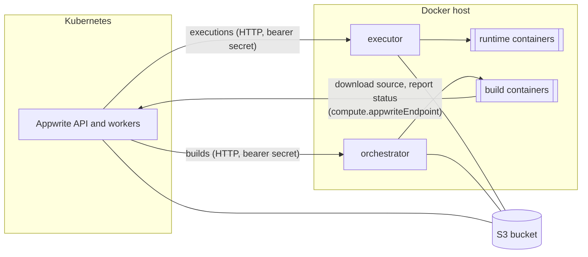

# Functions and Sites

Appwrite runs Functions and Sites with two
[Open Runtimes](https://github.com/open-runtimes) services:

| Service | Does | Appwrite setting |
| --- | --- | --- |
| [executor](https://github.com/open-runtimes/executor) | Starts runtime containers and executes functions and sites in them | `_APP_EXECUTOR_HOST`, `_APP_EXECUTOR_SECRET` |
| [orchestrator](https://github.com/open-runtimes/orchestrator) | Runs builds of deployments as containers | `_APP_JOBS_HOST`, `_APP_JOBS_SECRET` |

Both create containers through a Docker daemon. Inside Kubernetes that means
mounting a node's Docker socket (most nodes run containerd and don't have
one) or running Docker-in-Docker; either gives the pod root on the node. The
chart doesn't do that. Run both services on a Docker host next to the
cluster, and point the chart at them.



Without the compute plane, everything else in Appwrite works; deployments of
functions and sites stay in `waiting` and executions fail.

## Requirements

- **S3 storage.** The Docker host can't see the cluster's volumes, so code and
  build output move through object storage. Set `appwrite.storage.device: s3`
  (see [storage.md](storage.md)).
- **A private network between the cluster and the Docker host.** The executor
  and orchestrator speak plain HTTP, authenticated with a bearer secret. Don't
  expose them to the internet; use a VPC, WireGuard/Tailscale, or put a TLS
  proxy in front.
- **The Docker host can reach Appwrite** at `compute.appwriteEndpoint`
  (default `https://<appwrite.domain>`). Build containers download their source
  from Appwrite and report progress back to it. The URL's hostname must be
  `appwrite.domain`, because Appwrite routes by hostname.
- **Runtime images.** Pre-pull the images of the runtimes you enable
  (`RUNTIME_IMAGES` below), or the first execution of each runtime waits for
  the pull.

## 1. Configure the chart

```yaml
appwrite:
  domain: appwrite.example.com
  storage:
    device: s3
    s3:
      endpoint: https://s3.example.com
      region: us-east-1
      bucket: appwrite
      existingSecret: appwrite-s3     # keys: s3-access-key, s3-secret-key

compute:
  enabled: true
  executor:
    host: http://10.0.0.20:9900/v1
  orchestrator:
    host: http://10.0.0.20:8080
  functionsRuntimes: [node-22, python-3.12, php-8.3]
  sitesRuntimes: [static-1, node-22]
```

The chart generates the executor and orchestrator secrets and keeps them in
its Secret. To bring your own, set `compute.secrets.existingSecret` (keys
`executor-secret` and `orchestrator-secret`) or `compute.secrets.executorSecret`
and `compute.secrets.orchestratorSecret`.

Read the generated ones for the Docker host:

```console
kubectl -n appwrite get secret appwrite -o jsonpath='{.data.executor-secret}' | base64 -d
kubectl -n appwrite get secret appwrite -o jsonpath='{.data.orchestrator-secret}' | base64 -d
```

## 2. Run the executor and orchestrator

[`examples/compute`](../examples/compute) has a Docker Compose file for the
Docker host:

```console
cd examples/compute
cp .env.example .env                      # fill in secrets, S3 and runtimes
printf '%s' '<orchestrator secret>' > orchestrator-api-key
docker compose up -d
```

What to get right:

| Setting | Value |
| --- | --- |
| `EXECUTOR_SECRET` | the chart's executor secret |
| `orchestrator-api-key` | the chart's orchestrator secret, no trailing newline |
| `S3_*` | the bucket Appwrite uses |
| `EXECUTOR_STORAGE_DSN` | the same bucket, as a DSN, see below |
| `RUNTIMES` | `compute.functionsRuntimes` and `compute.sitesRuntimes` combined |

### The executor's storage DSN

When `appwrite.storage.s3.endpoint` is set (any S3-compatible store), Appwrite
records paths with the bucket as the first segment, so the executor's DSN
names the endpoint **without** the bucket:

```text
s3://ACCESS_KEY:SECRET_KEY@s3.example.com?region=us-east-1
s3://ACCESS_KEY:SECRET_KEY@minio.internal:9000?region=us-east-1&insecure=true   # plain HTTP
```

With AWS S3 (no endpoint in Appwrite), name the bucket in the hostname:

```text
s3://ACCESS_KEY:SECRET_KEY@my-bucket.s3.eu-central-1.amazonaws.com?region=eu-central-1
```

A wrong DSN shows up as executions failing with "Timed out waiting for
runtime": the executor can't find the build output.

## 3. Check it

```console
hack/functions-smoke.sh appwrite appwrite node-22
```

The script creates a project and a Node.js function, uploads code, waits for
the build and executes it.

## Troubleshooting

| Symptom | Likely cause |
| --- | --- |
| Deployments stay `waiting` | The orchestrator isn't reachable at `compute.orchestrator.host`, or its API key differs from the chart's orchestrator secret. |
| Builds fail downloading the source | The Docker host can't reach `compute.appwriteEndpoint`, or its hostname isn't `appwrite.domain`. |
| Executions fail with "Timed out waiting for runtime" | The executor's storage DSN doesn't point at the build output (see above), or the runtime image can't be pulled. |
| Executions fail with 401 | `EXECUTOR_SECRET` differs from the chart's executor secret. |

## Kubernetes-native alternatives

The open-runtimes orchestrator also has a Kubernetes backend (with its own
[Helm chart](https://github.com/open-runtimes/orchestrator/tree/main/charts/orchestrator)),
which runs builds as Kubernetes Jobs. Appwrite 2.3.0 still needs the
Docker-based executor for executions, so this chart doesn't integrate it yet.
